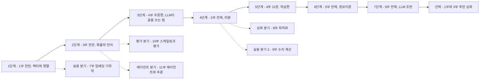

# 수포자를 위한 AI 수학 시리즈

수학을 포기했던 사람이 **AI(LLM)가 실제로 어떻게 동작하는지** 이해하는 것을 목표로 하는 학습 시리즈 — **6부 본편(1~6부) + 실용·심화 확장 트랙(7~11부)**. 전 11부 완결(2026-07-13 — 1~9부는 07-12, 10·11부는 07-13).
각 부는 독립된 인터랙티브 웹 앱(Vue 3 + Vite)과 대응 Jupyter 노트북으로 구성된다.

| 부 | 주제 | 폴더 | 시리즈에서의 역할 |
|---|---|---|---|
| 1부 | 선형대수학 | `apps/part1` | 단어를 벡터로, 변환을 행렬곱으로 보는 눈 |
| 2부 | 미분 | `apps/part2` | 모델이 "학습"하는 원리 — 경사하강·역전파 |
| 3부 | 확률과 통계 | `apps/part3` | "다음 단어를 확률로 고른다"를 읽는 문해력 |
| 4부 | 트랜스포머 | `apps/part4` | **시리즈의 정점** — LLM의 실체를 조립 |
| 5부 | 정보이론 | `apps/part5` | 손실함수·퍼플렉시티·temperature의 본체 |
| 6부 | LLM 조련 | `apps/part6` | 피날레 — GPT가 ChatGPT가 되기까지, 배운 수학의 총회수 |
| 7부 | 임베딩 기하학 | `apps/part7` | 실용 확장 — "회사 문서를 아는 챗봇"(RAG·의미 검색·벡터 DB)의 수학 |
| 8부 | 최적화 | `apps/part8` | 이론 심화 — 학습을 지배하는 다이얼(Adam·스케줄·정규화·손실 지형)의 수학 |
| 9부 | 수치 계산 | `apps/part9` | 실용 확장 2탄 — "내 PC에서 도는 AI"(비트·부동소수점·양자화·GGUF)의 수학 |
| 10부 | 스케일링 법칙과 평가의 통계 | `apps/part10` | 평가·전략 — "키우면 얼마나 좋아지나, 그 점수 차이는 진짜인가"의 수학 |
| 11부 | 에이전트와 추론의 수학 | `apps/part11` | 실용·전략 — "AI에게 일을 맡겨도 되나"(사슬·재시도·검수·비용)의 수학 |

> 🔎 **통합검색**: 포털·전 부 어디서든 `Ctrl/⌘+K`(또는 🔎)로 전 부의 장·개념(448개 색인 — 장 129 + 개념 위치 319, 비유어↔실무어 연결)을 가로질러 검색·이동한다.
>
> 🧠 **개념 온톨로지**: 시리즈의 개념 114개와 관계(먼저 알아야 · 다시 쓰이는 곳 · 이 과정의 비유어)를 `scripts/ontology/concepts.json` 한 곳에 둔다. 검색 색인이 여기서 나오고, 각 부의 AI 튜터(웹·노트북)는 질문에 나온 개념의 카드를 받아 **다른 부에서 배우는 개념도 "N부 M장"으로 안내**한다. 각 장 상단의 **개념 띠**는 처음 배우는 개념·먼저 알아 둘 것·다시 만나는 곳을, 포털 **개념 지도**(`/concepts`)는 선수 사슬과 내 진도를, **비유어 사전**(`/glossary`)은 비유어와 실무 용어의 짝을 보여 준다. 복습 표시는 선수 개념까지 이은 **복습 경로**로, 진단 결과는 **다시 볼 개념**으로 이름 붙는다. 이 사이트가 쓰는 기법 자체는 7부 8장(지식 그래프·GraphRAG)에서 가르친다. 설계: [`docs/todo_온톨로지_260906.md`](docs/todo_온톨로지_260906.md).
>
> 🌓 **화면 테마**: OS 설정에 따라 라이트/다크가 자동 전환되고, 사이드바(포털은 헤더)의 토글로 직접 고를 수도 있다(선택은 저장됨). 본문뿐 아니라 **인터랙티브 데모와 차트까지 같이 뒤집힌다.**
>
> 🎨 **부마다 고유색**: 11개 앱을 오갈 때 "지금 몇 부인지"를 색으로 먼저 알 수 있게 부별 강조색을 준다. 사이드바의 역할 칩(토대·조립·본체·조련·실용·심화·평가·전략)은 포털 학습 지도와 같은 색이라, 지도에서 본 카드와 그 부의 화면이 같은 언어로 읽힌다.
>
> 🧭 **이 프로젝트가 어떻게 만들어졌나**: 제작 타임라인·전환점 5개·설계 결정·불변식을 다이어그램으로 정리한 [`docs/PROCESS.md`](docs/PROCESS.md).

---

## 🗺️ 추천 학습 경로

> **원칙: 1→2→3→4→5 순서로 완주하지 않는다.**
> 수포자의 최대 리스크는 난이도가 아니라 "AI는 구경도 못 하고 수학만 하다 지치는 것"이다.
> 따라서 4부(트랜스포머)를 최대한 빨리 만나도록 경로를 설계했다.

```
1부 전반 → 3부 전반 → 4부 추론편 → 2부 전체 → 4부 학습편 → 5부 전체 → 6부 전체 → [선택] 1부·3부 후반
```



점선은 고정 단계가 아닌 **선택 분기** — 7부는 1단계만 마치면, 8·9부는 4단계(2부) 이후 언제든 진입할 수 있다(각 분기 절 참조). 10·11부는 2단계(3부 전반)만 마치면 진입할 수 있다(11부는 10부 6장을 먼저 보면 더 좋다).

### 1단계 — 1부 전반: 벡터·행렬·선형변환

- **범위**: 워밍업 ~ 6장(행렬식과 역행렬)까지.
- **건너뛸 것**: 7장부터의 **심화 트랙**(고유값·PCA·rank·투영·SVD·행렬미분) — 지금은 필요 없다.
  웹 목차에 「심화」 배지로 표시되어 있다.
- **목표 감각 하나**: "단어가 벡터가 되고, 행렬곱이 변환이다."

### 2단계 — 3부 전반: 확률의 언어

- **범위**: 샘플 ~ 7장(큰 수의 법칙과 중심극한정리)까지. 특히 조건부 확률(4장)과 확률분포(5장)가 핵심.
- **건너뛸 것**: 8~10장 **심화 트랙**(추정·신뢰구간, 가설검정과 p값, 상관·회귀) —
  LLM 이해에는 부차적이므로 뒤로 미룬다. 웹 목차에 「심화」 배지로 표시되어 있다.
- **이유**: LLM의 정체가 *"다음 단어를 확률로 고르는 기계"*이므로, 확률분포는 4부를 읽기 위한 문해력이다.

### 3단계 — 4부 추론편: LLM이 글을 쓰는 법 🎯

- **범위**: 1장 ~ 9장(다음 단어 예측) + 10장(전체 조립) + 12장(샘플링 — temperature·top-k·top-p).
- **건너뛸 것**: **11장(학습 — 손실과 경사하강)** — 미분이 필요하므로 아직 보지 않는다.
- **의미**: 여기가 시리즈의 보상 지점. 1부의 행렬곱(Q·K·V)과 3부의 확률분포(출력층)가
  실제로 쓰이는 걸 보면서, 앞 단계 수학이 소급 정당화된다.

### 4단계 — 2부 전체: 미분

- **범위**: 전체. 흐름은 연쇄법칙(6장) → 그래디언트와 경사하강법(9장) → 역전파 직관(10장).
- **이유**: "모델이 어떻게 똑똑해지는가"가 궁금해진 시점에 배워야 미분이
  "이걸 왜 하지"가 아니라 "학습의 원리를 알기 위한 도구"가 된다.

### 5단계 — 4부 학습편 복귀

- **범위**: 4부 11장(학습 — 손실과 경사하강).
- 2부에서 배운 경사하강이 트랜스포머 학습에 그대로 꽂히는 것을 확인한다.

### 6단계 — 5부 전체: 정보이론

- **범위**: 전체. 크로스 엔트로피 → KL 발산 → 퍼플렉시티 → temperature → 캡스톤.
- **이유**: 4부 11장(손실)과 12장(샘플링)에서 "일단 그런 게 있다"고 넘어간 것들의 본체.
  3부 확률이 선수 지식이고 4부를 이미 봤기 때문에 모든 챕터가 "아, 그게 이거였구나"로 읽힌다.
- 특히 **5부 8장(temperature)은 4부 12장의 심화판**이다.

### 7단계 — 6부 전체: LLM 조련

- **범위**: 전체. 사전학습 → SFT → 선호 학습(RLHF·DPO)의 3단 파이프라인.
- **이유**: 5부까지 마치면 "다음 단어 예측 기계"는 이해하지만, 그 기계가 왜 질문에
  공손히 대답하는 비서가 되는지는 모른다. 6부가 그 마지막 퍼즐이다.
- **수학의 총회수**: RLHF·DPO 수식 한가운데에 **5부 5장의 KL 발산**이 등장하고,
  LoRA에서 **1부의 저차원 행렬** 감각이, 보상 모델에서 **3부의 확률**이 재등장한다.

### 8단계(선택) — 남겨둔 심화

- 1부 후반: 고유값·고유벡터, PCA, 기저·차원·rank, 직교성과 투영, SVD, 행렬미분 (7~12장 순).
- 3부 후반: 추정과 신뢰구간, 가설검정과 p값, 상관관계와 회귀.
- 트랜스포머 이해 자체에는 필수가 아닌 교양·심화. **완주 욕심으로 초반에 여기서
  소모되지 않게 하는 것**이 이 커리큘럼의 핵심이다.

### 실용 분기(선택) — 7부: 임베딩 기하학 — ✅ 전 챕터 공개 완료 (2026-07-11)

- 본 경로의 고정 단계가 아니라 **1단계(1부 전반)만 마치면 언제든 진입 가능한 실용 트랙**.
  4부 3장(임베딩)과 6부 2장(문맥 창)을 봤다면 더 잘 읽히지만 필수는 아니다.
- 사내 실사용(도입) 관점의 1순위 확장 — 임직원이 가장 먼저 만나는 AI 활용처(RAG·의미 검색)의 수학.

### 이론 심화 분기(선택) — 8부: 최적화 — ✅ 전 챕터 공개 완료 (2026-07-12)

- 역시 고정 단계가 아닌 분기 — **4단계(2부 미분)를 마치면 진입 가능**, 6부(조련)를 봤다면
  "파인튜닝 설정 파일이 왜 그렇게 생겼는지"라는 동기가 생겨 가장 잘 읽힌다.
- 2부 9장(경사하강)이 "원리"에서 끝낸 이야기의 **실전층** — 실제 학습을 지배하는
  다이얼들(학습률·배치·모멘텀·Adam·스케줄·정규화)의 수학. 본인 이론 공백 1순위 주제.

### 실용 분기 2(선택) — 9부: 수치 계산 — ✅ 전 챕터 공개 완료 (2026-07-12)

- 7부에 이은 실용 확장 트랙 2탄 — 역시 고정 단계가 아닌 분기. 이진법·비트부터 자체 포함하므로
  선수 지식은 **2부 7장(지수·로그 감각)** 정도 — 진입 장벽이 7부와 함께 시리즈 최저 수준.
- "AI를 이해했다"(1~6부)와 "AI를 내 PC에서 돌린다"(로컬 Ollama) 사이의 마지막 수학 —
  모델 카드의 fp16, Ollama 태그의 `q4_K_M`, "7B = 4GB"가 전부 계산으로 읽히게 된다.
  시리즈의 로컬 튜터 인프라(비용 0·데이터 유출 0)의 원리 그 자체라 사내 도입 서사와도 직결.

### 평가·전략 분기(선택) — 10부: 스케일링 법칙과 평가의 통계 — ✅ 전 챕터 공개 완료 (2026-07-13)

- 고정 단계가 아닌 분기 — **2단계(3부 전반)만 마치면 진입 가능**(통계 심화는 자체 회수),
  6부 9장(조련 성적표)을 봤다면 "그 평가를 얼마나 믿을 수 있나"라는 동기가 생겨 가장 잘 읽힌다.
- **시리즈에서 유일하게 회수되지 않던 3부 8~10장(추정·검정·상관) 심화 트랙의 회수처** —
  "선택 심화로 미뤄둔 통계가 어디에 쓰이나"의 답이 이 부다.
- 사내 도입 관점의 평가 리터러시 — "신모델이 벤치마크 2점 앞섰다는데 바꿔야 하나요?"에
  계산(오차범위·유의성)으로 답하는 눈. 챕터 구성은 아래 "10부 챕터 구성" 표(정본).

### 에이전트 분기(선택) — 11부: 에이전트와 추론의 수학 — ✅ 전 챕터 공개 완료 (2026-07-13)

- 고정 단계가 아닌 분기 — **2단계(3부 전반)만 마치면 진입 가능**(조건부 확률·분포는 자체 회수),
  10부 6장(오차범위)을 봤다면 "에이전트 성적표를 얼마나 믿을 수 있나"까지 이어져 가장 잘 읽힌다.
- "AI가 글을 쓴다"(4부)를 넘어 "**AI에게 일을 맡긴다**" — 다단계 과업의 성공률(확률의 곱),
  재시도·다수결·검수자(베이즈), 추론 시점 컴퓨트와 비용의 수학. **3부 4장(조건부 확률·베이즈)의
  정면 회수처**이자 10부(평가 통계)의 속편.
- 사내 도입 관점의 에이전트 리터러시 — "에이전트에게 이 업무를 맡겨도 되나요? 검수는 몇 번?"에
  계산(사슬 성공률·pass@k·비용)으로 답하는 눈. 챕터 구성은 아래 "11부 챕터 구성" 표(정본).

---

## 6부 챕터 구성 (수포자를 위한 LLM 조련) — ✅ 전 챕터 공개 완료 (2026-07-11)

> **궁극 목표**: 다음 단어 예측 기계(베이스 모델)가 어떻게 지시를 따르는 비서(ChatGPT)가
> 되는지를, 수포자가 공식을 외우지 않고 직접 조작하며 이해하게 한다.
> 도달점은 **10장(캡스톤 — 조련 파이프라인 전체 조립)**.
> 시리즈 공통 설계 철학(직관 먼저, 인터랙티브, 웹 ↔ 노트북 1:1, 챕터별 연결 카드)을 따른다.

| 장 | 제목 | 핵심 내용 | 회수하는 수학 |
|---|---|---|---|
| 0 | 워밍업 — 같은 모델, 다른 대답 | 베이스 모델 vs 챗 모델의 응답을 나란히 비교하는 맛보기 | 4부 전체 |
| 1 | 큰 그림 — 사전학습에서 비서까지 | 사전학습 → SFT → 선호 학습 3단 파이프라인 지도 | — |
| 2 | 이어쓰기 기계의 한계 | 베이스 모델이 지시를 못 따르는 이유, 프롬프트로 흉내내기의 한계 | 4부 9장, 5부 7장 |
| 3 | SFT — 시범 보여주기 (핵심) | 지시-응답 데이터로 미세조정, 결국 같은 크로스 엔트로피 학습 | 5부 4장, 4부 11장 |
| 4 | 사람의 취향을 숫자로 — 선호 데이터와 보상 모델 (핵심) | A/B 선호 쌍, Bradley-Terry 직관, 보상 모델 학습 | 3부 4장, 2부 7장 시그모이드 |
| 5 | 보상으로 배우기 — 강화학습 최소 직관 | 행동·보상·정책, 보상을 높이는 방향으로의 경사 이동 | 2부 9장, 3부 5장 |
| 6 | RLHF (핵심) — KL 목줄 | 보상 최대화 + KL 페널티, 원본에서 너무 멀어지지 않게 묶는 이유 | **5부 5장 KL 발산** |
| 7 | DPO — 보상 모델 없이 조련하기 | 선호 쌍에서 바로 배우는 지름길, RLHF와의 득실 비교 | 5부 5장, 2부 7장 |
| 8 | LoRA — 살짝만 조련하기 | 거대 행렬을 얼리고 저차원 행렬 두 장만 학습하는 직관 | 1부 9장 rank, 11장 SVD |
| 9 | 조련 성적표 — 평가와 부작용 | 벤치마크, LLM 심판, 과잉 조련(아첨·망각)의 징후 | 3부 8~10장 |
| 10 | 🎯 캡스톤 — 나만의 챗봇 조련 | 미니 파이프라인 전체 조립: SFT → 보상 → DPO 시뮬레이션 | 전 시리즈 |

- **선수 지식**: 4부(필수), 5부(필수 — 특히 KL 발산), 2부 9장, 3부 4~5장.
- **학습 경로상 위치**: 7단계(5부 직후). 1부 8~12장을 건너뛴 학습자를 위해
  8장(LoRA)에 rank·저차원 최소 직관을 자체 포함시킨다.

---

## 7부 챕터 구성 (수포자를 위한 임베딩 기하학) — ✅ 전 챕터 공개 완료 (2026-07-11)

> **궁극 목표**: 임직원이 실제로 쓰는 "AI가 회사 문서를 아는 것처럼 답하는" 기능 —
> **RAG(검색 증강 생성)·의미 검색·벡터 DB** — 의 수학을 이해하고 직접 조립하게 한다.
> 도달점은 **10장(캡스톤 — 사내 FAQ 검색봇 조립)**.
> 시리즈에서의 의미: 첫 **실용 확장 트랙** — 이해(1~6부)에서 활용(7부~)으로. 도입(사내 실사용) 1순위.
> 핵심 한 줄: **"의미는 위치다 — 가까움을 계산하는 법."**

| 장 | 제목 | 핵심 내용 | 회수하는 수학 |
|---|---|---|---|
| 0 | 워밍업 — 비슷한 문장 찾기 | 사람은 어떻게 "비슷하다"를 아나 — 의미를 지도 위 위치로 보는 첫 경험 | 1부 1장 |
| 1 | 큰 그림 — 검색의 진화와 RAG | 키워드 검색의 한계 → 의미 검색 → RAG 파이프라인 지도(검색 결과가 프롬프트가 된다) | 4부 3장, 6부 2장 |
| 2 | 가까움의 수학 — 코사인 유사도 (핵심) | 유클리드 거리 vs 각도, 길이가 점수를 오염시키는 문제와 정규화 | **1부 2장 내적** |
| 3 | 임베딩 공간 탐험 | 의미의 방향과 벡터 연산(왕−남자+여자), 의미 클러스터 | 1부 1~2장, 4부 3장 |
| 4 | 고차원의 저주 (핵심) | 차원이 높으면 아무 벡터나 거의 직교 — 거리 감각이 무너지는 이유, 그런데도 임베딩이 작동하는 이유 | 3부 5·7장, 1부 9장 rank |
| 5 | 지도 그리기 — 차원 축소 | PCA 재회 + t-SNE·UMAP 감각 — 2D 지도는 항상 왜곡을 동반한다 | 1부 8장 PCA |
| 6 | 이웃 찾기 — kNN에서 벡터 DB까지 | 전수조사의 비용 → 근사 최근접 이웃(ANN) 직관, 벡터 DB의 정체 | — |
| 7 | 청킹과 검색 품질 | 문서 쪼개기의 트레이드오프, top-k·유사도 임계값, recall@k로 검색 채점 | 6부 9장, 3부 8장 |
| 8 | RAG 조립 (핵심) — 검색이 프롬프트가 되기까지 | 파이프라인 전체 + 실패 모드(검색 miss·청크 경계·근거 없는 답), RAG vs 파인튜닝 선택 기준, 벡터로 부족할 때 — 관계 지도(지식 그래프)·GraphRAG | 6부 2~3장 |
| 9 | 임베딩은 어떻게 배우나 — 대조 학습 | "짝은 가깝게, 남은 멀게" — 그리고 또 −log 손실 | 5부 4장, 6부 4장, 2부 9장 |
| 10 | 🎯 캡스톤 — 사내 FAQ 검색봇 | 미니 RAG 전체 조립: 임베딩 → 코사인 → top-k → 답변 구성 | 전 시리즈 |

- **선수 지식**: 1부 전반(필수 — 특히 2장 내적). 4부 3장(임베딩)·6부 2장(문맥 창)은 권장.
  진입 장벽이 시리즈에서 가장 낮다 — 실용 분기인 이유.
- **학습 경로상 위치**: 고정 단계가 아닌 선택 분기(1단계 직후부터 가능). 저장 접두사 `emb`.
- **6부와의 구도**: "모델에 지식을 넣는 두 길" — 조련(가중치를 바꾼다, 6부) vs RAG(문맥에 넣어준다, 7부).
  6부 2장의 퓨샷·문맥 창 논의가 7부의 출발점이 된다.

---

## 8부 챕터 구성 (수포자를 위한 최적화) — ✅ 전 챕터 공개 완료 (2026-07-12)

> **궁극 목표**: 2부 9장이 "경사하강이 뭔가"에서 멈춘 이야기의 실전층 — 실제 학습을 지배하는
> **다이얼들(학습률·미니배치·모멘텀·Adam·스케줄·정규화)**의 수학을 직접 조작하며 이해한다.
> 도달점은 **11장(캡스톤 — 파인튜닝 설정 파일 완독)**: `lr`·`warmup_steps`·`batch_size`·
> `weight_decay` 한 줄 한 줄이 전부 읽히고, 손실 곡선을 보고 무엇을 고칠지 아는 상태.
> 6부(조련)의 실전 짝꿍. 분량 방침: **줄이지 않는다 — 자세한 설명을 위한 확장 환영**(2026-07-11 지침).
> 핵심 한 줄: **"학습은 안개 낀 산을 내려가는 여행이다 — 보폭·관성·일정표가 도착지를 정한다."**

| 장 | 제목 | 핵심 내용 | 회수하는 수학 |
|---|---|---|---|
| 0 | 워밍업 — 같은 모델, 세 개의 운명 | 학습률 하나로 갈리는 성공·기어가기·폭발 — "수학 바깥의 다이얼"을 목격 | 2부 9장 |
| 1 | 큰 그림 — 안개 낀 산과 여행자 | 손실 지형(loss landscape) 지도: 골짜기·평원·절벽, 훈련 = 지형 위의 여행, 다이얼 전체 조망 | 2부 8~9장, 4부 11장 |
| 2 | 보폭의 과학 — 학습률 (핵심) | 작으면 기어가고 크면 폭발 — 발산 경계의 수학(보폭 vs 곡률), lr 고르기 실전 감각 | **2부 9장**, 2부 3장 |
| 3 | 흔들리는 나침반 — 미니배치 SGD | 기울기는 표본 추정치 — 배치 크기와 노이즈(또 1/√B), 노이즈의 순기능(탈출) | **3부 5·7장** |
| 4 | 관성으로 달리기 — 모멘텀 | 좁은 골짜기의 지그재그 문제 → 속도 누적, 지수이동평균(EMA) | 1부 2장(벡터 합) |
| 5 | 축마다 다른 보폭 — Adam (핵심) | 타원 골짜기(축별 스케일 불균형) → 적응적 보폭 = 모멘텀 + RMS — β₁·β₂·ε의 정체 | 4장 EMA, 1부 1장(좌표축) |
| 6 | 여행 일정표 — 학습률 스케줄 | 워밍업·코사인 감쇠·스텝 감쇠 — 왜 초반은 조심스럽게, 후반은 미세하게 | 6부 3장(SFT 설정 직결) |
| 7 | 과적합 — 통째로 외운 학생 (핵심) | 훈련 손실↓ 검증 손실↑ 갈라짐 — 일반화 = 표본 밖 성능 | 3부 7~8장, 6부 9장 |
| 8 | 안전장치들 — 정규화 | weight decay(원점 목줄)·드롭아웃·조기 종료 — KL 목줄(6부)의 형제들 | **6부 6장 KL**, 1부 2장(노름) |
| 9 | 훈련 일지 판독법 — 손실 곡선 읽기 | 곡선의 4대 증상(폭발 스파이크·정체 평원·계단·훈련↔검증 벌어짐) 진단과 처방, gradient clipping | 2부 1장(그래프 읽기), 6부 9장 |
| 10 | 지형의 함정들 — 안장점과 평원 | 고차원에선 국소최소보다 안장점이 흔한 이유 — 그런데도 SGD가 통하는 이유, PCA 슬라이스 시각화 | **7부 4장**, 7부 5장, 1부 7장 |
| 11 | 🎯 캡스톤 — 파인튜닝 설정 완독 | 미니 훈련 튜너(다이얼 전 조합 실험) + 곡선 판독 실전 + 실제 config 한 줄씩 완독 → 졸업 | 전 시리즈 (6부 직결) |

- **선수 지식**: 2부 전체(필수 — 특히 9장 경사하강). 3부 5·7장(표본·큰 수) 권장,
  6부(설정 파일이 어디서 나오는지의 맥락) 권장.
- **학습 경로상 위치**: 고정 단계가 아닌 이론 심화 분기(4단계 2부 직후 진입 가능,
  6부 완주 후 재방문 가치 최대). 저장 접두사 `opt`.
- **비유어 앵커**(작성 시 실무 용어와 같은 자리에서 짝지을 것): 보폭=학습률(learning rate) ·
  안개 낀 산=손실 지형(loss landscape) · 흔들리는 나침반=미니배치 SGD(stochastic gradient descent) ·
  관성=모멘텀(momentum) · 여행 일정표=학습률 스케줄(lr schedule) · 통째로 외움=과적합(overfitting) ·
  안전장치=정규화(regularization).
- **6부와의 구도**: 6부가 "무엇을 배우게 할까"(데이터·손실)라면 8부는 "**어떻게 잘 배우게 할까**"(다이얼).
  8장의 weight decay ↔ 6부 6장 KL 목줄은 "멀리 못 가게 묶는다"는 같은 사상의 두 얼굴.
- **실습 원칙**(7부와 동일): 전부 오프라인·결정적 — 브라우저/노트북에서 즉시 도는 1~2차원
  toy 손실 지형과 초소형 모델. 실제 GPU 학습을 요구하지 말 것.

---

## 9부 챕터 구성 (수포자를 위한 수치 계산) — ✅ 전 챕터 공개 완료 (2026-07-12)

> **궁극 목표**: "AI를 이해했다"(1~6부)에서 "AI를 내 PC에서 돌린다"(로컬 Ollama)로 건너가는
> 마지막 수학 — **컴퓨터가 실수(實數)를 담고 계산하는 법**(비트·부동소수점·반올림 오차·
> fp16/bf16·양자화·GGUF)을 직접 조작하며 이해한다.
> 도달점은 **11장(캡스톤 — 7B는 왜 4GB인가)**: 모델 카드의 fp16, Ollama 태그의 `q4_K_M`,
> 파일 크기가 전부 계산으로 읽히고, 내 PC 메모리에 맞는 모델을 스스로 고르는 상태.
> **시리즈의 로컬 Ollama 튜터가 바로 이 수학 위에서 돌고 있다** — 실용 확장 트랙 2탄(7부에 이어).
> 분량 방침: **줄이지 않는다 — 자세한 설명을 위한 확장 환영**(2026-07-11 지침).
> 핵심 한 줄: **"숫자를 담는 자에는 눈금이 있다 — 눈금의 촘촘함이 품질과 몸무게를 정한다."**

| 장 | 제목 | 핵심 내용 | 회수하는 수학 |
|---|---|---|---|
| 0 | 워밍업 — 0.1 + 0.2는 0.3이 아니다 | 학교 산수와 다른 컴퓨터 산수 목격 — 유한한 칸에 무한한 실수를 담는 문제 | — |
| 1 | 큰 그림 — 숫자의 몸무게 | 모델 = 수십억 개의 실수, 파일 크기 = 개수 × 숫자 하나의 크기 — 저장·계산·압축 지도 | 4부 10장(조립), 6부 8장(파라미터 계산) |
| 2 | 컴퓨터의 손가락 — 비트와 이진법 | 스위치 n개로 2ⁿ 가지 — 비트·바이트, 정수를 2진수로 담기 | **5부 1~2장(비트·압축)** |
| 3 | 고무줄 자 — 부동소수점 (핵심) | 과학적 표기법 → 부호·지수·가수, fp32 해부 — 0.1이 안 담기는 이유, 눈금이 벌어지는 구조 | 2부 7장(지수·로그), 5부 1장(log₂) |
| 4 | 눈금 사이의 오차 — 반올림과 누적 | 머신 엡실론, 더하는 순서로 달라지는 합, 큰 수가 작은 수를 삼킴, 뺄셈 재앙 | 3부 5·7장(오차 누적, 또 √n) |
| 5 | 자의 끝 — 오버플로·언더플로·NaN | inf·NaN·0 붕괴, exp의 폭발 — 8부에서 본 손실 스파이크의 하드웨어적 얼굴 | 2부 7장(지수 폭발), 8부 9장(스파이크) |
| 6 | 안전한 확률 계산 — log-sum-exp | softmax를 그대로 계산하면 터진다 — max 빼기 트릭, log 확률로 일하는 이유 | **4부 9장(softmax)**, 5부 4장(−log) |
| 7 | 반쪽 자 — fp16·bf16과 혼합 정밀도 (핵심) | 메모리 절반의 유혹 — fp16(촘촘·짧은 자) vs bf16(성긴·긴 자), 혼합 정밀도·loss scaling | 8부 9장(클리핑), 4부 11장(학습) |
| 8 | 눈금 갈아타기 — 양자화 (핵심) | 실수 자 → 정수 자 + 축척(scale)·영점(zero-point), int8 — 왜 추론은 반올림을 버티나 | 3부 5장(분포), 1부 2장(행렬곱·내적) |
| 9 | 4비트까지 — 블록 양자화와 GGUF | 아웃라이어 문제 → 블록별 축척, int4 — `Q4_K_M` 파일명이 뜻하는 것 | 3부 5장(분포의 꼬리) |
| 10 | 품질 성적표 — 양자화는 얼마나 잃나 | 퍼플렉시티로 열화 재기 — 용량↔품질 트레이드오프 곡선, 어디까지 줄여도 되나 | **5부 7장(퍼플렉시티)**, 6부 9장(평가) |
| 11 | 🎯 캡스톤 — 7B는 왜 4GB인가 | 모델 영수증 완독: 파라미터 수 × 비트 + 오버헤드 — Ollama 태그 읽고 내 PC에 맞는 모델 고르기 | 전 시리즈 (로컬 튜터 직결) |

- **선수 지식**: 2부 7장(지수·로그 감각) 권장 — 이진법·비트는 자체 포함이라 진입 장벽은 7부와 함께
  시리즈 최저. 4부 9장(softmax)·5부 1~2·7장(비트·퍼플렉시티)을 봤다면 6·10장의 회수가 풍부해진다.
- **학습 경로상 위치**: 고정 단계가 아닌 실용 분기 2탄(언제든 진입 가능, 6부까지 마친 뒤 재방문
  가치 최대). 저장 접두사 `num`.
- **비유어 앵커**(작성 시 실무 용어와 같은 자리에서 짝지을 것): 고무줄 자=부동소수점(floating point) ·
  눈금 촘촘함=정밀도(precision, 가수 비트) · 자의 길이=표현 범위(dynamic range, 지수 비트) ·
  가장 가까운 눈금으로=반올림 오차(rounding error) · 자의 끝=오버플로(overflow) ·
  반쪽 자=반정밀도(half precision, fp16·bf16) · 눈금 갈아타기·축척 스티커=양자화(quantization)·
  스케일 팩터(scale factor) · 숫자의 몸무게=메모리 풋프린트(memory footprint).
- **6·8부와의 구도**: 6부 "무엇을 배우게 할까"(데이터·손실) · 8부 "어떻게 잘 배우게 할까"(다이얼)에
  이어 9부는 "**무엇으로 담고 계산하나**"(그릇) — 시리즈가 다뤄온 모든 수(임베딩·가중치·확률)의
  물리적 실체.
- **실습 원칙**(7·8부와 동일): 전부 오프라인·결정적 — 미니 비트 시뮬레이터·toy 텐서 양자화를
  브라우저/노트북에서 즉시 돌린다. 실제 대형 모델 다운로드·GPU 를 요구하지 말 것.

---

## 10부 챕터 구성 (수포자를 위한 스케일링 법칙과 평가의 통계) — ✅ 전 챕터 공개 완료 (2026-07-13)

> **궁극 목표**: "신모델이 벤치마크에서 2점 앞섰다"는 뉴스·리더보드·모델 카드를 **숫자로
> 판별하는 눈** — 키우면 왜/얼마나 좋아지는지(멱법칙·Chinchilla)와, 그 점수 차이가 진짜인지
> (오차범위·검정)를 스스로 계산한다.
> 도달점은 **10장(캡스톤 — AI 뉴스 팩트체크)**: 가상의 신모델 발표(기사+모델 카드+리더보드)를
> 완독하고 ① 스케일링 주장을 C≈6ND 로 검산 ② 점수 차이의 유의성을 판정해 도입 결론을 내는 상태.
> **3부 8~10장(추정·검정·상관) 심화 트랙의 회수처**이자 6부 9장(조련 성적표)의 정식 심화판.
> 분량 방침: **줄이지 않는다 — 자세한 설명을 위한 확장 환영**.
> 핵심 한 줄: **"성장은 로그-로그 위의 직선이고, 점수 차이는 오차범위 안에선 소음이다."**

| 장 | 제목 | 핵심 내용 | 회수하는 수학 |
|---|---|---|---|
| 0 | 워밍업 — 2점 차이의 진실 | 두 모델의 벤치마크 점수, 문항 수를 바꾸면 순위가 뒤집힌다 — "점수는 측정이다" 목격 | 6부 9장(평가 맛보기) |
| 1 | 큰 그림 — 키우면 좋아진다, 그런데 얼마나? | 훈련의 3재료(파라미터 N·데이터 D·컴퓨트 C) 지도 — 성장의 법칙과 시험의 통계, 10부 여정표 | 9부 1장(N 공식), 8부 1장(훈련 지도) |
| 2 | 곱의 세계 — 로그 눈금과 멱법칙 (핵심) | 10배씩 뛰는 축, 로그-로그에서 직선이 되는 y = a·xᵇ — 기울기 b = "10배 키우면 10ᵇ배" | **2부 7장(지수·로그)**, 5부 1장(log₂) |
| 3 | 손실의 직선 — 스케일링 법칙 | 미니 LM으로 데이터·크기를 늘리며 손실 실측 → 로그-로그 직선, 수확 체감 | 5부 4·7장(손실·PPL), 4부 11장(학습), 9부 10장(곡선 읽기) |
| 4 | 몸집과 밥의 황금비 — Chinchilla (핵심) | 예산 C ≈ 6ND 고정 시 N↔D 배분 곡선의 최저점 — 과체격 모델, "파라미터당 ~20토큰" 어림 | 9부 1장(파라미터 수), 2부 9장(최저점) |
| 5 | 창발일까 착시일까 | 능력이 계단처럼 튀는 사례 — 지표를 바꾸면 완만해지는 "창발 논쟁"을 직접 재현 | 5부 7장(지표), 3부 3장(독립 사건의 곱) |
| 6 | 시험의 오차범위 (핵심) | 벤치마크 = 표본 — 정확도의 신뢰구간 ±1.96√(p(1−p)/n), 여론조사 ±3.1%p 와 같은 수학 | **3부 8장(추정·신뢰구간)**, 3부 7장(큰 수) |
| 7 | 차이가 진짜일까 — 두 모델 비교 | 2점 차이의 유의성 — 같은 문항 쌍대 비교(paired)가 필요 표본을 줄이는 마법, p값의 실전 복귀 | **3부 9장(가설검정·p값)** |
| 8 | 기출 유출 — 오염과 벤치마크의 수명 | contamination — 훈련 데이터에 시험 문제가 섞이면, 점수 급등의 의심 목록 | 6부 3장(데이터), 6부 9장(평가) |
| 9 | AI 채점관의 성적표 — LLM 심판 | 위치·길이·자기 선호 편향의 실측 — 심판 간 일치도, 사람 채점과의 상관 | **3부 10장(상관)**, 6부 9장(심화) |
| 10 | 🎯 캡스톤 — AI 뉴스 팩트체크 | 가상 신모델 발표 완독: 스케일링 주장 검산(6ND) + 점수 차 유의성 판정 + 도입 결론 → 졸업 | 전 시리즈 |

- **선수 지식**: 3부 전반(확률 기초) 필수, 2부 7장(로그 감각) 권장 — 3부 8~10장(신뢰구간·p값·상관)은
  **자체 회수**(안 봤어도 최소 직관을 그 자리에서 제공, 봤다면 "그때 그 공식"으로 연결).
- **학습 경로상 위치**: 고정 단계가 아닌 평가·전략 분기(2단계 이후 언제든, 6부 9장 뒤 재방문 가치 최대).
  저장 접두사 `scale`.
- **비유어 앵커**(작성 시 실무 용어와 같은 자리에서 짝지을 것): 곱의 세계의 직선=멱법칙(power law) ·
  몸집과 밥의 황금비=컴퓨트 최적(Chinchilla optimal) · 훈련 예산=컴퓨트(C≈6ND) ·
  모의고사=벤치마크(benchmark) · 오차범위=신뢰구간(confidence interval, 여론조사 ±3.1%p) ·
  기출 유출=오염(contamination) · AI 채점관=LLM 심판(LLM-as-judge) · 착시 계단=창발(emergent abilities) 논쟁.
- **시리즈 질문 사슬의 완성**: 6부 "무엇을 배우게 할까" · 8부 "어떻게 잘 배우게 할까" · 9부 "무엇으로
  담고 계산하나"에 이어 10부는 "**얼마나 키우고, 정말 좋아졌나**" — 훈련 전략과 사후 판정.
- **실습 원칙**(7~9부와 동일): 전부 오프라인·결정적 — 시드 고정 이항 시뮬(오차범위), 9부 10장의
  미니 bigram LM 재활용(데이터량 스윕 → 손실 멱법칙), 예산 배분 곡선, 편향 주입 심판 시뮬.
  벤치마크·모델명은 가상(실존 명칭 금지), 수학은 실제 관행과 일치.

---

## 11부 챕터 구성 (수포자를 위한 에이전트와 추론의 수학) — ✅ 전 챕터 공개 완료 (2026-07-13)

> **궁극 목표**: "AI에게 다단계 업무를 맡기면 어디까지 믿을 수 있나"를 수포자가 확률의 산수로
> 직접 계산하게 한다 — 한 걸음의 정확도(확률)가 일의 성공률(곱)이 되고, 재시도·다수결·검수가
> 그 곱을 되살리는 과정을 전부 조작하며 이해한다.
> 도달점은 **12장(캡스톤 — 이 에이전트, 도입해도 되나)**: 가상 에이전트 제품 자료를 읽고
> ① 과업 사슬 성공률을 검산하고 ② pass@k·검수 설계를 해석하고 ③ 비용 대 정확도로 도입 결론을
> 내는 상태. 핵심 한 줄: **"일의 성공률은 걸음의 곱이고, 되살리는 길은 다시 뽑기·다수결·검수다."**

| 장 | 제목 | 내용 | 회수하는 수학 |
|---|---|---|---|
| 0 | 워밍업 — 한 번은 맞히는데 열 번은 못 맞힌다 | 정확도 90% AI에게 10단계 일을 맡기면 성공률 35% — 사슬 붕괴 목격 | 3부 3장(독립 곱), 10부 5장(p⁸의 쌍둥이) |
| 1 | 큰 그림 — 챗봇에서 에이전트로 | 한 턴 응답 vs 다단계 과업: 상태·행동·도구·루프, 11부 여정표 | 4부 12장(생성 루프), 6부 5장(행동·보상) |
| 2 | 징검다리 — 사슬의 수학 (핵심) | 성공률 = 걸음의 곱, 병목 단계 찾기, 로그로 곱을 합으로 | **3부 3장(독립 곱)**, 2부 7장(로그) |
| 3 | 도구를 드는 손 — 도구 호출 | 언제 검색·계산기를 쓰나 = 분류 확률, 호출 신뢰도와 임계값, 도구 스키마 = 작은 온톨로지 | 3부 4장(조건부), 7부 2장(유사도 매칭)·8장(지식 그래프) |
| 4 | 다시 뽑기 — 재시도와 Best-of-N | 성공까지 몇 번? 기하분포, 1−(1−p)^N, 뽑기 비용 | 3부 5장(분포), 10부 6장(±) |
| 5 | 다수결 회의 — self-consistency | 여러 답의 투표 — 이항 다수결, 상관된 오류의 함정 | 3부 5장(이항), 3부 7장(큰 수) |
| 6 | 검수자 — verifier와 베이즈 (핵심) | 검수 통과한 답이 진짜 맞을 확률 — 민감도·특이도·기저율의 역설 | **3부 4장(조건부·베이즈) 정면 회수**, 6부 4장(판별) |
| 7 | 생각의 길이 — 추론 시점 컴퓨트 | 더 오래(직렬) vs 더 많이(병렬) — 추론 스케일링과 토큰 비용 | 10부 2·4장(멱법칙·예산), 9부 1장(비용) |
| 8 | 갈림길 지도 — 탐색과 계획 | 트리·분기 계수·지수 폭발, 탐욕 vs 빔 vs 되추적(빔 서치는 자체 소개) | 4부 12장(후보 고르기), 2부 7장(지수) |
| 9 | 여럿이 하기 — 멀티에이전트 협업 | 분업 = 사슬의 병렬화, 합의의 함정 = 상관된 오류, 검토자 분리 | 10부 9장(심판·선수 분리), 3부 10장(상관) |
| 10 | 기억의 경제학 — 컨텍스트 예산 | 무엇을 넣고 뺄까 — 토큰 예산, 요약 = 압축과 정보 손실 | 5부 1~2장(정보·압축), 7부 8장(RAG) |
| 11 | 에이전트의 성적표 | pass@k 공식, 궤적 평가, 오차범위·다중 비교의 재등판 | **10부 6·7장(±·쌍대)**, 3부 8장(추정) |
| 12 | 🎯 캡스톤 — 이 에이전트, 도입해도 되나 | 가상 에이전트 제품 자료 감정: 사슬 검산 + pass@k 해석 + 비용 계산 → 도입 판정서 | 전 시리즈 |

- **선수 지식**: 3부 전반(확률 기초) 필수 — 조건부 확률(3부 4장)이 특히 중요하나 6장에서
  **자체 회수**(안 봤어도 최소 직관을 그 자리에서 제공). 10부 6장(오차범위)은 11장에서 재회수.
- **학습 경로상 위치**: 고정 단계가 아닌 에이전트 분기(2단계 이후 언제든, 10부 뒤 재방문 가치 최대).
  저장 접두사 `agent`.
- **비유어 앵커**(작성 시 실무 용어와 같은 자리에서 짝지을 것): AI 일꾼=에이전트(agent) ·
  징검다리=과업 사슬(task chain) · 제비 다시 뽑기=Best-of-N(best-of-N sampling) ·
  다수결 회의=자기 일관성(self-consistency) · 검수자=검증자(verifier) ·
  생각의 길이=추론 시점 컴퓨트(test-time compute) · 갈림길 지도=탐색 트리(search tree) ·
  책상 위 서류 더미=컨텍스트 윈도(context window) · k번 안에 한 번=pass@k.
- **시리즈 질문 사슬의 연장**: 6부 "무엇을 배우게 할까" · 8부 "어떻게 잘 배우게 할까" ·
  9부 "무엇으로 담고 계산하나" · 10부 "얼마나 키우고, 정말 좋아졌나"에 이어 11부는
  "**이제 일을 맡겨도 되나**" — 부려 쓰는 단계의 수학.
- **실습 원칙**(7~10부와 동일): 전부 오프라인·결정적 — 시드 고정(mulberry32) 가상 과업 사슬 시뮬,
  검수자·투표·탐색 시뮬. 실제 에이전트 프레임워크·외부 API 호출 금지, 제품·도구명은 가상,
  수학은 실제 관행(pass@k 정의, Best-of-N, self-consistency)과 일치.

---

## 설계 원리 두 가지

1. **4부를 "추론편"과 "학습편"으로 쪼개면 선수 과목이 절반으로 준다.**
   추론에는 선형대수 + 확률만 필요하고, 학습에는 미분 + 정보이론이 필요하다.
   쪼개지 않으면 네 과목을 전부 마친 뒤에야 AI를 만나게 된다.
2. **수학은 항상 "쓰이는 곳을 본 직후 또는 직전"에 배치한다.**
   동기가 선행하면 수포자도 버틴다.

## 부 간 주요 연결 지점

| 출발 | 도착 | 연결 내용 |
|---|---|---|
| 1부 행렬 연산·선형변환 | 4부 3장 임베딩, 6장 Q·K·V | 어텐션은 결국 행렬곱 |
| 2부 6장 연쇄법칙 | 4부 11장, 2부 10장 역전파 | 역전파 = 연쇄법칙의 반복 적용 |
| 2부 9장 ↔ 1부 12장 | 4부 11장 | 그래디언트·경사하강을 세 부에서 다룸 — 중복 아닌 심화 |
| 3부 확률분포·조건부 확률 | 4부 9장 다음 단어 예측 | LLM 출력 = 조건부 확률분포 |
| 5부 4장 크로스 엔트로피 | 4부 11장 손실함수 | LLM 손실함수의 정체 |
| 5부 8장 temperature | 4부 12장 샘플링 | 같은 다이얼의 직관편·수학편 |
| 5부 5장 KL 발산 | 6부 6~7장 RLHF·DPO | 조련이 원본에서 멀어지지 않게 묶는 목줄 |
| 1부 9장 rank, 11장 SVD | 6부 8장 LoRA | 거대 행렬의 변화를 저차원으로 근사 |
| 3부 4장 조건부 확률, 2부 7장 시그모이드 | 6부 4장 보상 모델 | 선호 확률을 시그모이드로 모델링 |
| 1부 2장 내적 | 7부 2장 코사인 유사도 | 의미 검색의 자 — 각도로 재는 가까움 |
| 1부 8장 PCA | 7부 5장 차원 축소 | 임베딩 공간의 지도 그리기 |
| 6부 2장 문맥 창·퓨샷 | 7부 1·8장 RAG | 지식 주입의 두 길 — 조련 vs 검색 증강 |
| 3부 5·7장 기댓값·큰 수의 법칙 | 7부 4장 고차원의 저주 | 고차원에서 내적이 집중되는 이유 |
| 5부 4장 −log 손실, 6부 4장 쌍 학습 | 7부 9장 대조 학습 | InfoNCE — 같은 채점 철학의 세 번째 얼굴 |
| 2부 9장 경사하강 | 8부 전체 | "원리"의 실전층 — 학습을 지배하는 다이얼들 |
| 3부 5·7장 표본과 큰 수의 법칙 | 8부 3장 미니배치 SGD | 기울기 = 표본 추정치, 노이즈 ~ 1/√B |
| 6부 6장 KL 목줄 | 8부 8장 정규화 | 멀리 못 가게 묶는 두 목줄 — 원본 vs 원점 |
| 7부 4장 고차원의 저주 | 8부 10장 안장점 | 고차원 손실 지형의 직관 |
| 5부 1~2장 놀람·비트 | 9부 2장 이진법 | 정보의 단위(비트)가 저장의 단위가 된다 |
| 2부 7장 지수·로그 | 9부 3·5·6장 | 지수 표기가 부동소수점의 뼈대 — exp 폭발과 log 피신 |
| 4부 9장 출력층 softmax | 9부 6장 log-sum-exp | 안전한 softmax — 이론과 구현 사이 |
| 3부 5장 확률분포 | 9부 8·9장 양자화 | 가중치 분포가 축척과 아웃라이어를 정한다 |
| 5부 7장 퍼플렉시티 | 9부 10장 품질 성적표 | 양자화 열화를 재는 자 |
| 8부 9장 손실 스파이크 | 9부 5·7장 | NaN·오버플로 — 수치 사고의 현장과 원인 |
| 2부 7장 지수·로그 | 10부 2장 로그-로그 | 곱의 세계를 직선으로 펴는 종이 |
| 3부 8장 추정·신뢰구간 | 10부 6장 시험의 오차범위 | 심화 트랙의 회수처 — 벤치마크 점수의 ± |
| 3부 9장 가설검정·p값 | 10부 7장 두 모델 비교 | 2점 차이가 유의한가 — p값의 실전 복귀 |
| 3부 10장 상관·회귀 | 10부 9장 LLM 심판 | 심판 채점과 사람 채점의 일치도 |
| 6부 9장 조련 성적표 | 10부 6~9장 | 평가 기초의 심화판 — 점수를 믿는 법 |
| 9부 1장 숫자의 몸무게 | 10부 4장 Chinchilla | 파라미터 수 N 공식이 예산 C≈6ND 로 |
| 3부 3장 독립 사건의 곱 | 11부 0·2장 사슬의 수학 | 10단계 일의 성공률 = 걸음의 곱 |
| 3부 4장 조건부 확률·베이즈 | 11부 6장 검수자 | 검수 통과가 정답 확률을 얼마나 올리나 — 베이즈의 정면 회수 |
| 3부 5·7장 분포·큰 수 | 11부 4·5장 재시도·다수결 | 기하·이항분포의 실전 무대 |
| 4부 12장 샘플링 | 11부 7·8장 생각의 길이·갈림길 | 한 문장의 다이얼이 과업의 전략으로 |
| 10부 6·9장 오차범위·LLM 심판 | 11부 11장 에이전트의 성적표 | pass@k·궤적 평가 — 평가 통계의 속편 |
