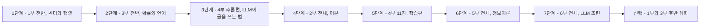

# 수포자를 위한 AI 수학 시리즈

수학을 포기했던 사람이 **AI(LLM)가 실제로 어떻게 동작하는지** 이해하는 것을 목표로 하는 6부작 학습 시리즈(+실용 확장 로드맵).
각 부는 독립된 인터랙티브 웹 앱(Vue 3 + Vite)과 대응 Jupyter 노트북으로 구성된다.

| 부 | 주제 | 폴더 | 시리즈에서의 역할 |
|---|---|---|---|
| 1부 | 선형대수학 | `apps/part1` | 단어를 벡터로, 변환을 행렬곱으로 보는 눈 |
| 2부 | 미분 | `apps/part2` | 모델이 "학습"하는 원리 — 경사하강·역전파 |
| 3부 | 확률과 통계 | `apps/part3` | "다음 단어를 확률로 고른다"를 읽는 문해력 |
| 4부 | 트랜스포머 | `apps/part4` | **시리즈의 정점** — LLM의 실체를 조립 |
| 5부 | 정보이론 | `apps/part5` | 손실함수·퍼플렉시티·temperature의 본체 |
| 6부 | LLM 조련 | `apps/part6` | 피날레 — GPT가 ChatGPT가 되기까지, 배운 수학의 총회수 |
| 7부 | 임베딩 기하학 | `apps/part7` | 실용 확장 — "회사 문서를 아는 챗봇"(RAG·의미 검색·벡터 DB)의 수학 |

---

## 🗺️ 추천 학습 경로

> **원칙: 1→2→3→4→5 순서로 완주하지 않는다.**
> 수포자의 최대 리스크는 난이도가 아니라 "AI는 구경도 못 하고 수학만 하다 지치는 것"이다.
> 따라서 4부(트랜스포머)를 최대한 빨리 만나도록 경로를 설계했다.

```
1부 전반 → 3부 전반 → 4부 추론편 → 2부 전체 → 4부 학습편 → 5부 전체 → 6부 전체 → [선택] 1부·3부 후반
```



### 1단계 — 1부 전반: 벡터·행렬·선형변환

- **범위**: 워밍업 ~ 6장(행렬식과 역행렬)까지.
- **건너뛸 것**: 7장부터의 **심화 트랙**(고유값·PCA·rank·투영·SVD·행렬미분) — 지금은 필요 없다.
  웹 목차에 「심화」 배지로 표시되어 있다.
- **목표 감각 하나**: "단어가 벡터가 되고, 행렬곱이 변환이다."

### 2단계 — 3부 전반: 확률의 언어

- **범위**: 샘플 ~ 7장(큰 수의 법칙과 중심극한정리)까지. 특히 조건부 확률(4장)과 확률분포(5장)가 핵심.
- **건너뛸 것**: 8~10장 **심화 트랙**(추정·신뢰구간, 가설검정과 p값, 상관·회귀) —
  LLM 이해에는 부차적이므로 뒤로 미룬다. 웹 목차에 「심화」 배지로 표시되어 있다.
- **이유**: LLM의 정체가 *"다음 단어를 확률로 고르는 기계"*이므로, 확률분포는 4부를 읽기 위한 문해력이다.

### 3단계 — 4부 추론편: LLM이 글을 쓰는 법 🎯

- **범위**: 1장 ~ 9장(다음 단어 예측) + 10장(전체 조립) + 12장(샘플링 — temperature·top-k·top-p).
- **건너뛸 것**: **11장(학습 — 손실과 경사하강)** — 미분이 필요하므로 아직 보지 않는다.
- **의미**: 여기가 시리즈의 보상 지점. 1부의 행렬곱(Q·K·V)과 3부의 확률분포(출력층)가
  실제로 쓰이는 걸 보면서, 앞 단계 수학이 소급 정당화된다.

### 4단계 — 2부 전체: 미분

- **범위**: 전체. 흐름은 연쇄법칙(6장) → 그래디언트와 경사하강법(9장) → 역전파 직관(10장).
- **이유**: "모델이 어떻게 똑똑해지는가"가 궁금해진 시점에 배워야 미분이
  "이걸 왜 하지"가 아니라 "학습의 원리를 알기 위한 도구"가 된다.

### 5단계 — 4부 학습편 복귀

- **범위**: 4부 11장(학습 — 손실과 경사하강).
- 2부에서 배운 경사하강이 트랜스포머 학습에 그대로 꽂히는 것을 확인한다.

### 6단계 — 5부 전체: 정보이론

- **범위**: 전체. 크로스 엔트로피 → KL 발산 → 퍼플렉시티 → temperature → 캡스톤.
- **이유**: 4부 11장(손실)과 12장(샘플링)에서 "일단 그런 게 있다"고 넘어간 것들의 본체.
  3부 확률이 선수 지식이고 4부를 이미 봤기 때문에 모든 챕터가 "아, 그게 이거였구나"로 읽힌다.
- 특히 **5부 8장(temperature)은 4부 12장의 심화판**이다.

### 7단계 — 6부 전체: LLM 조련

- **범위**: 전체. 사전학습 → SFT → 선호 학습(RLHF·DPO)의 3단 파이프라인.
- **이유**: 5부까지 마치면 "다음 단어 예측 기계"는 이해하지만, 그 기계가 왜 질문에
  공손히 대답하는 비서가 되는지는 모른다. 6부가 그 마지막 퍼즐이다.
- **수학의 총회수**: RLHF·DPO 수식 한가운데에 **5부 6장의 KL 발산**이 등장하고,
  LoRA에서 **1부의 저차원 행렬** 감각이, 보상 모델에서 **3부의 확률**이 재등장한다.

### 8단계(선택) — 남겨둔 심화

- 1부 후반: 고유값·고유벡터, 기저·차원·rank, 직교성과 투영, SVD, PCA, 행렬미분.
- 3부 후반: 추정과 신뢰구간, 가설검정과 p값, 상관관계와 회귀.
- 트랜스포머 이해 자체에는 필수가 아닌 교양·심화. **완주 욕심으로 초반에 여기서
  소모되지 않게 하는 것**이 이 커리큘럼의 핵심이다.

### 실용 분기(선택) — 7부: 임베딩 기하학

- 본 경로의 고정 단계가 아니라 **1단계(1부 전반)만 마치면 언제든 진입 가능한 실용 트랙**.
  4부 3장(임베딩)과 6부 2장(문맥 창)을 봤다면 더 잘 읽히지만 필수는 아니다.
- 사내 실사용(도입) 관점의 1순위 확장 — 임직원이 가장 먼저 만나는 AI 활용처(RAG·의미 검색)의 수학.

---

## 6부 챕터 구성 (수포자를 위한 LLM 조련) — ✅ 전 챕터 공개 완료 (2026-07-11)

> **궁극 목표**: 다음 단어 예측 기계(베이스 모델)가 어떻게 지시를 따르는 비서(ChatGPT)가
> 되는지를, 수포자가 공식을 외우지 않고 직접 조작하며 이해하게 한다.
> 도달점은 **10장(캡스톤 — 조련 파이프라인 전체 조립)**.
> 시리즈 공통 설계 철학(직관 먼저, 인터랙티브, 웹 ↔ 노트북 1:1, 챕터별 연결 카드)을 따른다.

| 장 | 제목 | 핵심 내용 | 회수하는 수학 |
|---|---|---|---|
| 0 | 워밍업 — 같은 모델, 다른 대답 | 베이스 모델 vs 챗 모델의 응답을 나란히 비교하는 맛보기 | 4부 전체 |
| 1 | 큰 그림 — 사전학습에서 비서까지 | 사전학습 → SFT → 선호 학습 3단 파이프라인 지도 | — |
| 2 | 이어쓰기 기계의 한계 | 베이스 모델이 지시를 못 따르는 이유, 프롬프트로 흉내내기의 한계 | 4부 9장, 5부 7장 |
| 3 | SFT — 시범 보여주기 (핵심) | 지시-응답 데이터로 미세조정, 결국 같은 크로스 엔트로피 학습 | 5부 4장, 4부 11장 |
| 4 | 사람의 취향을 숫자로 — 선호 데이터와 보상 모델 (핵심) | A/B 선호 쌍, Bradley-Terry 직관, 보상 모델 학습 | 3부 4장, 2부 7장 시그모이드 |
| 5 | 보상으로 배우기 — 강화학습 최소 직관 | 행동·보상·정책, 보상을 높이는 방향으로의 경사 이동 | 2부 9장, 3부 5장 |
| 6 | RLHF (핵심) — KL 목줄 | 보상 최대화 + KL 페널티, 원본에서 너무 멀어지지 않게 묶는 이유 | **5부 6장 KL 발산** |
| 7 | DPO — 보상 모델 없이 조련하기 | 선호 쌍에서 바로 배우는 지름길, RLHF와의 득실 비교 | 5부 6장, 2부 7장 |
| 8 | LoRA — 살짝만 조련하기 | 거대 행렬을 얼리고 저차원 행렬 두 장만 학습하는 직관 | 1부 9장 rank, 11장 SVD |
| 9 | 조련 성적표 — 평가와 부작용 | 벤치마크, LLM 심판, 과잉 조련(아첨·망각)의 징후 | 3부 8~10장 |
| 10 | 🎯 캡스톤 — 나만의 챗봇 조련 | 미니 파이프라인 전체 조립: SFT → 보상 → DPO 시뮬레이션 | 전 시리즈 |

- **선수 지식**: 4부(필수), 5부(필수 — 특히 KL 발산), 2부 9장, 3부 4~5장.
- **학습 경로상 위치**: 7단계(5부 직후). 1부 8~12장을 건너뛴 학습자를 위해
  8장(LoRA)에 rank·저차원 최소 직관을 자체 포함시킨다.

---

## 7부 챕터 구성 (수포자를 위한 임베딩 기하학) — ✅ 전 챕터 공개 완료 (2026-07-11)

> **궁극 목표**: 임직원이 실제로 쓰는 "AI가 회사 문서를 아는 것처럼 답하는" 기능 —
> **RAG(검색 증강 생성)·의미 검색·벡터 DB** — 의 수학을 이해하고 직접 조립하게 한다.
> 도달점은 **10장(캡스톤 — 사내 FAQ 검색봇 조립)**.
> 시리즈에서의 의미: 첫 **실용 확장 트랙** — 이해(1~6부)에서 활용(7부~)으로. 도입(사내 실사용) 1순위.
> 핵심 한 줄: **"의미는 위치다 — 가까움을 계산하는 법."**

| 장 | 제목 | 핵심 내용 | 회수하는 수학 |
|---|---|---|---|
| 0 | 워밍업 — 비슷한 문장 찾기 | 사람은 어떻게 "비슷하다"를 아나 — 의미를 지도 위 위치로 보는 첫 경험 | 1부 1장 |
| 1 | 큰 그림 — 검색의 진화와 RAG | 키워드 검색의 한계 → 의미 검색 → RAG 파이프라인 지도(검색 결과가 프롬프트가 된다) | 4부 3장, 6부 2장 |
| 2 | 가까움의 수학 — 코사인 유사도 (핵심) | 유클리드 거리 vs 각도, 길이가 점수를 오염시키는 문제와 정규화 | **1부 2장 내적** |
| 3 | 임베딩 공간 탐험 | 의미의 방향과 벡터 연산(왕−남자+여자), 의미 클러스터 | 1부 1~2장, 4부 3장 |
| 4 | 고차원의 저주 (핵심) | 차원이 높으면 아무 벡터나 거의 직교 — 거리 감각이 무너지는 이유, 그런데도 임베딩이 작동하는 이유 | 3부 5·7장, 1부 9장 rank |
| 5 | 지도 그리기 — 차원 축소 | PCA 재회 + t-SNE·UMAP 감각 — 2D 지도는 항상 왜곡을 동반한다 | 1부 8장 PCA |
| 6 | 이웃 찾기 — kNN에서 벡터 DB까지 | 전수조사의 비용 → 근사 최근접 이웃(ANN) 직관, 벡터 DB의 정체 | — |
| 7 | 청킹과 검색 품질 | 문서 쪼개기의 트레이드오프, top-k·유사도 임계값, recall@k로 검색 채점 | 6부 9장, 3부 8장 |
| 8 | RAG 조립 (핵심) — 검색이 프롬프트가 되기까지 | 파이프라인 전체 + 실패 모드(검색 miss·청크 경계·근거 없는 답), RAG vs 파인튜닝 선택 기준 | 6부 2~3장 |
| 9 | 임베딩은 어떻게 배우나 — 대조 학습 | "짝은 가깝게, 남은 멀게" — 그리고 또 −log 손실 | 5부 4장, 6부 4장, 2부 9장 |
| 10 | 🎯 캡스톤 — 사내 FAQ 검색봇 | 미니 RAG 전체 조립: 임베딩 → 코사인 → top-k → 답변 구성 | 전 시리즈 |

- **선수 지식**: 1부 전반(필수 — 특히 2장 내적). 4부 3장(임베딩)·6부 2장(문맥 창)은 권장.
  진입 장벽이 시리즈에서 가장 낮다 — 실용 분기인 이유.
- **학습 경로상 위치**: 고정 단계가 아닌 선택 분기(1단계 직후부터 가능). 저장 접두사 `emb`.
- **6부와의 구도**: "모델에 지식을 넣는 두 길" — 조련(가중치를 바꾼다, 6부) vs RAG(문맥에 넣어준다, 7부).
  6부 2장의 퓨샷·문맥 창 논의가 7부의 출발점이 된다.

---

## 설계 원리 두 가지

1. **4부를 "추론편"과 "학습편"으로 쪼개면 선수 과목이 절반으로 준다.**
   추론에는 선형대수 + 확률만 필요하고, 학습에는 미분 + 정보이론이 필요하다.
   쪼개지 않으면 네 과목을 전부 마친 뒤에야 AI를 만나게 된다.
2. **수학은 항상 "쓰이는 곳을 본 직후 또는 직전"에 배치한다.**
   동기가 선행하면 수포자도 버틴다.

## 부 간 주요 연결 지점

| 출발 | 도착 | 연결 내용 |
|---|---|---|
| 1부 행렬 연산·선형변환 | 4부 3장 임베딩, 6장 Q·K·V | 어텐션은 결국 행렬곱 |
| 2부 6장 연쇄법칙 | 4부 11장, 2부 10장 역전파 | 역전파 = 연쇄법칙의 반복 적용 |
| 2부 9장 ↔ 1부 13장 | 4부 11장 | 그래디언트·경사하강을 세 부에서 다룸 — 중복 아닌 심화 |
| 3부 확률분포·조건부 확률 | 4부 9장 다음 단어 예측 | LLM 출력 = 조건부 확률분포 |
| 5부 4장 크로스 엔트로피 | 4부 11장 손실함수 | LLM 손실함수의 정체 |
| 5부 8장 temperature | 4부 12장 샘플링 | 같은 다이얼의 직관편·수학편 |
| 5부 6장 KL 발산 | 6부 6~7장 RLHF·DPO | 조련이 원본에서 멀어지지 않게 묶는 목줄 |
| 1부 9장 rank, 11장 SVD | 6부 8장 LoRA | 거대 행렬의 변화를 저차원으로 근사 |
| 3부 4장 조건부 확률, 2부 7장 시그모이드 | 6부 4장 보상 모델 | 선호 확률을 시그모이드로 모델링 |
| 1부 2장 내적 | 7부 2장 코사인 유사도 | 의미 검색의 자 — 각도로 재는 가까움 |
| 1부 8장 PCA | 7부 5장 차원 축소 | 임베딩 공간의 지도 그리기 |
| 6부 2장 문맥 창·퓨샷 | 7부 1·8장 RAG | 지식 주입의 두 길 — 조련 vs 검색 증강 |
| 3부 5·7장 기댓값·큰 수의 법칙 | 7부 4장 고차원의 저주 | 고차원에서 내적이 집중되는 이유 |
| 5부 4장 −log 손실, 6부 4장 쌍 학습 | 7부 9장 대조 학습 | InfoNCE — 같은 채점 철학의 세 번째 얼굴 |
