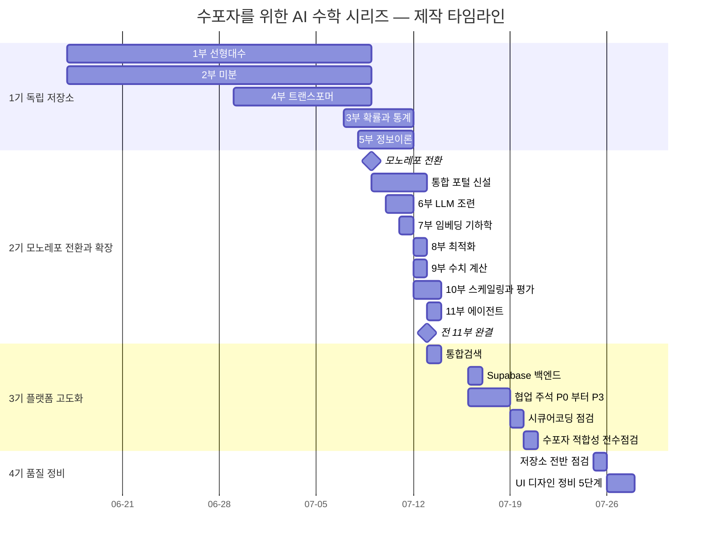
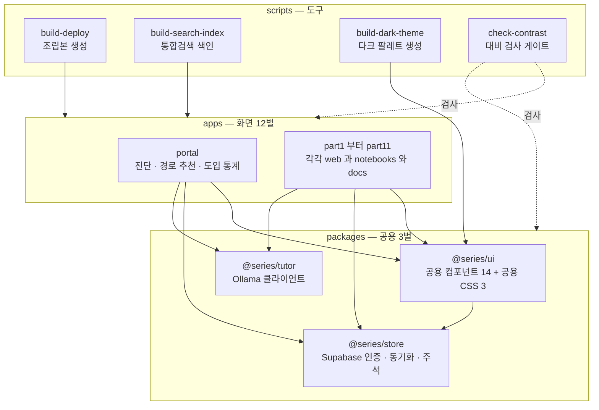
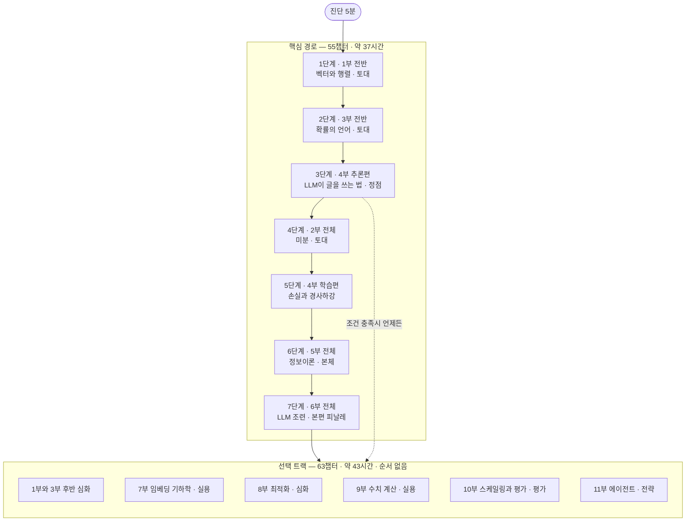
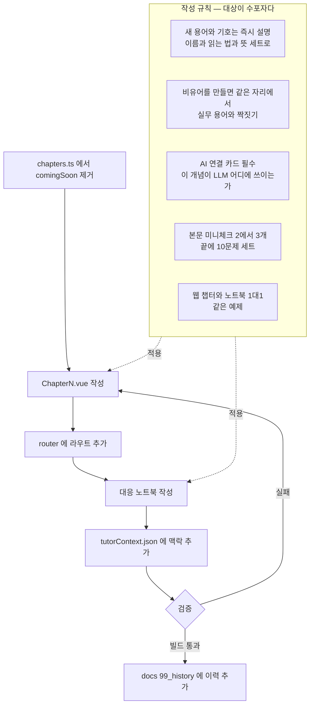
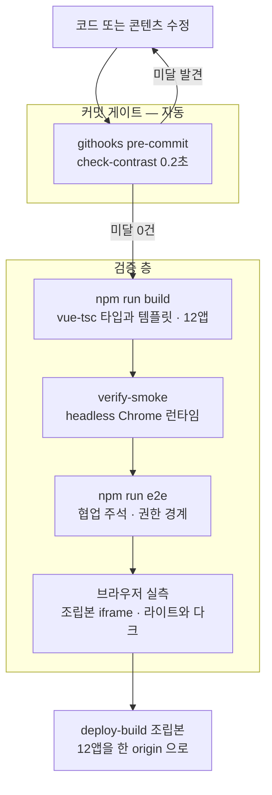
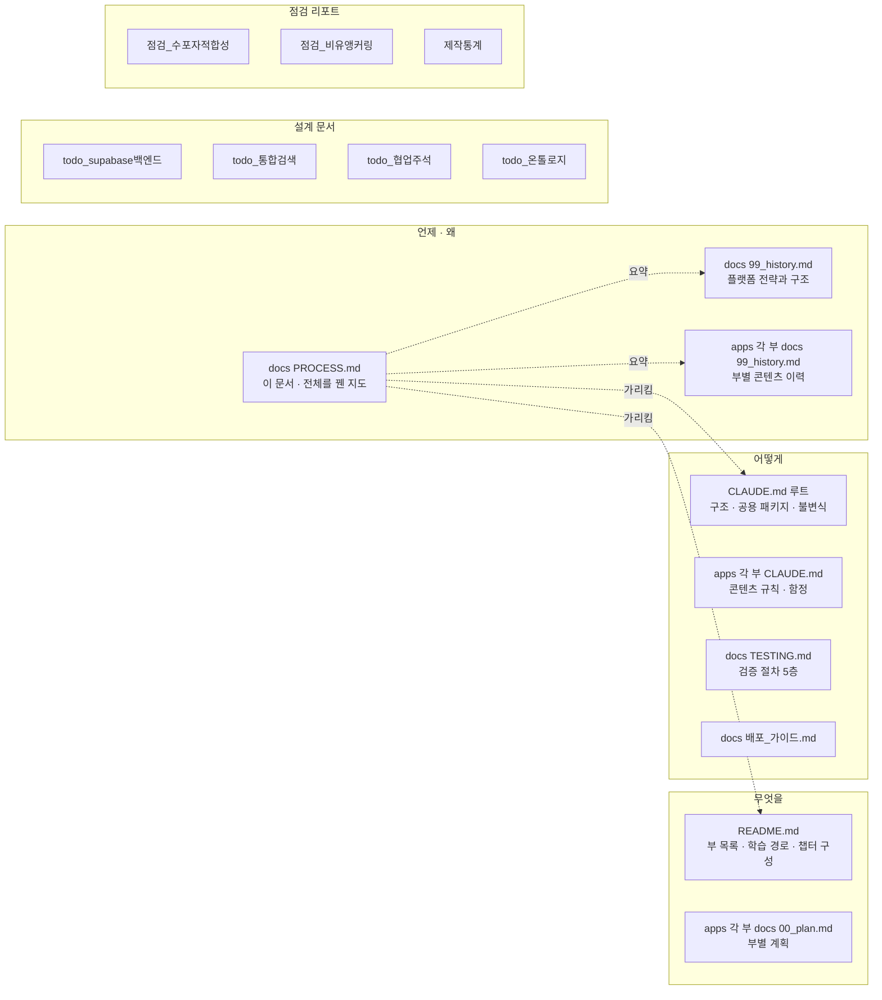

# 프로세스 지도 — 무엇을, 어떤 순서로, 왜 만들었나

> 12벌로 흩어진 작업 이력(`docs/99_history.md` + `apps/*/docs/99_history.md` × 12)을 하나의 서사로 꿴 문서.
> **정본이 아니라 지도다.** 각 항목의 정본은 9절 "산출물 지도"가 가리키는 곳에 있고, 여기서는
> 그것들이 서로 어떻게 이어지는지만 본다.
>
> 기준 시점: **2026-07-27**. 수치는 저장소에서 직접 센 값이다.

---

## 1. 한눈에

| 지표 | 값 |
|---|---|
| 제작 기간 | 2026-06-17 ~ 07-27 — 41일, **활동일 25일** |
| 앱 | **12개** — 11개 부 + 통합 포털 |
| 챕터 | **129개** — 본 챕터 118 + 워밍업 11 |
| 노트북 | **131권** — 웹 챕터와 1:1 |
| 문제 | **1,658개** — Quiz 1,520 + StepQuiz 138 |
| Vue 컴포넌트 | **350개** — 부 전용 데모 156 + 공용 14 + 챕터 129 + 기타 |
| 작업 이력 항목 | **360개** (12벌 합산) |
| 커밋 | 153개 |
| 학습 분량 | 핵심 경로 55챕터 · 약 37시간 / 선택 트랙 63챕터 · 약 43시간 |

제작 자체의 비용·토큰 통계는 별도 문서 `제작통계_260714.md` 에 있다 —
단 **2026-07-14 스냅샷**이라 그 뒤 2주치(10·11부 이후 전부)가 빠져 있다.

**이 프로젝트의 목적은 두 가지다**: ① 사내 임직원이 실제로 쓰게 만드는 것(도입), ② 제작자 본인의
수학·AI 지식을 채우는 것. 아래 모든 결정은 이 둘 중 하나로 설명된다.

---

## 2. 제작 타임라인

### 눈에 띄는 것 — 부 하나를 만드는 데 걸린 시간

| 부 | 기간 | 비고 |
|---|---|---|
| 1부 선형대수 | 22일 | 첫 부. 형식을 발명하는 데 대부분을 썼다 |
| 4부 트랜스포머 | 10일 | 시리즈의 정점, 분량 최다 |
| 6부 LLM 조련 | 2일 | 모노레포 이후 |
| 7·8·9·11부 | **각 1일** | 공용 패키지 + 확립된 챕터 형식 |

**22일 → 1일.** 이 가속은 재능이 아니라 **구조의 결과**다. 1부에서 발명한 것(챕터 형식, 문제 표준,
AI 연결 카드, 노트북 1:1 대응)이 `packages/ui` 와 `CLAUDE.md` 규칙으로 굳으면서, 이후의 부는
"콘텐츠를 붓는" 작업만 남았다. 3절의 전환점 ①이 그 분기점이다.

---

## 3. 전환점 다섯 개

각 전환은 "무엇이 문제였나 → 무엇을 바꿨나 → 무엇이 가능해졌나" 순서로 읽으면 된다.

### ① 모노레포 전환 — 2026-07-09

**문제**: 부마다 독립 저장소였고, 공용 컴포넌트가 **5벌 복제**돼 있었다. 1부가 "골든 카피"였고
`check_drift.py` 로 복제본이 어긋났는지 검사했다. 컴포넌트 하나를 고치면 5곳에 전파해야 했다.

**바꾼 것**: npm workspaces 모노레포. 공용 컴포넌트를 `packages/ui` 한 곳으로.
앱전용 결합은 **provide/inject** 로 끊어 패키지를 주제 중립으로 유지.

**가능해진 것**: 한 번 고치면 전 부 반영. 골든카피·드리프트 검사 체제 폐기. 6~11부가 1~2일에
나온 직접적 원인이다.

### ② 통합 포털 신설 — 2026-07-09 ~ 07-12

**문제**: 부가 늘수록 "어디서 시작해 어디로 가야 하나"를 아무도 몰랐다. 그리고 1→2→3→4→5 순서가
**정답이 아니다** — 그 순서로 가면 네 과목을 다 마친 뒤에야 AI를 만난다.

**바꾼 것**: 진단 → 경로 추천 허브. 4부를 추론편/학습편으로 쪼개 선수 과목을 절반으로 줄이고,
비선형 경로를 지도로 그렸다(5절).

**가능해진 것**: "5분 진단 후 당신에게 필요한 단계만 남는다" — 도입 장벽을 낮추는 핵심 장치.

### ③ 백엔드 도입 — 2026-07-16

**문제**: 진도·복습이 localStorage 뿐이라 기기를 옮기면 사라졌다. 사내 도입에는 치명적.

**바꾼 것**: Supabase 하나로 ① 인증 ② 진도·복습 크로스기기 동기화 ③ 협업 주석 ④ 도입 통계.
**환경변수 미설정 시 전부 no-op** 으로 설계 — 백엔드 없이도 앱이 정상 동작한다.

**가능해진 것**: 사내 배포 가능 상태. 그리고 로컬 개발은 여전히 백엔드 없이 굴러간다.

### ④ 협업 주석 — 2026-07-16 ~ 07-18

**문제**: 혼자 공부하다 막히면 거기서 끝났다. 학습 도구가 아니라 읽을거리에 머물렀다.

**바꾼 것**: 임의 항목에 앵커를 달아 익명 메모·질문을 남기고, AI 답변과 사람(강사) Q&A를 붙였다.
전 11부로 확대(`partNumberKey` 주입), 관리자용 미해결 질문 큐까지.

**가능해진 것**: 도입의 실질 — "혼자 보는 자료"에서 "같이 쓰는 도구"로.

### ⑤ 품질 정비 — 2026-07-20 ~ 07-27

**문제**: 콘텐츠가 다 찬 뒤에야 보이는 것들. 설명 없는 기호, OS별로 깨지는 화면, 못 읽는 글자색.

**바꾼 것**:
- **수포자 적합성 전수 점검**(07-20) — 11개 부 전 챕터의 미정의 용어·비유 앵커링을 훑어 정비
- **UI 디자인 정비 5단계**(07-26~27) — 읽기 열, 부별 정체성, 색 토큰화, 다크 모드, 대비

**가능해진 것**: 그리고 **재발 방지 장치**가 남았다 — `npm run check:contrast` 와 커밋 훅.
한 번 청소하고 끝나는 문제가 아니라서(챕터를 추가할 때마다 다시 들어온다) 게이트로 세웠다.

---

## 4. 저장소 구조

**핵심은 `packages/ui` 가 주제 중립이라는 것.** 앱전용 결합은 전부 provide/inject 로 주입한다.

| 주입 키 | 잇는 것 | 틀리면 |
|---|---|---|
| `storagePrefixKey` | QuizSet ↔ 앱별 localStorage 이름공간 | **사용자 진도가 끊긴다** |
| `reviewApiKey` | ReviewFlag ↔ 앱 review 스토어 | 복습 별표가 안 붙는다 |
| `notebookResolverKey` | NotebookCard ↔ 앱 chapters | 노트북 카드가 안 뜬다 |
| `partNumberKey` | 협업 주석 게이트 | **남의 부 메모가 섞인다** |
| `searchIndexKey` | SearchPalette ↔ 색인 URL | 검색이 빈다 |

---

## 5. 학습 경로 — 1부터 순서대로가 아니다

**설계 원리 두 가지**

1. **4부를 추론편과 학습편으로 쪼개면 선수 과목이 절반으로 준다.** 추론에는 선형대수와 확률만
   필요하고, 학습에는 미분과 정보이론이 필요하다. 쪼개지 않으면 네 과목을 전부 마친 뒤에야
   AI를 만난다 — 수포자는 그 전에 이탈한다.
2. **수학은 항상 쓰이는 곳을 본 직후 또는 직전에 배치한다.** 동기가 선행하면 버틴다.

그래서 3단계에서 트랜스포머를 만난다. 미분(4단계)보다 **먼저**다.

---

## 6. 챕터 하나가 만들어지는 과정

규칙 ②가 이 시리즈의 특징이다. 비유를 만들면 반드시 실무 용어와 짝짓는다 — 6부의 "조련"은
사후 학습·파인튜닝·정렬과, 8부의 "보폭"은 학습률과 같은 자리에서 묶인다. 비유만 남으면
**밖에서 통하지 않는 지식**이 되기 때문이다.

---

## 7. 검증 파이프라인

이 저장소에는 유닛 테스트가 없다. 대신 층이 다른 검증 다섯 개가 있다.

**왜 조립본인가**: 각 부를 따로 dev 서버로 띄우면 포트가 달라 origin 이 갈린다. 그러면
localStorage 가 분리돼 **포털이 다른 부의 진도를 읽는 기능**을 재현할 수 없다. 배포 형태와 같은
한 origin 조립본에서만 검증된다.

**대비 검사기가 잡는 것** — 사람 눈으로는 못 잡는 네 가지:

| 함정 | 예 |
|---|---|
| 배경이 부모에 있다 | `bg-indigo-100` 카드 안의 자식 글자 |
| 배경이 동적 바인딩 안에 있다 | `:class` 삼항의 분기별 배경 |
| 계열마다 밝기가 다르다 | emerald-600 은 3.49대1 미달, indigo-600 은 6.18대1 통과 |
| 라이트는 통과, 다크는 미달 | `bg-X-100` 위 `text-X-600` |

---

## 8. 설계 결정 기록

| 결정 | 이유 | 버린 대안 |
|---|---|---|
| npm workspaces 모노레포 | 공용 컴포넌트 5벌 복제와 드리프트 제거 | 부별 독립 저장소 + 골든카피 전파 |
| 공용 패키지는 주제 중립 + provide/inject | 패키지가 특정 부를 알면 재사용이 깨진다 | 패키지에 부별 분기 넣기 |
| 검증 수단은 `npm run build` | vue-tsc 가 타입·템플릿·미사용 변수까지 잡는다 | 유닛 테스트 도입 — 콘텐츠 중심이라 비용 대비 효과가 낮음 |
| Supabase 미설정 시 no-op | 백엔드 없이도 앱이 온전히 동작해야 한다 | 백엔드 필수화 |
| 관리자 경계는 서버 RLS | 클라이언트 표시는 UI 편의일 뿐 | 프런트 플래그만으로 관리자 판정 |
| 다크 모드는 팔레트 변수 재정의 | Tailwind v4 가 유틸리티를 변수 참조로 내보낸다 | 마크업 전체에 `dark:` 클래스 추가 — 129챕터 수정 |
| 데모 색은 `--c-*` 토큰 | 하드코딩 hex 는 다크에서 그 데모만 깨진다 | hex 유지 |
| 본문 레이아웃은 레이어 밖 CSS | 레이어 밖 규칙이 마크업의 유틸리티를 이긴다 | 129챕터의 클래스를 일일이 수정 |
| 실습은 전부 오프라인·결정적 | 시드 고정이라야 E2E와 assert 가 성립 | 외부 API·실제 GPU 학습 요구 |
| AI 튜터는 로컬 Ollama | 비용 0, 사내 반입 자료가 밖으로 안 나간다 | 상용 API |

---

## 9. 불변식 — 건드리면 조용히 깨지는 것들

빌드가 통과하므로 **자동으로는 안 잡힌다.**

| 대상 | 규칙 | 어기면 |
|---|---|---|
| 저장 접두사 12개 | `la` `diff` `stat` `tf` `it` `tame` `emb` `opt` `num` `scale` `agent` `hub` | 사용자 진도가 끊기고 포털 연동이 깨진다 |
| `partNumberKey` | 부 번호 = Supabase `annotations.part` | 같은 슬러그를 공유하므로 남의 부 메모가 섞인다 |
| 앵커 id | `{chapter}-{type}-{slug}`, 배포 후 변경 금지 | 달아 둔 메모가 미아가 된다 |
| 개념 id | `scripts/ontology/concepts.json` 의 `id` — 배포 후 변경·삭제 금지 | 개념을 참조하는 검색·튜터 카드·(2단계) 딥링크가 고아가 된다 — `check:ontology` 가 위치·앵커·순환은 잡지만 개명은 못 잡는다 |
| Tailwind `@source` | 각 앱 style.css 에 패키지 경로 | 공용 컴포넌트 스타일이 조용히 사라진다 |
| `optimizeDeps.exclude` | 전 12앱에 공용 패키지 3종 | 패키지 컴포넌트가 안 뜬다 |
| 테마 localStorage 키 | `series-theme-v1` — theme.ts · index.html · 문서 3곳 동일 | 첫 페인트에 흰 화면이 번쩍인다 |
| `dark.css` | 자동 생성물. `tokens.css` 수정 후 `npm run theme:dark` | 그 토큰만 다크에서 안 뒤집힌다 — 검사기가 잡는다 |
| 웹 챕터와 노트북 | 1대1, 같은 예제 | 두 갈래 학습이 어긋난다 |

---

## 10. 산출물 지도 — 무엇이 어디의 정본인가

| 알고 싶은 것 | 볼 곳 |
|---|---|
| 무슨 부가 있고 어떤 순서로 배우나 | `README.md` |
| 이 저장소에서 작업하는 규칙 | 루트 `CLAUDE.md` + 부별 `CLAUDE.md` |
| 어떻게 검증하나 | `docs/TESTING.md` |
| 처음 어떻게 실행하나 | `docs/실행_가이드.html` — 설치 · 조립본/개발 서버/노트북 · 튜터 · 백엔드 · 온톨로지 확인 체크리스트 |
| 언제 무엇을 했나 | `docs/99_history.md` + 부별 `99_history.md` |
| **전체가 어떻게 이어지나** | **이 문서** |
| 기능별 설계 근거 | `docs/todo_*.md` |
| 개념과 관계의 정본 | `scripts/ontology/concepts.json` — 검색 색인·개념 그래프·튜터 카드의 원천 (`npm run check:ontology`) |
| 품질 점검 결과 | `docs/점검_*.md` |
| 제작 비용·토큰 | `docs/제작통계_260714.md` — 07-14 스냅샷 |
| 발표 자료 | `docs/hackathon/` — 사내 해커톤 자료라 로컬 전용(저장소에 없음, `.gitignore`) |

---

## 11. 지금 열려 있는 것

| 항목 | 상태 |
|---|---|
| 제작통계 갱신 | 2026-07-14 스냅샷 이후 2주치 미반영 |
| 발표 산출물 개정 | `docs/hackathon/` 이 1부 단독 시절 프레임 |
| 모바일 실측 | 390px 레이아웃과 터치 포인터 44px 타깃 미확인 |
| 아이콘 체계 | 이모지 448곳 — 폰트 스택만 고정, OS별 모양 차이는 남음 |
| 개념 온톨로지 | 1~4단계 완료(2026-09-06 — 정본 개념 114 · `check:ontology` · 튜터 개념 카드(웹+노트북) · 챕터 띠 · 포털 개념 지도·용어 대조표(옛 이름 비유어 사전) · 팔레트 이웃 · 복습 경로 · 개념 단위 진단 · 질문 집계 · 7부 GraphRAG 절 · 11부 도구 스키마 카드). 남은 건 유지 작업 — `docs/todo_온톨로지_260906.md` §11~§14 |

---

## 부록 — 부별 고유색

11개 앱을 오갈 때 위치를 색으로 먼저 알린다. 사이드바의 역할 칩은 포털 학습 지도와 같은 색 토큰이라,
지도에서 본 카드와 그 부의 화면이 같은 언어로 읽힌다.

| 부 | 주제 | 색 | 역할 |
|---|---|---|---|
| 1부 | 선형대수학 | sky | 토대 |
| 2부 | 미분 | blue | 토대 |
| 3부 | 확률과 통계 | cyan | 토대 |
| 4부 | 트랜스포머 | indigo | 조립 · 정점 |
| 5부 | 정보이론 | violet | 본체 |
| 6부 | LLM 조련 | amber | 조련 |
| 7부 | 임베딩 기하학 | teal | 실용 |
| 8부 | 최적화 | purple | 심화 |
| 9부 | 수치 계산 | orange | 실용 |
| 10부 | 스케일링과 평가 | pink | 평가 |
| 11부 | 에이전트 | fuchsia | 전략 |
