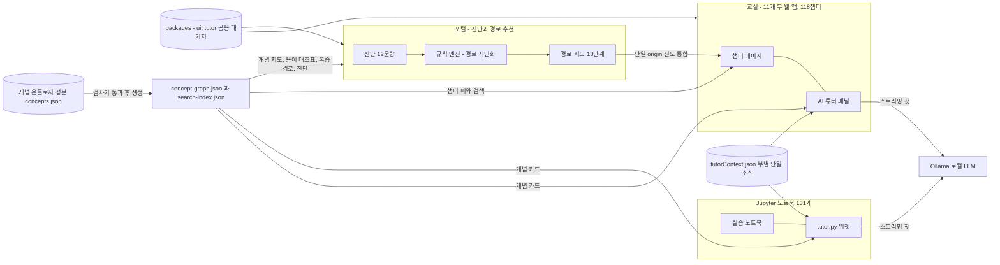

# 프로그램 명세 — 수포자 사관학교 🎓 (해커톤 제출용)

> **한 줄 소개**: 수학을 포기했던 직원도 ChatGPT 의 내부 동작을 이해하게 만드는 **AI 강사 플랫폼** —
> 5분 진단으로 **개인 학습 경로를 추천**하고, 11부작 인터랙티브 교실로 가르치고, 막히면 **로컬 AI 튜터**가 옆에서 답한다.
> 전부 사내 로컬에서 — **비용 ₩0, 데이터 유출 0.**

| 항목 | 내용 |
|------|------|
| 제출자 | jiyupapa <!-- TODO: 팀명/트랙 등 주최측 요구 항목 --> |
| 저장소 | 모노레포 `MATH_PLATFORM` (포털 + 11개 부 + 공용 패키지) <!-- TODO: 제출용 원격 URL 확정 --> |
| 형태 | 웹 플랫폼 (Vue 3, 정적 배포) + Python 노트북 131개 (Jupyter) + 로컬 LLM AI 튜터 (Ollama) |
| 상태 | **1~11부 전 챕터 완결 (118 학습 챕터)** + 진단·경로 추천 포털 가동 — 핵심 경로 55챕터 약 37시간 |

<!-- TODO: 대표 스크린샷 — ① 포털 진단→경로 지도 ② 4부 어텐션 시각화 ③ AI 튜터 패널 -->

---

## 1. 문제 정의

- 전 직원의 AI 리터러시가 필요한 시대 — 그런데 ChatGPT 의 원리(임베딩·어텐션·확률·학습)는
  전부 **수학 위에** 서 있고, 대부분의 직원에게 수학은 "중학교에서 멈춘 과목"이다.
- 기존 해법은 수포자에게 실패한다: 강의는 1→2→3 순서로 수학만 가르치다 **AI 를 만나기 전에
  지치게** 하고, 설명 없는 기호 하나에서 이탈하며, 막혔을 때 물어볼 곳이 없다.
- 이 플랫폼은 **강사처럼** 답한다:
  **① 진단하고 경로를 짠다** (5분 배치 테스트 → 필요한 단계만 남긴 개인 경로) →
  **② 직관 먼저 가르친다** (드래그하면 반응하는 시각화 → 문제 → 수식, 트랜스포머를 최대한 빨리 만나는 지름길 경로) →
  **③ 막히면 옆에서 답한다** (지금 보는 챕터를 아는 로컬 AI 튜터).

## 2. 핵심 기능 명세

### A. AI 강사 — 진단·경로 추천 (포털)

| # | 기능 | 설명 | 상태 |
|---|------|------|------|
| A1 | 입장 진단 (1층) | 경로 분기점에 대응하는 **관문 4개(벡터·확률·미분·log) × 3문항 + 자신감 자기보고 2문항** — 5분 이내 | ✅ |
| A2 | 규칙 기반 경로 엔진 | 진단 결과로 **13단계 경로 지도**를 개인화 — 통과 관문의 단계는 접고(이미 앎), 자신감이 낮으면 "빠른 복습"으로 완화. **결정은 규칙**(같은 입력 → 같은 경로, 근거를 화면에 표시), 개인화 요약 "N챕터 · M시간" | ✅ |
| A3 | 학습 중 적응 (2층) | 각 부의 진도·복습 데이터를 포털이 읽어 — 지도에 **진도 배지**, **"다음 목적지"** 카드, 복습 북마크 잔존 시 **"복습 먼저"**, 필수 트랙 완주 시 **"심화 해금"** (단일 origin 배포에서 E2E 16항목 검증) | ✅ |
| A4 | 강사 설명 (3층) | 추천 근거를 규칙 템플릿으로 항상 표시 + 로컬 LLM 이 강사 말투로 재구술(Ollama 미실행 시 템플릿 폴백) | ✅ |
| A5 | 학습 전후 향상도 | 최초 진단을 기준선으로 보관 → 재진단 시 정답·통과 관문·자신감을 전↔후 그래프로 | ✅ |

### B. 교실 — 11부작 인터랙티브 커리큘럼

| # | 기능 | 설명 | 상태 |
|---|------|------|------|
| B1 | 118 학습 챕터 (11부작) | 1부 선형대수 → 2부 미분 → 3부 확률통계 → **4부 트랜스포머(정점)** → 5부 정보이론 → 6부 LLM 조련(SFT·RLHF·DPO·LoRA) → 7부 임베딩 기하학(RAG) → 8부 최적화(Adam·스케줄) → 9부 수치 계산(양자화·GGUF) → 10부 스케일링 법칙·평가 통계(Chinchilla·벤치마크 오차범위) → 11부 에이전트와 추론(사슬 성공률·검수 베이즈·pass@k). 챕터마다 전용 인터랙티브 실험 | ✅ |
| B2 | 지름길 학습 경로 | "수학만 하다 지치는 것"을 막는 설계 — 1부 전반 → 3부 전반 → **4부 추론편(LLM 이 글을 쓰는 법)** 을 3단계 만에 만나고, 미분·정보이론은 궁금해진 뒤에 배운다 | ✅ |
| B3 | AI 연결 (전 챕터) | 모든 챕터에 "이 개념이 LLM 어디에 쓰이나" 카드 — 내적→어텐션·RAG, 확률→다음 단어 예측, KL→RLHF 목줄, 양자화→4GB GGUF | ✅ |
| B4 | 자동채점 문제 시스템 | **1,600+ 문항** — 챕터당 미니체크 + 난이도별 10문제 세트(객관식·참거짓·숫자입력), 계산형은 중간 단계까지 채점(StepQuiz), 단계별 힌트·해설, 완료 시 진도 | ✅ |
| B5 | 진도·복습 | 부별 진도 저장(localStorage) + 복습 북마크 — 포털 2층과 통합 | ✅ |
| B6 | Python 노트북 131개 | 웹 챕터와 1:1 같은 예제 — 직관을 NumPy 로 굳히기. 전부 assert 자가검증 포함, `nbconvert` 무에러 | ✅ |

### C. 튜터 — 완전 로컬 LLM

| # | 기능 | 설명 | 상태 |
|---|------|------|------|
| C1 | AI 튜터 (웹, 부별 주제) | 우하단 🤖 플로팅 챗 — **지금 보는 챕터의 맥락을 주입**받아 본문과 일치하는 답변, "그 내용은 N장에 있어요" 목차 내비게이션(클릭 링크), 주제 이탈 가드레일 | ✅ |
| C2 | AI 튜터 (노트북) | 웹과 **같은 튜터**가 Jupyter 안에도 — 챕터 맥락은 웹과 공용 단일 소스(JSON) | ✅ |
| C3 | 📖 코드 설명 | 실행한 코드 셀을 골라 클릭 → 목적·핵심 줄·챕터 개념 연결 순으로 해설 | ✅ |
| C4 | 개념 그래프 접지 (웹·노트북) | 질문에 나온 개념의 카드(배우는 곳·선수·다시 쓰이는 곳·비유, 최대 3장 ≈ 100토큰)를 시스템 프롬프트에 붙여 **다른 부에서 배우는 개념도 "N부 M장"으로 안내** — 벡터 DB 없이, 결정적. 실측: 카드 없이 "N부 2장" 자리표시자 → 카드 붙이면 "2부 6장, 먼저 도함수 2부 3장" | ✅ |

### D. 개념 온톨로지 — 시리즈의 개념과 관계를 한 파일로 (2026-09-06)

| # | 기능 | 설명 | 상태 |
|---|------|------|------|
| D1 | 정본 `scripts/ontology/concepts.json` | 개념 **114** — 처음 배우는 곳(부·장·섹션 앵커) · 다시 쓰이는 곳과 어떻게(**261**) · 먼저 알아야 하는 개념(**185**) · 별칭 · 이 과정의 비유어(**65**). 흩어져 있던 검색 사전·README 연결표·포털 경로·튜터 맥락 4벌을 합친 것 | ✅ |
| D2 | 검사기 `npm run check:ontology` | 위치·앵커 실재, 선수 순환, 비유 유일, **본문 상호 링크 151 대상 실재**, README 연결표 대조 — **커밋 훅**에서 자동 | ✅ |
| D3 | 챕터 띠 + 개념 지도 + 용어 대조표 | 129개 장 상단에 "처음 배우는 개념 · 먼저 알아 둘 것 · 다시 만나는 곳" 띠 / 포털 `/concepts` 부별 행·선수 사슬·진도 겹치기·`?c=` 딥링크 / `/glossary` 비유 65개 ↔ 실무 용어(세 부 용어 대조표의 통합판) | ✅ |
| D4 | 개인화 3종 | 복습 표시 → 개념 → 선수 개념까지 잇는 **복습 경로** / 진단 문항의 개념 태그로 **다시 볼 개념**(홈 칩·지도 표시·설명 문장) / 주석 위치를 개념으로 묶은 **질문 집계**(도입 현황, 본문·작성자 없음) | ✅ |
| D5 | 검색 팔레트 이웃 줄 | 개념 결과 아래 "먼저 … · 다시 … · 이 과정에서는 '목줄'(6부) · 밖에서는 KL divergence", 처음 배우는 곳 우선 정렬 — 색인 226 → 504 | ✅ |
| D6 | 콘텐츠로도 | 7부 8장 4절 "벡터로 부족할 때 — 지식 그래프·GraphRAG"(노트북 실험 포함)가 이 사이트가 쓰는 기법 자체를 가르친다 · 11부 3장 "도구 스키마는 작은 온톨로지" | ✅ |

## 3. 차별점 두 가지

### ① "AI 강사" — 결정은 규칙이, 말은 LLM이

추천 경로는 **설명 가능한 규칙 엔진**이 만든다(블랙박스 없음 — 근거가 화면에 그대로).
LLM 은 그 결정을 강사 말투로 풀어 말하는 역할만 — 시연 중 돌발이 없고, 심사위원 질문
"왜 이 경로냐"에 화면으로 답할 수 있다.

### ② 완전 로컬 — 서버 0 · 비용 ₩0 · 데이터 유출 0

- 플랫폼 전체가 **정적 웹 + 로컬 LLM**: 백엔드 서버 없이 사내 어디든 배포 가능.
- 튜터는 Ollama(기본 `gemma4:e2b`)로 구동 — **오프라인 시연 가능**, 질문이 외부로 안 나감.
- 경량 모델을 프롬프트 엔지니어링으로 보정: 챕터별 맥락(`tutorContext.json`) 주입으로
  작은 모델도 본문과 일치하는 답을 하도록 설계(함정 질문 실측 통과).
- 주제 가드레일: "[OFFTOPIC]" 센티널 스트리밍 감지 — 실측 **10/10 차단 · 추가 지연 0초**
  (별도 분류 호출 방식은 8/10 + 4초라 기각).
- 그리고 9부(수치 계산)가 이 인프라 자체를 교재로 만든다 — **"지금 이 튜터가 왜 4GB 파일로
  내 PC 에서 도는가"를 학습자가 계산으로 이해**하게 됨(도입 서사와 교육 내용의 일치).

## 4. 시스템 아키텍처



- **모노레포**(npm workspaces): `apps/portal` + `apps/part1..11` + `packages/ui`(공용 컴포넌트
  12종)·`packages/tutor`(Ollama 클라이언트 + 개념 카드 접지) — 한 번 고치면 전 부 반영.
- **개념 온톨로지 정본 하나**: `scripts/ontology/concepts.json` 을 검사기(`check:ontology`, 커밋 훅)가 지키고, 빌드가
  `concept-graph.json`·`search-index.json` 으로 컴파일해 12개 앱 `public/` 에 심는다 — 튜터(웹·노트북)·챕터 띠·검색·
  포털 지도/사전/개인화가 전부 이 산출물만 읽는다(서버·추론기 없음).
- **단일 origin 조립 배포**: `npm run deploy:build` 가 포털(`/`)과 각 부(`/part1/`…`/part11/`)를
  한 폴더로 조립 — 포털이 각 부의 진도를 직접 읽는 개인화(2층)의 성립 조건.
- **튜터 맥락 단일 소스**: 부별 JSON 하나를 웹(TS)과 노트북(Python)이 같이 읽음.

## 5. 데모 시나리오 (5분) — 상세 대본: [`13_demo_script.md`](13_demo_script.md)

1. **문제 제기 (30초)** — "직원 대부분이 AI 를 쓰지만, 원리를 아는 사람은 없습니다. 수학 때문에."
2. **진단 → 경로 (1분)** — 심사위원이 문항 몇 개에 답하는 순간, 경로 지도가 **그 사람의
   경로로 다시 그려진다** — "확률 감각이 이미 있으니 3부는 건너뛰고 바로 4부부터. N챕터, M시간."
3. **와우 — 라이브 투어 (2분)** — "본부장님, 아무 문장이나 주세요" → 그 문장이 토큰(4부 2장) →
   임베딩(3장) → 어텐션 내적(6장) → 다음 단어 확률(9장) → temperature 다이얼(12장)로
   흘러가는 것을 라이브로.
4. **개념 지도 (15초)** — 방금 본 어텐션이 시리즈 개념 114개의 지도에서 어디인지, 먼저 알아야 하는 것(실선)과 다음
   개념(점선)을 한 화면으로.
5. **튜터 (1분)** — 다른 부에서 배우는 개념을 질문("크로스 엔트로피는 어디서?" → "5부 4장, 먼저 엔트로피 5부 3장") →
   잡담 차단 → (Wi-Fi 끄고) 오프라인 재질문.
6. **숫자 한 장 + QR (30초)** — 118챕터 · 1,600+ 문항 · 131 노트북 · 개념 114 · 운영비 ₩0 — "지금 폰으로 열어보세요."

## 6. 기술 스택 · 실행

| 영역 | 스택 |
|------|------|
| 웹 | Vue 3 · TypeScript · Vite · Vue Router · Pinia · KaTeX · Chart.js · Tailwind CSS v4 (npm workspaces 모노레포) |
| 노트북 | Python · NumPy · Matplotlib · JupyterLab · ipywidgets (루트 공용 venv) |
| AI | Ollama (로컬 LLM) — REST 스트리밍(NDJSON) 직접 호출, 프레임워크 의존성 없음. `VITE_OLLAMA_URL` 로 원격 전환 가능 |

```bash
npm install                  # 최초 1회 — 전 워크스페이스 링크
npm run deploy:build         # 포털 + 11개 부를 단일 origin 으로 조립
npm run deploy:serve         # http://localhost:4173 — 플랫폼 전체 구동
ollama pull gemma4:e2b       # AI 튜터 (선택)
```

## 7. 품질 검증

- **수포자 페르소나 검수**: "중학 수학까지만 기억하는 성인" 페르소나 전 챕터 검수 —
  1부에서 40여 건 발견·전량 수정 후 "학습 적합" 판정(`REVIEW_260703_수포자검수.md`),
  이후 전 부 확장 시 동일 기준 적용 + 정기 전체 재점검으로 교차참조·기호 설명 보강.
- **자동 검증 4종**: ① `vue-tsc` 타입체크 + 전 12앱 빌드 ② 노트북 131개 `nbconvert --execute`
  무에러(전부 assert 자가검증 내장) ③ headless 브라우저 E2E — 개인화 2층 통합 16항목 + 전 페이지 스모크 160 +
  온톨로지 개인화 8 ④ **온톨로지 검사**(`check:ontology`, 커밋 훅) — 개념 114 의 위치·앵커 실재, 선수 순환 0, 본문 상호
  링크 151 실재
  (`scripts/verify-layer2.mjs`), 챕터 렌더·인터랙션·콘솔 에러 스모크(부별 공개 시마다 수행).
- **AI 튜터 실측**: 스트리밍 E2E, 함정 질문, 가드레일 10문항, 목차 내비게이션, 코드 설명 —
  전부 실제 Ollama 로 검증(각 부 `docs/99_history.md` 기록).

## 8. 한계와 로드맵

- **한계**: 로컬 경량 모델 특성상 튜터 답변이 가끔 부정확할 수 있음("본문 설명이 우선!" 상시
  고지 + 챕터 맥락 보정). 로그인하지 않으면 진도는 브라우저(localStorage)에만 남는다 — 기기 간 이동은 사내 계정으로 로그인했을 때(선택).
- **로드맵**: ① 사내 파일럿(동료 5~10명 완주율·이탈 지점 수집) → 도입 지점 확정(온보딩·AI 교육)
  ② 사내 호스트 배포와 계정 운영 — 선택 로그인 백엔드(기기 간 진도·복습·진단 동기화, 협업 메모, 도입 현황 대시보드)는 구현 완료, 기본값은 백엔드 없이 로컬
  ③ 콘텐츠 확장 — 스케일링 법칙과 평가의 통계는 **10부**, 에이전트와 추론의 수학은 **11부로 완결(2026-07-13)**, 다음 후보는 확산 모델의 수학(조건부).

---

> 상세 문서: 전략·개인화 설계 [`../TODO_260708.md`](../TODO_260708.md) · 효과 측정 지표 [`12_metrics.md`](12_metrics.md) · 시연 대본 [`13_demo_script.md`](13_demo_script.md) · 시리즈 커리큘럼 [루트 README](../../README.md) · 테스트 방법 [`../TESTING.md`](../TESTING.md)
