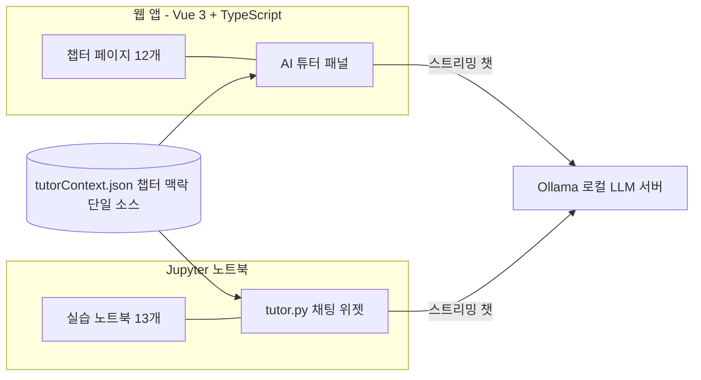

# 프로그램 명세 — 수포자를 위한 선형대수학 📐 (해커톤 제출용)

> **한 줄 소개**: 수학을 포기했던 성인이 화살표를 드래그하고, AI 튜터에게 물어가며,
> **선형대수를 통해 AI의 작동 원리를 이해**하게 만드는 인터랙티브 학습 프로그램.

| 항목 | 내용 |
|------|------|
| 제출자 | jiyupapa <!-- TODO: 팀명/트랙 등 주최측 요구 항목 --> |
| 저장소 | https://github.com/jiyupapa/part1-linear-algebra |
| 형태 | 웹 앱 (Vue 3) + Python 노트북 (Jupyter) + 로컬 LLM AI 튜터 (Ollama) |
| 상태 | **전 과정 완성** — 12챕터 + 워밍업, 총 학습 분량 약 8.5시간 |

<!-- TODO: 대표 스크린샷 1~2장 (웹 챕터 화면 + AI 튜터 패널) -->

---

## 1. 문제 정의

- 대부분의 성인에게 수학은 "중학교에서 멈춘 과목"이다. 그런데 AI 시대의 핵심 개념
  (임베딩, 유사도 검색, 신경망, 차원축소, 학습률…)은 전부 **선형대수 위에** 서 있다.
- 기존 교재·강의는 수포자에게 실패한다: 설명 없는 기호 하나에서 이탈하고,
  정적인 수식은 직관을 주지 못하며, 막혔을 때 물어볼 곳이 없다.
- 이 프로그램은 세 가지로 답한다:
  **① 직관 먼저** (드래그하면 실시간으로 반응하는 시각화) →
  **② 즉시 확인** (자동채점 문제 + 단계별 힌트·해설) →
  **③ 막히면 질문** (지금 보는 챕터를 아는 로컬 AI 튜터).

## 2. 핵심 기능 명세

| # | 기능 | 설명 | 상태 |
|---|------|------|------|
| F1 | 인터랙티브 12챕터 | 좌표·벡터 → 내적 → 행렬 → 연립방정식 → 선형변환 → 행렬식·역행렬 → 고유값 → PCA → 기저·rank → 직교·투영 → SVD → 그래디언트·경사하강. 벡터 드래그 캔버스·격자 변형 등 챕터별 인터랙티브 시각화 | ✅ |
| F2 | AI 연결 (전 챕터) | 각 챕터마다 그 개념이 AI에서 어떻게 쓰이는지 연결 — 내적→코사인 유사도·추천·어텐션, 행렬곱→신경망 층, 고유값·SVD→차원축소·추천, 그래디언트→딥러닝 학습 | ✅ |
| F3 | 자동채점 문제 시스템 | 챕터당 본문 미니체크 + 난이도별 10문제 세트(객관식·참거짓·숫자입력), 계산형은 중간 단계까지 채점(StepQuiz), 단계별 힌트·해설 | ✅ |
| F4 | 진도·복습 | 문제 세트 완료 시 진도 저장(localStorage), 헷갈린 문제 복습 목록 | ✅ |
| F5 | AI 튜터 (웹) | 우하단 🤖 플로팅 챗. **지금 보는 챕터의 맥락을 주입**받아 본문과 일치하는 답변, "그 내용은 N장에 있어요" 목차 내비게이션(답변 속 N장이 클릭 가능한 링크), 수학·학습 외 질문 차단 가드레일 | ✅ |
| F6 | AI 튜터 (노트북) | 웹과 **같은 튜터**가 Jupyter 안에도 — 플로팅 🤖 버튼, 추천 질문, 모델 선택. 챕터 맥락은 웹과 공용 단일 소스(JSON) | ✅ |
| F7 | 📖 코드 설명 | 노트북에서 **실행했던 코드 셀을 드롭다운에서 골라** 버튼 클릭 → 튜터가 목적·핵심 줄·챕터 개념 연결 순으로 설명. 함수형 `explain()` 도 제공 | ✅ |
| F8 | Python 실습 노트북 13개 | 웹 챕터와 1:1 대응 — 웹에서 잡은 직관을 NumPy 로 직접 계산하며 굳히기 | ✅ |

## 3. 차별점 — 완전 로컬 LLM AI 튜터 🤖

가장 큰 기술적 차별점은 **AI 튜터가 클라우드 API 없이 전부 로컬에서 돈다**는 것.

- **비용·키·인터넷 불필요**: Ollama(기본 모델 `gemma4:e2b`, 약 5B)로 구동 —
  **오프라인 현장 시연 가능**, 학습자 질문이 외부로 나가지 않음(프라이버시).
- **경량 모델을 프롬프트 엔지니어링으로 보정**: 챕터별 핵심 개념·용어·함정을 정리한
  맥락(`tutorContext.json`)을 시스템 프롬프트에 주입해, 작은 모델도 본문과 일치하는
  답을 하도록 설계. 함정 질문(예: "고유값이 음수면 왜 고유벡터인가요?") 실측 통과.
- **주제 가드레일**: "학습 무관 요청이면 정확히 [OFFTOPIC]만 출력" 센티널 방식 —
  스트리밍 첫 토큰을 보류하며 감지, 감지 시 생성 중단 후 안내 문구로 교체.
  실측 10/10 정확도, **추가 지연 0초** (별도 분류 호출 방식은 정확도 8/10 + 4초 지연이라 기각).
- **웹·노트북 동일 페르소나**: 존댓말, 새 용어 즉시 설명, 비유 먼저, 5문장 제한,
  격려 — 학습 환경이 바뀌어도 같은 튜터.

## 4. 시스템 아키텍처



- **챕터 = 콘텐츠 단위**: 메타데이터 단일 소스(`chapters.ts`)에서 목차·라우팅·진도 분모가 파생.
- **튜터 맥락 단일 소스**: 챕터별 맥락·전체 목차를 JSON 하나로 관리 — 웹(TS)과
  노트북(Python)이 같은 파일을 읽어 중복 없이 동기화.
- **노트북 코드 설명**: IPython 실행 이력에서 코드 셀을 수집 — 파일 저장 여부와 무관하게
  "학습자가 실행한 그대로"를 설명.

## 5. 데모 시나리오 (5분)

1. **웹 첫 화면** → 워밍업 챕터에서 벡터를 직접 드래그 — 성분·길이가 실시간 반응.
2. **ch2 벡터 연산** → 내적 시각화 → "AI 연결: 코사인 유사도로 영화 추천" 데모 →
   미니체크 문제 풀이(힌트·해설).
3. **AI 튜터 (웹)** → 🤖 열고 "내적이 크면 무조건 비슷한 건가요?" — 챕터 맥락 기반 답변.
   "적분은 어디서 배워요?" — "이 과정엔 없어요(2부 예정)" 정직 답변.
   "저녁 메뉴 추천해줘" — 가드레일이 차단하고 학습으로 유도.
4. **노트북 (ch2)** → 같은 내용을 NumPy 로 계산 → 🤖 버튼 → 코사인 유사도 셀을 골라
   **📖 코드 설명** — 코드를 한 줄씩 수포자 눈높이로 설명.
5. **진도 화면** → 문제 세트 완료 → 진도 반영. (인터넷을 끊고 3~4를 반복해 **오프라인 동작** 시연 가능)

## 6. 기술 스택 · 실행

| 영역 | 스택 |
|------|------|
| 웹 | Vue 3 · TypeScript · Vite · Vue Router · Pinia · KaTeX · Chart.js · Tailwind CSS v4 |
| 노트북 | Python · NumPy · Matplotlib · JupyterLab · ipywidgets |
| AI | Ollama (로컬 LLM, 기본 gemma4:e2b) — REST 스트리밍(NDJSON) 직접 호출, 프레임워크 의존성 없음 |

```bash
# 웹 (http://localhost:5173)
cd web && npm install && npm run dev
# 노트북
cd notebooks && pip install -r requirements.txt && jupyter lab
# AI 튜터 (선택)
ollama pull gemma4:e2b
```

## 7. 품질 검증

- **수포자 페르소나 검수**: "중학 수학까지만 기억하는 성인" 페르소나로 전 챕터 4트랙 검수
  → 발견 40여 건 수정 → 재검수 전 챕터 "학습 적합" 판정 (`docs/REVIEW_260703_수포자검수.md`).
- **자동 검증**: 웹은 `vue-tsc` 타입체크 + 빌드, 노트북 13개는 `nbconvert --execute` 무에러 실행.
- **AI 튜터 실측**: 스트리밍 E2E, 함정 질문, 가드레일 10문항, 목차 내비게이션 5문항, 코드 설명 —
  전부 실제 Ollama 로 검증 (과정은 `docs/99_history.md` 에 기록).

## 8. 한계와 로드맵

- **한계**: 로컬 경량 모델 특성상 답변이 가끔 부정확할 수 있음 → UI에 "본문 설명이 우선!" 상시 고지,
  챕터 맥락 주입으로 보정. 노트북 튜터는 Jupyter(브라우저) 환경 기준.
- **로드맵**: 본 저장소는 **"수포자를 위한 수학" 3부작의 1부**. 같은 철학·컴포넌트로
  **2부 미적분**(미분→경사하강의 뚜껑 열기), **3부 확률통계**(AI의 불확실성·추론)로 확장 예정.
  1부의 컴포넌트(문제 시스템·시각화 캔버스·튜터)는 재사용 전제로 설계됨.

---

> 상세 문서: 전체 계획 [`00_plan.md`](../../apps/part1/docs/00_plan.md) · 효과 측정 지표 [`12_metrics.md`](12_metrics.md) · 작업 이력 [`99_history.md`](../../apps/part1/docs/99_history.md) · 실행 가이드 [README](../../apps/part1/README.md)
