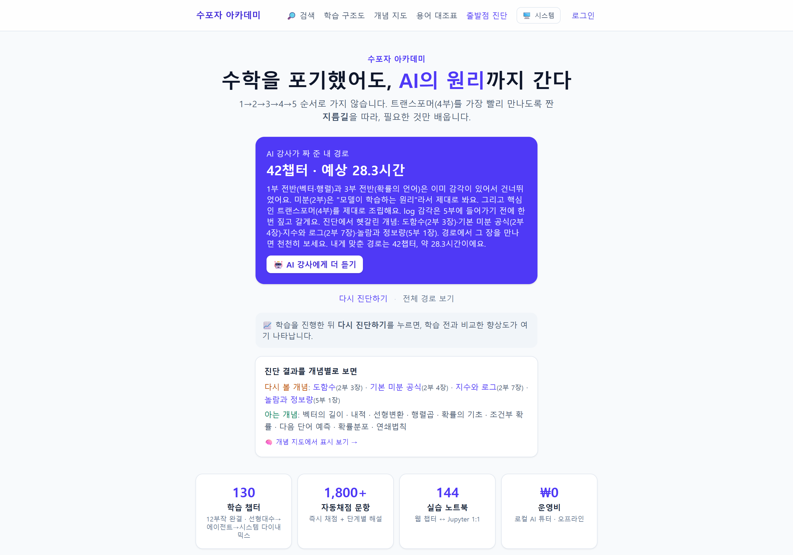
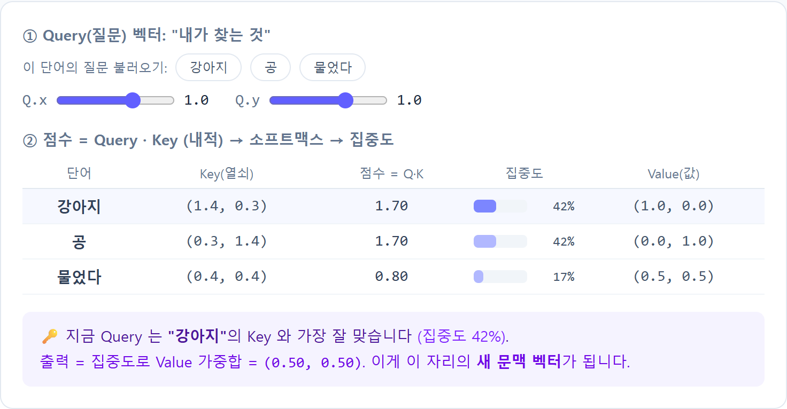
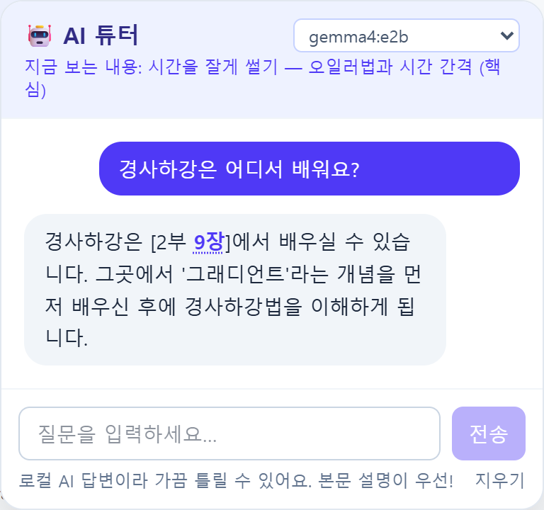
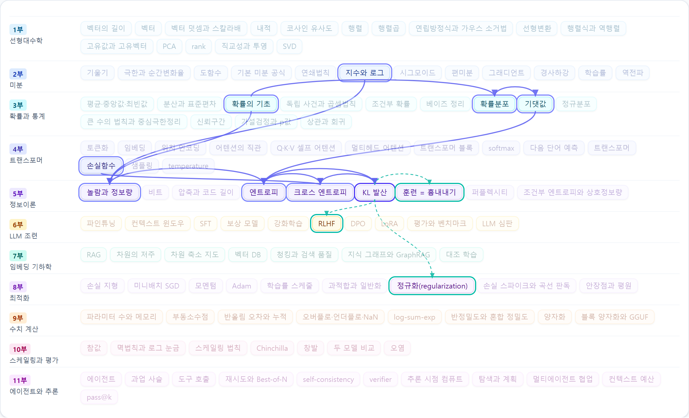
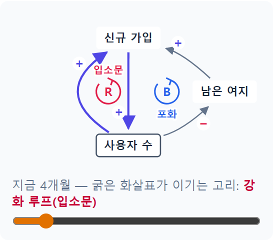
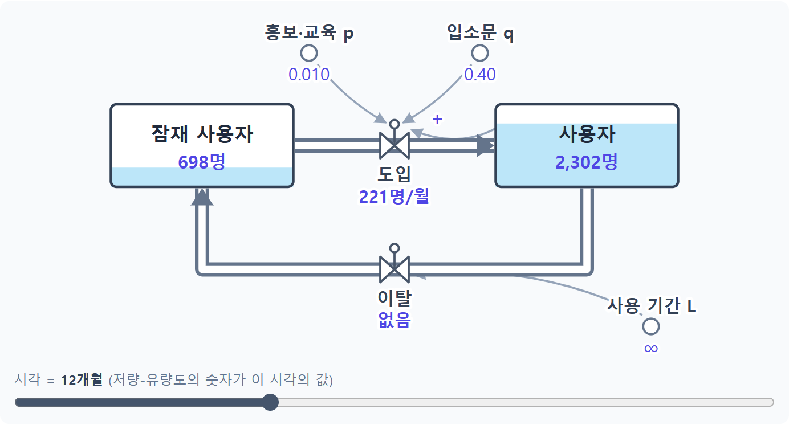
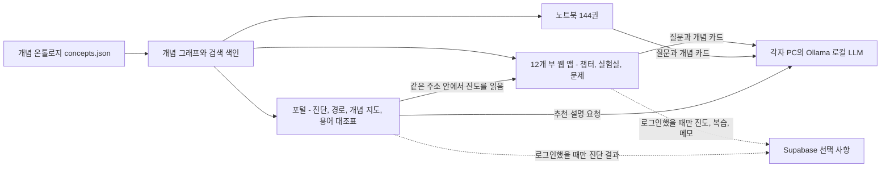

# 수포자 아카데미 프로젝트 설명

학교 수학을 포기했거나 오래되어 잊어버린 사람이 LLM(대규모 언어 모델, ChatGPT 같은 AI 의 바탕)의 동작 원리를 이해하도록 돕는 웹 학습 자료입니다.

| 항목 | 내용 |
|---|---|
| 제출자 | (이름·소속을 적어 주세요) |
| 형태 | 웹 앱 13개(통합 포털 + 12개 부), Python 노트북 144권, 각자 PC 에서 도는 AI 튜터 |
| 규모 | 12부, 130개 챕터(워밍업을 합치면 142개 장), 자동 채점 문제 1,800개 이상 |
| 진행 상태 | 12개 부 콘텐츠 완성(2026-10-13). 사내 서버 배포와 동료 시범 사용은 아직 하지 않았습니다 |
| 제작 | 2026-06-17 시작. 혼자 기획했고 Claude Code 와 함께 만들었습니다 |
| 기준일 | 2026-11-03. 이 문서의 숫자는 이날 저장소에서 다시 세거나 실행해 확인했고, 다른 시점의 값은 날짜를 함께 적었습니다 |

---

## 1. 요약

저도 수포자였습니다. 그런데 이제는 매일 LLM 을 사용합니다. 답이 어떻게 나오는지는 모른 채로요. 그래서 그 바탕에 있는 수학을 공부하려고 혼자 쓸 자료를 만들기 시작했고, 같이 보면 좋겠다는 생각에 하나씩 늘리다 보니 12부, 130개 챕터가 됐습니다.

제 목표는 AI 학습의 기반이 되는 수학을 공부하는 것입니다. 이름은 아카데미지만 전문적인 수학 강좌는 아니고, 수포자가 공부하면서 만든 자료입니다.

쓰는 순서는 세 단계입니다.

1. **진단:** 14개 문항으로 어디까지 기억하는지 확인합니다.
2. **학습 순서:** 진단 결과에 따라 이미 아는 단계를 접고, 왜 그렇게 정했는지 화면에 보여 줍니다.
3. **챕터 학습:** 직접 조작하는 실험실, 바로 채점되는 문제, 막힐 때 물어보는 AI 튜터로 공부합니다.

이 구성을 세 가지 기술이 받칩니다.

| 기둥 | 하는 일 | 확인한 것 |
|---|---|---|
| **LLM 튜터** | 각자 PC 에서 도는 모델이 지금 보는 챕터를 알고 답합니다. 학습 순서를 정하는 일에는 끼지 않습니다 | 다른 부 개념의 위치를 물은 7번 모두 맞는 위치로 안내, 주제 판정 30문항 중 29문항 정답 |
| **개념 온톨로지** | 개념 사이의 관계를 한 파일에 적어 둔 지도입니다. 검색, 튜터, 복습 안내가 모두 이 파일을 읽습니다 | 개념 127개, 관계 520개, 읽는 곳 9곳, 커밋할 때마다 자동 검사 |
| **시스템 다이내믹스** | 시간에 따른 변화를 모형으로 계산합니다. 12부에서 가르치고, 이 자료의 사내 확산 계획에도 썼습니다 | 직원 300명을 가정한 시나리오 7종(예측이 아닌 비교용) |

**아직 없는 것도 분명히 밝힙니다.** 실제 사용자가 써 본 기록이 없어서 학습 효과와 완주율은 측정하지 못했습니다. 다음 단계는 동료 5~10명과 함께 써 보는 것입니다.

---

## 2. 왜 만들었나

AI 를 잘 쓰는 것과 AI 를 아는 것은 다릅니다. 원리를 알면 답을 어디까지 믿을지, 어떤 자료는 넣으면 안 되는지 스스로 판단하기가 쉬워집니다.

문제는 원리로 가는 길에 수학이 있다는 것입니다. 선형대수, 미분, 확률을 차례로 듣다 보면 AI 까지 가기 전에 지치기 쉽습니다. 그래서 순서를 바꿨습니다. 선형대수와 확률은 앞부분만 먼저 배우고, 곧바로 LLM 의 바탕인 트랜스포머(문장 속 단어들의 관계를 계산하는 모델 구조)로 갑니다. 나머지 수학은 그다음에 배웁니다.

```text
1부 전반 → 3부 전반 → 4부 추론편 → 2부 전체 → 4부 학습편 → 5부 전체 → 6부 전체
(벡터·행렬)  (확률)     (LLM 이 글을 쓰는 법)  (미분)   (학습 원리)  (정보이론)  (사후 학습)
```

이렇게 할 수 있는 이유는 트랜스포머를 둘로 나눴기 때문입니다. 글을 쓰는 과정(추론)을 이해하는 데는 선형대수와 확률이면 되고, 학습 과정을 이해할 때 미분과 정보이론이 필요합니다.

---

## 3. 어떻게 쓰나

### 3.1 진단

벡터, 확률, 미분, 로그의 네 관문에서 3문항씩 12문항을 풀고, 자신감을 묻는 2문항에 답합니다. 시험이 아니라 시작 지점을 정하는 문항이며, 5분 안에 끝내는 것을 목표로 설계했습니다.

### 3.2 학습 순서 결정

결과는 정해진 규칙으로 계산합니다. 관문은 3문항 중 2문항 이상 맞히면 통과이고, 같은 답을 넣으면 언제나 같은 경로가 나옵니다. 아는 것 같아도 자신감이 낮으면(5점 만점에 평균 2.5 이하) 건너뛰지 않고 빠른 복습으로 돌립니다.

| 진단 결과 | 경로 | 분량 |
|---|---|---|
| 통과한 관문 없음 | 핵심 경로 7단계 전부 | 55챕터, 약 37시간 |
| 벡터·확률 통과, 자신감 낮음 | 앞 두 단계를 빠른 복습으로 | 55챕터, 약 32시간 |
| 벡터·확률 통과, 자신감 보통 이상 | 앞 두 단계를 건너뜀 | 42챕터, 약 28시간 |
| 네 관문 모두 통과, 자신감 보통 이상 | 앞 두 단계를 건너뛰고 미분은 빠른 복습으로 | 42챕터, 약 24시간 |

분량은 챕터마다 잡은 예상 시간의 합이고, 실제 학습자를 재서 나온 값이 아닙니다. 선택 트랙까지 모두 합치면 130챕터, 약 89시간입니다.

틀린 문항은 점수 대신 다시 볼 위치로 안내합니다("도함수, 2부 3장"). 학습이 진행되면 포털이 각 부의 진도와 복습 표시를 읽어 다음에 볼 곳을 권하고, 다시 진단하면 처음 결과와 비교해 보여 줍니다.



*진단 후 포털 첫 화면(벡터·확률 통과, 미분·로그 미통과, 자신감 보통인 경우).*

### 3.3 챕터 학습

모든 챕터를 같은 순서로 구성했습니다.

- **직관 먼저, 공식은 나중에:** 그림과 비유로 시작해 직접 조작해 본 뒤 수식을 봅니다.
- **새 용어와 기호는 바로 설명:** 기호는 이름, 읽는 법, 뜻을 함께 적습니다.
- **비유는 실무 용어와 함께:** 예를 들어 6부의 "조련"은 그 자리에서 사후 학습(post-training), 파인튜닝, 정렬(alignment)과 짝지어 설명합니다. 비유만 알면 밖에서 대화할 수 없기 때문입니다.
- **AI 와 연결:** 그 개념이 LLM 어디에 쓰이는지 카드로 보여 줍니다.
- **문제:** 본문 중간의 짧은 확인 문제와 챕터 끝의 10문제 세트를 바로 채점합니다. 계산 문제는 중간 단계까지 채점합니다.
- **노트북:** 웹 챕터와 같은 예제를 Python 으로 직접 돌려 봅니다. 프로그래밍을 몰라도 웹만으로 공부할 수 있습니다.

이 자료는 LLM 을 쓰기도 하지만, 가르치는 대상도 LLM 입니다. 4부에서는 문장이 토큰(모델이 처리하는 글자 조각)으로 잘리고, 어텐션(단어끼리 서로 얼마나 관련 있는지 계산하는 방법)을 거쳐, 확률로 다음 단어를 고르는 과정을 조작해 봅니다. 토큰화 실험실에는 직접 쓴 문장을 넣을 수 있고, 어텐션과 다음 단어 확률 실험실은 준비된 예시의 값을 슬라이더로 바꿔 봅니다.



*4부 6장 어텐션 실험실. 슬라이더를 움직이면 단어별 점수와 집중도가 바로 바뀝니다.*

---

## 4. 세 기둥

### 4.1 LLM: 각자 PC 에서 도는 튜터

Ollama(PC 에서 LLM 을 돌리는 공개 프로그램)와 경량 모델 `gemma4:e2b` 를 씁니다. LLM 은 네 곳에서 일합니다.

| 어디서 | 하는 일 |
|---|---|
| 챕터 튜터(12개 부 전체) | 지금 보는 챕터를 알고 질문에 답합니다 |
| 추천 설명(포털) | 규칙이 정한 경로를 풀어서 설명합니다. Ollama 가 없으면 규칙이 만든 문장을 그대로 보여 줍니다 |
| 메모에서 묻기 | 협업 메모의 질문을 튜터에게 보내고, 답은 사용자가 누를 때만 메모에 저장합니다 |
| 노트북 튜터 | Jupyter 안에서 웹과 같은 방식으로 답하고, 실행한 코드도 설명합니다 |

**원칙은 "결정은 규칙, 설명은 LLM"입니다.** 무엇을 배울지는 규칙이 정하고 LLM 은 설명만 맡습니다. LLM 이 가끔 틀려도 학습 순서가 흔들리지 않게 하려는 것입니다.

**다른 부의 내용까지 답하는 방법:** 질문에 나온 개념을 온톨로지에서 찾아 그 개념의 카드(배우는 곳, 먼저 알아야 할 것, 다시 쓰이는 곳, 약 100토큰)를 프롬프트(모델에 주는 지시문)에 함께 넣습니다.



*12부를 공부하던 중 2부의 개념을 물은 화면. 답 속의 "9장"을 누르면 바로 이동합니다.*

2026-11-03 조립본의 실제 튜터 창에서 잰 결과입니다.

| 측정 | 결과 |
|---|---|
| 다른 부 개념의 위치 | 12부 5장에서 "경사하강은 어디서 배워요?" 4번, 1부 2장에서 "KL 발산은 어디서 배워요?" 3번. **7번 모두 맞는 위치**(2부 9장, 5부 5장) |
| 먼저 볼 개념 안내 | 경사하강 4번 가운데 2번은 "그래디언트를 먼저"까지 말했고 2번은 위치만 말했습니다. 답 전체가 늘 같지는 않습니다 |
| 주제 판정 | 1부, 4부, 12부 튜터에 각각 학습 질문 5개와 무관한 요청 5개, **30문항 중 29문항 정답**. 4부에서 "오늘 점심 뭐 먹을까요?"를 막지 못했습니다 |
| 응답 시간 | 첫 질문 약 7초, 이후 위치 안내 0.3~1.6초, 개념 설명 약 2~3초(2026-07 첫 측정은 완답 5~6초). 막을 때는 약 0.2초 |

응답 시간은 개발 PC(Intel Core i9-14900HX, RTX 4070 노트북용 GPU, 메모리 32GB) 기준이며 **일반 업무용 PC 에서는 재 보지 않았습니다.**

한계도 있습니다. 경량 모델이라 틀린 답을 할 수 있어서 튜터 창에 "본문 설명이 우선"이라고 늘 표시합니다. 위치를 묻는 질문에는 잘 답하지만 풀이를 묻는 질문에는 답이 막연할 때가 있고, 측정 중 12부 튜터는 "루트가 뭐예요?"에 바로 설명하지 않고 되물었습니다.

### 4.2 개념 온톨로지: 개념 사이의 관계를 적은 지도

온톨로지는 개념과 관계를 정해진 형식으로 적어 둔 지도입니다. 무엇을 먼저 알아야 하는지, 나중에 어디서 다시 쓰이는지를 파일 하나(`scripts/ontology/concepts.json`)에 정리했습니다.

| 항목 | 수 |
|---|---|
| 개념 | 127개 |
| 관계 | 520개(먼저 알아야 하는 관계 203 + 다시 쓰이는 곳 317) |
| 이 과정의 비유와 실무 용어 짝 | 70개 |
| 이 파일을 읽는 곳 | 9곳: 검색, 웹 튜터, 노트북 튜터, 챕터 위 개념 띠, 개념 지도, 용어 대조표, 복습 경로, 진단, 질문 집계 |

흩어져 있던 검색 사전, 연결표, 포털 경로, 튜터 맥락 네 벌을 이 파일 하나로 합쳤습니다. 그래서 한 번 고치면 아홉 곳에 함께 반영됩니다.

공부하다 막히는 이유 중 하나는 지금 배우는 것이 어디에 쓰이는지 모른다는 것입니다. 아래 지도에서는 12부의 S자 성장을 고르면 2부의 시그모이드와 지수·로그까지 이어진 경로가 보입니다.



*포털의 개념 지도. 12부 "S자 성장"을 고른 화면입니다.*

**튜터에 준 효과:** 카드를 넣기 전에는 다른 부 개념을 물으면 "N부 2장"처럼 빈칸을 그대로 답했습니다(2026-09-06, `gemma3:4b`). 넣은 뒤에는 4.1절처럼 정확한 위치를 답합니다.

**벡터 DB 를 쓰지 않은 이유:** 벡터 DB 는 문장의 의미를 숫자로 바꿔 비슷한 내용을 찾는 저장소입니다. 140여 개 장 규모에서는 손으로 정리한 그래프로 충분하다고 판단했고, 이 방식은 같은 질문에 늘 같은 카드를 내며 인터넷 없이 돕니다. 두 방식을 비교 측정하지는 않았습니다. 이 기법 자체는 7부 8장에서 지식 그래프와 GraphRAG 로 가르칩니다.

**지키는 방법:** 검사기(`npm run check:ontology`)가 개념의 위치와 앵커가 실제로 있는지, 선수 관계가 순환하지 않는지, 본문의 부 간 링크 185개가 실제 장을 가리키는지 확인합니다. 커밋할 때와 저장소에 올릴 때 자동으로 돕니다.

### 4.3 시스템 다이내믹스: 시간에 따른 변화를 모형으로

시스템 다이내믹스는 쌓이는 양과 흐르는 양, 되돌아오는 고리로 시간에 따른 변화를 계산하는 방법입니다. 12부에서 13개 장(워밍업 포함), 실험실 13개, 노트북 13권으로 가르칩니다.

**첫째 그림, 인과지도**는 원인과 결과의 관계를 그립니다.

- 화살표는 원인에서 결과로 향합니다.
- `+` 는 원인이 늘면 결과도 원래보다 늘어난다는 뜻이고, `−` 는 원래보다 줄어든다는 뜻입니다.
- `R` 은 강화 루프로, 돌수록 스스로 커지는 고리입니다. `B` 는 균형 루프로, 한계 쪽으로 되돌리는 고리입니다.
- 굵은 화살표는 지금 이기고 있는 고리입니다.



그림을 따라 읽으면 이렇습니다. 사용자가 늘면 입소문으로 신규 가입이 늘고, 신규 가입이 늘면 사용자가 더 늘어납니다(R). 한편 사용자가 늘면 남은 여지가 줄고, 남은 여지가 줄면 신규 가입이 줄어듭니다(B). 처음에는 R 이 이기다가 나중에는 B 가 이겨서 S자 곡선이 됩니다.

**둘째 그림, 저량-유량도**는 같은 구조를 숫자로 계산할 수 있게 바꾼 것입니다.

- 네모 상자는 저량(쌓이는 양)입니다. 잠재 사용자와 사용자가 여기에 해당합니다.
- 굵은 관과 밸브는 유량(흐르는 양)입니다. 도입과 이탈이 여기에 해당합니다.
- 작은 동그라미는 직접 정하는 값입니다. 홍보·교육 강도 p, 입소문 세기 q, 평균 사용 기간 L 입니다.
- 가는 화살표는 밸브가 어떤 값을 보고 열리는지를 나타냅니다.



*12부 12장 실험실. 이탈이 없는 기본 설정의 12개월 시점 화면입니다.*

**AI 와 같은 수학이 나옵니다.** 모형을 한 칸씩 계산하는 오일러법(다음 값 = 지금 값 + 변화율 × 시간 간격)은 AI 가 학습하는 경사하강(다음 가중치 = 지금 가중치 − 학습률 × 기울기)과 식의 꼴이 같습니다. S자 성장 곡선은 2부의 시그모이드와 같은 함수입니다.

**이 자료의 사내 확산도 같은 모형으로 돌려 봤습니다.** Bass 확산 모형(새로운 것이 퍼지는 과정을 설명하는 대표적인 모형)에 이탈을 더했고, 직원 300명에 평균 10개월 쓰면 그만둔다고 가정했습니다.

| 시나리오 | 절반 도달 | 3년 뒤 쓰는 사람 |
|---|---|---|
| 기준(p 0.01, q 0.4, 평균 10개월 사용) | 12.2개월 | 75.8% |
| 홍보 3배(p 0.03) | 8.2개월 | 77.2% |
| 입소문 1.5배(q 0.6) | 8.1개월 | 83.7% |
| 사용 기간 2배(평균 20개월) | 10.4개월 | 87.8% |

이탈이 없다고 가정하면 3년 뒤 모두 100%이고, 절반 도달은 기본 9.1개월, 홍보 3배 6.4개월, 입소문 1.5배 6.8개월입니다.

읽는 법은 이렇습니다. 이탈이 있으면 홍보를 세 배로 늘려도 남는 사람은 거의 그대로입니다. 남는 사람 수는 입소문과 사용 기간이 크게 좌우합니다. 그래서 크게 알리기보다 몇 명이 먼저 써 보고 주변에 권하는 쪽이 맞다고 봅니다. 진도 이어 보기, 복습 표시, 함께 쓰는 메모도 오래 쓰게 하려는 기능입니다.

**이 숫자는 예측이 아닙니다.** p, q, L 은 제가 가정한 값이고, 어떤 값이 무엇을 바꾸는지 비교하는 용도입니다. 시범 사용에서 실제 값을 재면 다시 돌려 보겠습니다. 12부 12장 실험실과 노트북에서 같은 계산을 누구나 다시 돌려 볼 수 있습니다.

---

## 5. 커리큘럼

| 부 | 주제 | 챕터 | 배우는 것 | 구분 |
|---|---|---:|---|---|
| 1 | 선형대수학 | 12 | 단어를 벡터로, 변환을 행렬곱으로 보기 | 전반 핵심, 후반 선택 |
| 2 | 미분 | 10 | 모델이 학습하는 원리, 경사하강과 역전파 | 핵심 |
| 3 | 확률과 통계 | 10 | 다음 단어를 확률로 고르는 것을 읽는 힘 | 전반 핵심, 후반 선택 |
| 4 | 트랜스포머 | 12 | LLM 의 구조를 직접 조립 | 핵심 |
| 5 | 정보이론 | 10 | 손실함수, 퍼플렉시티, temperature | 핵심 |
| 6 | LLM 조련(사후 학습·파인튜닝·정렬) | 10 | GPT 가 ChatGPT 가 되기까지: SFT, RLHF, DPO | 핵심 |
| 7 | 임베딩 기하학 | 10 | 회사 문서를 찾아 답하는 챗봇(RAG), 의미 검색, 벡터 DB 의 수학 | 선택 |
| 8 | 최적화 | 11 | 학습률, Adam, 스케줄, 정규화 | 선택 |
| 9 | 수치 계산 | 11 | 부동소수점, 양자화, GGUF, 내 PC 에 맞는 모델 고르기 | 선택 |
| 10 | 스케일링 법칙과 평가의 통계 | 10 | 모델을 키우면 얼마나 좋아지나, 점수 차이는 진짜인가 | 선택 |
| 11 | 에이전트와 추론의 수학 | 12 | AI 에게 일을 어디까지 맡겨도 되나: 성공률, 재시도, 검수 | 선택 |
| 12 | 시스템 다이내믹스 | 12 | 들이고 나면 시간이 지나며 무슨 일이 벌어지나 | 선택 |

챕터 수는 워밍업을 뺀 값이고, 부마다 워밍업이 하나씩 더 있습니다. 노트북은 142개 장에 1권씩이고, 1부에 추가 노트북 2권이 더 있어 모두 144권입니다.

---

## 6. 자동화 전후 비교: 시간, 오류, 비용

"이 자료 없이" 칸은 일반적인 상황을 적은 것으로, 직접 비교 측정한 값이 아닙니다. 튜터의 오류 비교 칸만 실제로 잰 값입니다.

| 구분 | 항목 | 이 자료 없이 | 이 자료에서 | 근거 |
|---|---|---|---|---|
| 시간 | 막혔을 때 답 얻기 | 물어볼 사람을 찾아 기다림 | 첫 질문 약 7초, 이후 약 0.3~3초 | 실측, 개발 PC |
| 시간 | 채점과 해설 | 해답지와 대조 | 제출 즉시 | 기능 동작 |
| 시간 | 학습 순서 정하기 | 혼자 찾아서 정함 | 14문항 진단 후 바로 | 5분은 설계 목표 |
| 시간 | 실습 코드 이해 | 한 줄씩 검색 | 실행한 코드를 튜터가 설명 | 기능 동작 |
| 오류 | 주제를 벗어난 질문 판정 | 별도 분류 호출 방식 8/10, 질문당 약 4초 추가(2026-07) | 프롬프트 신호 방식 29/30, 별도 호출 없음 | 실측 |
| 오류 | 다른 부 개념의 위치 안내 | 카드 없이 "N부 2장" 빈칸(2026-09) | 7번 모두 맞는 위치 | 실측 |
| 오류 | 끊어진 링크, 화면 오류, 글자 대비 | 사람이 눈으로 확인 | 자동 검사(8절) | 실행 결과 |
| 비용 | AI 사용료 | 클라우드 API 사용량만큼 과금 | 0원 | 구조상 |
| 비용 | 서버 | API·백엔드 서버 운영 | 백엔드 없이 웹 페이지 올려 둘 곳만 필요 | 구조상 |
| 비용 | 설치 | 설치 없이 브라우저로 사용 | 웹 학습은 브라우저만으로 가능. 튜터를 쓰는 PC 에는 Ollama 와 7.2GB 모델 필요 | 실제 크기 |

제작에는 Claude Code 를 사용했으며, 그 비용은 위 운영 비용에 넣지 않았습니다.

**측정하지 못한 것:** 학습 효과, 완주율, 실제 학습 시간, 실제 시간 절약은 사용자가 있어야 잴 수 있어 아직 없습니다. 재진단으로 학습 전후를 비교하는 기능은 구현돼 있으니 시범 사용에서 재 보겠습니다.

---

## 7. 구조와 데이터



공용 화면 부품과 튜터 연결을 패키지 한 곳에 모아 두어 한 번 고치면 모든 부에 반영됩니다(npm workspaces 모노레포).

| 영역 | 사용 기술 |
|---|---|
| 화면 | Vue 3.5, Vite 6, TypeScript, Tailwind CSS 4, Chart.js, KaTeX |
| 실습 | Python 3.13, Jupyter, NumPy, Matplotlib |
| 제품 속 AI | Ollama, `gemma4:e2b` |
| 선택 백엔드 | Supabase(PostgreSQL, 로그인, 행 단위 보안) |
| 검증 | Playwright, GitHub Actions, 커밋 훅 |

**어떤 데이터가 어디로 가는가**

| 데이터 | 가는 곳 |
|---|---|
| 튜터 질문과 답 | 각자 PC 의 Ollama(`localhost:11434`)로만 갑니다. 서버에 저장하지 않습니다. 사내 서버 한 대에 Ollama 를 두도록 설정(`VITE_OLLAMA_URL`)하면 그 서버로 갑니다 |
| 진도, 복습 표시, 진단 결과 | 기본은 브라우저 안에 저장합니다. 로그인하면 다른 기기와 이어 보도록 Supabase 에 동기화합니다 |
| 협업 메모 | 로그인했을 때 Supabase 에 저장합니다. 작성자 이름은 저장하지 않고, 본인 수정·삭제 확인에 쓰는 계정 ID 만 남습니다 |

로그인은 선택이며 사내 이메일 도메인 계정만 가입할 수 있습니다. 제품은 실행 중에 Claude 를 호출하지 않습니다. Supabase 는 외부 서비스로 쓸 수도 있고 사내 서버에 직접 설치할 수도 있습니다.

---

## 8. 품질 확인

### 자동 검사

| 검사 | 범위 | 언제 도나 | 최근 결과 |
|---|---|---|---|
| 타입 검사와 빌드 | 13개 앱 | 저장소에 올릴 때마다(CI) | 통과(2026-11-01, 최신 커밋) |
| 글자 대비 | 라이트·다크 양쪽 4.5:1 기준, 화면 파일 393개 | 커밋 훅, CI | 미달 없음(2026-11-03) |
| 개념 온톨로지 | 개념 127개의 위치, 선수 순환, 본문 링크 185개 | 커밋 훅, CI | 통과(2026-11-03) |
| 전체 화면 점검 | 142개 장, 홈 13, 포털 4, 온톨로지 화면 4, 메모와 튜터 연결 12 | 직접 실행 | **175건 통과**(2026-11-03) |
| 포털 진도 통합 | 각 부의 진도를 포털이 읽는 동작 | 직접 실행 | **17건 통과**(2026-11-03) |
| 개인화 | 복습 경로, 진단 개념 표시 | 직접 실행 | **8건 통과**(2026-11-03) |
| 노트북 실행 | 전체 노트북 | 직접 실행 | **144권 중 143권 통과**(2026-11-03). 나머지 1권은 무거운 패키지가 따로 필요한 1부 독립 데모로, 공용 환경에 일부러 넣지 않았습니다 |
| 협업 메모 | 실제 백엔드로 권한과 동작 확인 | 직접 실행 | 65건 통과(2026-10-13). 관리자 시나리오는 사람이 확인 |

### 내용 검수

- **1부 전체:** "중학교 수학까지만 어렴풋이 기억하는 성인" 관점으로 읽어 막힐 만한 곳 40여 군데를 고쳤습니다(2026-07-03~04).
- **1~11부 전 챕터:** AI 에이전트가 같은 관점으로 부마다 정독했습니다. 학습을 막는 결함은 없었고, 보통 11건과 경미 43건을 처리했습니다(2026-07-20).
- **용어와 문장:** 기계 번역처럼 읽히는 표현과 비표준 용어를 점검해 고쳤습니다(2026-09-28, 12부는 10-13).

이 검수들은 실제 학습자가 읽은 결과가 아니고, 수학 전문가의 감수도 받지 않았습니다. AI 와 함께 쓴 내용이므로 틀린 곳이 있을 수 있습니다.

---

## 9. AI 를 쓴 곳

**제품 안:** 4.1절의 로컬 LLM 입니다. 공개된 도구만으로 돌아가므로 회사 안에서도 같은 구성으로 쓸 수 있습니다.

**만드는 과정:** Claude Code 와 함께 콘텐츠, 코드, 검수, 발표 자료를 만들었습니다. git 커밋 181개 중 180개가 공동 작성입니다(2026-11-03, 모노레포 전환 이후). 방향과 판단은 제가 했고 작성은 AI 와 함께 했습니다.

**구조를 만들어 두니 속도가 달라졌습니다.** 첫 부인 1부는 22일 걸렸지만, 공용 패키지와 작성 규칙이 자리 잡은 뒤에는 7, 8, 9, 11부가 각각 1일 안팎에 나왔습니다. 대신 빠르게 만든 만큼 8절의 자동 검사와 내용 검수를 함께 세웠습니다.

---

## 10. 한계

1. **실사용 검증이 없습니다.** 학습 효과, 완주율, 실제 소요 시간을 재지 못했습니다.
2. **사내 서버에 올리지 않았습니다.** 지금은 PC 에서 실행하는 상태이며, 주소를 열면 바로 쓰려면 올려 둘 곳이 정해져야 합니다.
3. **튜터 설치와 성능을 사내 PC 에서 확인하지 않았습니다.** Ollama 설치가 비개발자에게 장벽이 될 수 있고, 일반 PC 의 응답 속도도 모릅니다. 사내 서버 한 대에 모델을 올리는 설정도 있지만, 실제 사내 환경에서 운영해 보지는 않았습니다.
4. **튜터는 틀릴 수 있습니다.** 주제 판정도 완벽하지 않습니다(29/30).
5. **내용을 전문가가 감수하지 않았습니다.** 8절의 검수는 AI 와 자동 검사 중심입니다.
6. **도입 시나리오는 가정입니다.** 실제 값으로 바꾸기 전에는 방향을 비교하는 용도로만 봐야 합니다.

---

## 11. 다음 단계

1. **작게 시작:** 동료 5~10명이 같이 써 보면서 어디까지 따라오고 어디서 막히는지 봅니다.
2. **다시 계산:** 그 결과로 입소문과 사용 기간 값을 바꿔 모형을 다시 돌립니다.
3. **논의:** 괜찮으면 회사 서버에 올리고 신입 교육이나 사내 교육에 넣을지 논의합니다. 로그인, 기기 간 진도 동기화, 협업 메모, 도입 현황 화면은 이미 구현돼 있습니다.

---

## 12. 실행 방법

필요한 것은 Node.js 이고(개발은 v24), AI 튜터를 쓰려면 Ollama 를 설치합니다. 튜터가 없어도 학습은 할 수 있습니다.

```bash
npm install
npm run deploy:build         # 포털과 12개 부를 한 주소로 조립
npm run deploy:serve         # http://localhost:4173 에서 실행
ollama pull gemma4:e2b       # AI 튜터를 쓸 때만, 7.2GB
```

노트북 환경 설정과 자세한 절차는 저장소의 `docs/실행_가이드.html` 에 있습니다.

---

## 13. 함께 보는 자료

| 자료 | 파일 |
|---|---|
| 발표 자료(16장 + 영상 장, 발표자 노트 포함) | `(최종)수포자아카데미_발표자료.pptx` (저장소 원본 `docs/hackathon/11_pitch_deck.pptx`) |
| 시연 영상(3분 43초, AI 음성 내레이션) | `(최종)수포자아카데미_동영상.mp4` (저장소 원본 `docs/hackathon/demo_3min_hyperframes.mp4`) |
| 소스 코드 | GitHub 비공개 저장소 |
| 커리큘럼 전체 | 저장소 `README.md` |
| 제작 과정과 설계 결정 | 저장소 `docs/PROCESS.md` (2026-07-27 기준) |
| 검증 방법 | 저장소 `docs/TESTING.md` |
