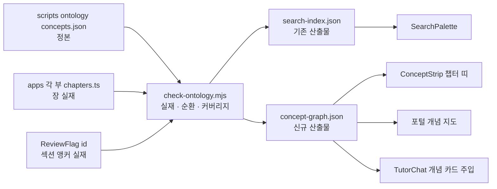

# TODO — 개념 온톨로지(concept ontology) 설계 노트

작성: 2026-09-06 · 상태: **✅ 1~4단계 전부 구현 완료 (2026-09-06) — §11·§12·§13·§14. 남은 것은 유지 작업뿐**

> 시리즈의 개념(수학·AI 용어)을 **노드**로, "먼저 알아야 한다 / 다시 쓰인다 / 이 과정에서는 이렇게 부른다"를
> **타입 있는 간선**으로 가진 **개념 그래프 하나**를 정본으로 두고, 검색·튜터·챕터 연결·포털 지도·개인화가
> 전부 그것을 소비하게 한다. 서버·추론기 없음 — 빌드 타임 JSON, 결정적 규칙. 기존 에토스 그대로.
>
> 결론 한 줄: **이 저장소에는 온톨로지의 반쪽이 이미 4벌 흩어져 있다.** "도입"은 새 기술을 붙이는 일이 아니라
> 그 넷을 하나로 합치고 소비처로 컴파일하는 일이다.
>
> 관련: `docs/todo_통합검색_260713_pm11.md`(개념 사전의 출발점 — 이 노트가 그 §4 2단계의 후속),
> `docs/todo_협업주석_260716.md` §6(앵커 규칙 — 노드를 붙일 자리), `docs/점검_비유앵커링_260718.md`(비유어↔실무어 원천).

---

## 0. 여기서 말하는 "온톨로지"

| 뜻 | 채택 여부 | 이유 |
|---|---|---|
| **개념 어휘 + 개념 사이 관계의 타입 + 각 개념이 콘텐츠 어디에 붙는지**를 기계가 읽는 형식으로 적은 것 | ✅ 이것 | 시리즈 규모(개념 100~150)에 딱 맞고, 소비처가 전부 이미 있다 |
| SKOS 수준의 어휘 체계 — prefLabel / altLabel / related | ✅ 이 정도 | 검색·튜터·UI 문장이 필요로 하는 건 이 수준 |
| OWL 추론·트리플스토어·SPARQL·서버 | ❌ | 정적 배포·비용 0·결정적 원칙에 어긋남. 규모도 안 맞음 |
| 팔란티어식 "객체·링크·액션" 운영 온톨로지 | ❌ | 우리 객체는 콘텐츠지 업무 데이터가 아니다 |

형식은 **JSON 한 파일**. RDF/JSON-LD 는 필요해지면 그때 내보내기(export)로 붙인다 — 정본을 그 형식으로 두지 않는다.

---

## 1. 왜 이 시리즈에 특히 맞나

1. **시리즈 논지가 곧 그래프다.** README 「부 간 주요 연결 지점」의 요지는 "같은 수학이 여러 부에 재등장한다"
   (KL 발산 = 5부 5장·6부 6~7장·8부 8장, 조건부 확률·베이즈 = 3부 4장·6부 4장·11부 6장). 그 재등장 구조를
   그린 그림이 개념 그래프이고, 통합검색 노트 §1 이 "부가기능이 아니라 시리즈 논리의 완성"이라 한 이유와 같다.
2. **반쪽이 이미 4벌 있다(§2).** 새로 만드는 게 아니라 합치는 일이라 1단계는 콘텐츠를 한 줄도 안 건드린다.
3. **두 목적에 직결.** ① 도입 — 튜터가 부를 가로질러 답하고, 검색·지도가 "다음에 볼 것"을 안다.
   ② 본인 학습 — **시리즈 온톨로지를 직접 짜는 것이 총복습 그 자체**다. 각 부 캡스톤의 용어 치환표가 이미 그 초안.

---

## 2. 이미 있는 반쪽 4벌 — 그리고 서로 어긋나는 지점

| # | 자산 | 위치 | 규모 | 있는 것 | 없는 것 |
|---|---|---|---|---|---|
| ① | 검색 개념 사전 | `scripts/search-concepts.json` | 개념 65 · 위치 97 | 별칭(비유어 일부 포함)·한 줄 설명·위치(부·장) | **개념 사이 관계**, 정의처/회수처 구분, 섹션 단위 위치 |
| ② | 부 간 연결표 | README 「부 간 주요 연결 지점」 | 35행 | 출발 → 도착 → 연결 내용 = 사실상 `usedIn` 간선 | **산문**이라 기계가 못 읽음. 본문 `PartLink` **78개 파일**과 수기 중복, 각 부 챕터 표의 "회수하는 수학" 열과도 삼중 |
| ③ | 포털 경로·구조·진단 | `apps/portal/web/src/data/{curriculum,structure,diagnostic}.ts` | 13단계 · 관문 4 · 문항 12 | 단계 그래프(실선/점선)·관문 통과 규칙 | **개념 단위가 아님** — "부 절반" 단위 |
| ④ | 튜터 맥락 | `apps/partN/web/src/data/tutorContext.json` ×11 | 11벌 | 챕터별 맥락 + 자기 부 목차 | 다른 부 언급이 **부마다 손으로 쓴 산문이라 제각각**(아래) |
| ⑤ | 비유어 원천 | 캡스톤 치환표(6부 10장·7부 10장·9부 11장) + 각 부 `CLAUDE.md` 비유어 절 + 점검 노트 | 3표 + 11문서 | 비유어 ↔ 실무어 짝 | ①의 `aliases` 에 일부만 흘러 들어감 — 부 정보 없음 |

**④의 증상(구체).** 전 11부 `TutorChat.vue` 시스템 프롬프트 규칙 8: *"목차에 없는 주제는 이 과정에 없다고 솔직히
말하기."* 목차는 자기 부뿐이고, 다른 부 안내는 각 JSON 끝에 산문으로 붙어 있다 — 1부는 "미적분·확률통계는 이 과정에
없음(시리즈 2부·3부 **예정**)"(낡음), 6부는 1~5부를 전부 열거, 11부는 3부·10부만. 정본이 없으니 부마다 다르고
낡는다. 1부 튜터에게 "연쇄법칙이 뭐예요"를 물으면 "이 과정에 없다"가 규칙상 정답이다.

**붙일 자리(이미 완비).** `ReviewFlag` 섹션 앵커 `chN-sM` **548개** + `anchorId` 2개 = **550개**(2026-09-06 실측,
`<ReviewFlag id=…>` 유일 id 합). 앵커 규칙 "배포 후 변경 금지"(협업주석 §6)가 이미 불변식이라, 개념의 위치 참조로
쓰기에 안정적이다. 즉 **노드(개념)만 없고 노드를 꽂을 못은 다 박혀 있다.**

---

## 3. 데이터 모델

### 3-1. 노드 — `concept`

| 필드 | 타입 | 필수 | 뜻 |
|---|---|---|---|
| `id` | ASCII kebab-case | ✅ | 영구 식별자. **배포 후 변경·삭제 금지**(앵커와 같은 불변식). 영문 실무어에서 딴다: `kl-divergence`, `chain-rule` |
| `label` | string | ✅ | 한국어 표시명(실무·수학 표준어). 예: `KL 발산` |
| `aliases` | string[] | ✅ | 동의어·영문·표기 변형. **비유어는 여기 두지 않는다** → `metaphors` |
| `kind` | `math` \| `ai` \| `tool` \| `metric` | ✅ | 수학 개념 / AI·ML 개념 / 도구·포맷(GGUF·Ollama 태그) / 지표(퍼플렉시티·pass@k) |
| `definedAt` | `{part, slug, anchor?}` | ✅ 정확히 1 | 처음 제대로 배우는 곳. `anchor` 는 그 장의 `ReviewFlag` id |
| `usedAt` | `{part, slug, anchor?, how}[]` | — | 다시 쓰이는 곳 + 어떻게(한 구절). README 연결표의 "연결 내용"이 `how` 로 들어간다 |
| `prereq` | id[] | — | 이 개념을 이해하려면 먼저 알아야 하는 개념 |
| `related` | id[] | — | 약한 연관("함께 보기") |
| `metaphors` | `{term, part, note?}[]` | — | 이 시리즈가 쓰는 비유어와 **어느 부에서**. 예: `{term:'목줄', part:6}` |
| `note` | string | ✅ | 한 줄 정의(검색 결과·튜터 카드에 그대로 씀). 기존 사전의 `note` 승계 |

### 3-2. 관계 — 5종만

| 관계 | 표현 | 뜻 | 원천 | 소비처 |
|---|---|---|---|---|
| **prereq** | `A.prereq = [B]` | B를 알아야 A | README 연결표 + 각 부 "선수 지식" 줄 + 큐레이션 | 챕터 띠 "먼저 알아 두면", 복습 경로, 튜터 카드 |
| **usedIn** | `A.usedAt = [위치]` | A가 그 장에서 다시 쓰인다 | README 연결표 35행(부록 A) + 각 부 "회수하는 수학" 열 | 챕터 띠 "다시 만나는 곳", 검색, 포털 지도, 튜터 카드 |
| **alias** | `A.aliases` | 같은 것의 다른 이름 | 기존 사전 | 검색, 튜터 매칭 |
| **metaphorFor** | `A.metaphors` | 이 부에서 A를 이렇게 부른다 | 치환표·CLAUDE.md·점검 노트(부록 B) | 검색, "밖에서는 이렇게 부름" UI 문장, 튜터 카드, 포털 비유어 사전 |
| **related** | `A.related` | 약한 연관 | 큐레이션 | 검색 "함께 보기" |

부 → 장 → 섹션 위계(broader/narrower)는 **별도 관계로 두지 않는다** — 위치 필드(`part`·`slug`·`anchor`)가 이미 표현한다.

### 3-3. 예시

```json
{
  "id": "kl-divergence",
  "label": "KL 발산",
  "aliases": ["KL divergence", "쿨백 라이블러", "KL", "relative entropy", "상대 엔트로피"],
  "kind": "math",
  "note": "두 분포가 얼마나 다른가 — 원본에서 멀어지지 않게 묶는 목줄",
  "definedAt": { "part": 5, "slug": "ch5", "anchor": "ch5-s2" },
  "usedAt": [
    { "part": 6, "slug": "ch6", "anchor": "ch6-s2", "how": "RLHF 의 KL 페널티 — 원본에서 멀어지지 않게" },
    { "part": 6, "slug": "ch7", "how": "DPO 수식 안의 같은 항" },
    { "part": 8, "slug": "ch8", "how": "정규화와 같은 목줄 — 원본 vs 원점" }
  ],
  "prereq": ["cross-entropy", "probability-distribution", "exp-log"],
  "related": ["perplexity"],
  "metaphors": [{ "term": "목줄", "part": 6, "note": "KL 페널티" }]
}
```

### 3-4. 위치 참조 규칙 — 정본은 각각 이미 있다

- `part` ∈ 1..11, `slug` 는 그 부 `chapters.ts` 에 실재(`comingSoon` 제외) — `build-search-index.mjs` 가 지금도 이 검증을 한다.
- `anchor` 는 그 장 `.vue` 의 `<ReviewFlag id>` 또는 `anchorId` 에 실재. 없으면 장 단위로만 연결(허용).
- 1단계 커버리지 목표: **`definedAt` 은 anchor 권장, `usedAt` 은 선택**(§9 D).

### 3-5. 불변식(PROCESS §9 표에 추가할 후보)

| 대상 | 규칙 | 어기면 |
|---|---|---|
| 개념 `id` | 배포 후 변경·삭제 금지 | 개념을 참조하는 북마크 경로·주석 집계·딥링크가 고아가 된다 |
| `prereq` | 순환 없음(DAG) | 복습 경로·"먼저 볼 것"이 무한 루프 |
| `definedAt` | 개념당 정확히 1곳 | 챕터 띠·튜터가 "처음 배우는 곳"을 두 곳 말한다 |
| `metaphors[].part` | 필수 | 같은 비유어가 다른 부에서 다른 뜻일 수 있다(예: "목줄" 6부 vs 8부) |
| 회색 지대 비유어 | 그래프에 넣지 않는다 | 점검 노트 ②의 "억지 앵커 금지"와 충돌 |

---

## 4. 배치 — 정본·산출물·소비 방식

```
정본   scripts/ontology/concepts.json          ← search-concepts.json 을 승격·이전(복제 아님, 옛 파일 삭제)
검사   scripts/check-ontology.mjs              ← §6 규칙 9개. pre-commit + deploy:build 앞단
산출   apps/*/web/public/search-index.json     ← 기존 산출물. 개념 엔트리의 원천만 새 파일로 바뀜(형식 유지)
       apps/*/web/public/concept-graph.json    ← 신규(1단계부터 — 튜터가 읽는다). 그래프 전체 + 장 제목 조회표
소비   fetch 로 읽는다(SearchPalette 와 같은 패턴). 앱이 TS 로 import 하지 않는다 → 12앱 vite/tailwind 설정 변경 0
```

- **왜 `scripts/` 인가**: 1단계 소비자가 스크립트뿐이고, 런타임은 컴파일된 JSON 을 fetch 한다. 워크스페이스 패키지로
  올리면 12앱 `optimizeDeps.exclude`(불변식)를 전부 건드려야 하는데 얻는 게 없다. 앱이 TS 타입으로 그래프를
  import 해야 하는 날이 오면 그때 `packages/ontology` 로 승격(§9 A).
- **왜 각 앱 `public/` 에 심나**: 검색 인덱스와 같은 이유 — dev 단독·per-app 빌드·조립 배포본 어디서든 `BASE_URL` 기준으로
  같은 경로. `.gitignore` 의 `search-index.json` 항목 옆에 `concept-graph.json` 추가.
- **주입 키**: `injection.ts` 에 `conceptGraphKey`(URL) 추가, 기본값 `<base>concept-graph.json` — `searchIndexKey` 와 동일 계약.

---

## 5. 소비처 9곳

| # | 소비처 | 무엇이 바뀌나 | 코드 자리 | 콘텐츠 수정 | 단계 |
|---|---|---|---|---|---|
| 1 | **튜터 접지** | 질문에서 개념을 찾아 "개념 카드"(정의·별칭·정의처·회수처·선수·비유어)를 시스템 프롬프트에 덧붙임. 규칙 8을 "시리즈 카드에서 찾아 N부 M장 안내"로 | `packages/tutor` 헬퍼 + 11부 `TutorChat.vue` 각 3줄 | 0 | **1** |
| 2 | **검사기** `check:ontology` | 실재·순환·중복·커버리지 + PartLink·README 표 대조(§6) | `scripts/check-ontology.mjs` + `githooks/pre-commit` | 0 | **1** |
| 3 | 검색 팔레트 | 개념 결과 아래 "먼저 볼 것 / 다시 만나는 곳 / 밖에서는 …" 한 줄. 비유어가 `metaphorFor` 타입이라 "이 과정에서는 조련, 문서에서는 post-training" 문장 생성 가능 | `SearchPalette.vue` + 인덱스 개념 엔트리에 필드 3개 | 0 | 2 |
| 4 | **챕터 띠 `ConceptStrip`** | 장 상단에 "처음 배우는 개념 / 먼저 알아 두면(어느 부 몇 장) / 다시 만나는 곳" 자동. 수기 `PartLink` 드리프트 소멸 | `packages/ui` 신규 + 11부 `App.vue` `RouterView` 위 1줄(챕터 라우트에서만 렌더) | 0 | 2 |
| 5 | 포털 개념 지도 `/concepts` | 개념 노드(부 고유색) + prereq 실선 + usedIn 점선. 진도 오버레이: 정의처 장 완료 = 아는 개념, 선수 전부 앎 + 미완 = 다음 개념 | `apps/portal` 뷰 신규 — `StructureView` 의 SVG 방식 재사용, 결정적 배치(부 순서 열 × 위상 순서 행) | 0 | 2 |
| 6 | 복습 경로 | 북마크 `{id:'ch6-s2'}` → 그 앵커/장의 개념 → prereq 닫힘 → 위상 정렬 = "복습 경로: 확률분포(3부 5장) → 크로스 엔트로피(5부 4장) → KL 발산(5부 5장)" | 포털 `insights.ts` 확장(규칙 엔진 유지) | 0 | 3 |
| 7 | 개념 단위 진단 | 문항에 `concepts: [id]`, 관문 = 개념 집합. `recommend.ts` 판정 규칙은 그대로, `explain` 이 개념 이름으로 말함 | `diagnostic.ts`·`explain.ts` | 0 | 3 |
| 8 | 질문 집계 | `annotations.item_id`(섹션) → 개념 → "어느 개념에 질문이 몰리나" 도입 통계. 부를 넘어 같은 개념의 질문을 한 묶음으로 | 포털 `AdoptionView` 클라이언트 집계(스키마 변경 0) | 0 | 3 |
| 9 | 콘텐츠 | 7부 6장 뒤 "벡터로 부족할 때 — 지식 그래프·GraphRAG" 절 · 11부 3장 도구 스키마 = "미니 온톨로지" 짝 · 포털 **비유어 사전** 페이지(`metaphors` 에서 생성 — 전 부 치환표의 통합판) | 콘텐츠 + 포털 뷰 | 있음 | 4 |

---

## 6. 빌드·검증 파이프라인



**검사기 규칙 9개** (`npm run check:ontology` — 미달이면 exit 1, 경고는 통과):

| # | 검사 | 실패/경고 |
|---|---|---|
| 1 | `id` 유일·ASCII kebab-case | 실패 |
| 2 | `definedAt`·`usedAt` 의 `part`/`slug` 가 해당 `chapters.ts` 에 실재 | 실패 |
| 3 | `anchor` 가 그 장 `.vue` 의 `ReviewFlag id`/`anchorId` 에 실재 | 실패 |
| 4 | `prereq`·`related` 대상 실재 + `prereq` 무순환 | 실패 |
| 5 | `definedAt` 정확히 1 · `metaphors[].part` 필수 · 같은 부 안에서 비유어 유일 | 실패 |
| 6 | **PartLink 대조** — 전 챕터의 `<PartLink :part ch>` 대상이 실재하는가(온톨로지 무관, 지금 아무도 안 잡는 드리프트) | 실패 |
| 7 | PartLink 쌍(이 장 → 저 장)이 그래프 간선(`usedAt`/`prereq`)에 없으면 **누락 간선 후보**로 출력(`--suggest`) — 78개 파일의 수기 링크를 간선으로 역수집하는 부트스트랩 도구 | 경고 |
| 8 | README 연결표 35행의 (출발 장, 도착 장) 쌍이 그래프에 있는가 | 경고 (§9 C 에 따라 실패로 승격 가능) |
| 9 | 커버리지 — 장별 정의/회수 개념 수, 0인 장 목록 | 경고 |

`build-search-index.mjs` 는 새 정본을 읽도록 경로만 바꾸고 출력 형식은 유지한다(팔레트 무변경). `deploy:build` 순서:
`check-ontology → search:index → 앱 빌드`. pre-commit 에는 check-contrast 옆에 붙인다(순수 파일 검사라 0.5초 안).

---

## 7. 튜터 접지 상세 — 1단계의 핵심

**방식(§9 B 권장 A): 질문 매칭 → 개념 카드 동적 주입.** 시리즈 전체 색인을 문자열로 통째로 넣는 방식(B)은
경량 로컬 모델(`gemma4:e2b`)에 1.5k 토큰을 매번 얹는다. 질문에 나온 개념 최대 3개의 카드만 넣으면 300토큰 안이다.

```
packages/tutor/src/concepts.ts
  loadConceptGraph(url): Promise<Graph>           // 첫 전송 때 1회 fetch, 실패 시 null(접지 없이 진행)
  matchConcepts(graph, question, max=3): Concept[] // 정규화(소문자·공백 제거) 후 label/aliases/metaphors.term 부분일치,
                                                   // 긴 별칭 우선(더 특정), 결정적
  conceptCards(concepts, currentPart): string      // 아래 형식의 한국어 카드
```

카드 형식(예):

```
[개념 카드] KL 발산 (KL divergence, 상대 엔트로피) — 두 분포가 얼마나 다른가.
  처음 배우는 곳: 5부 5장. 다시 쓰는 곳: 6부 6장(RLHF 의 KL 페널티), 6부 7장, 8부 8장(정규화와 같은 목줄).
  먼저 알아야: 크로스 엔트로피(5부 4장), 확률분포(3부 5장). 이 시리즈의 비유어: 목줄(6부).
```

`TutorChat.vue`(11부, THEMED) 변경 3줄: import · 전송 직전 `conceptCards(matchConcepts(graph, q), PART)` 를 시스템
프롬프트 끝에 덧붙임 · 규칙 8 문구 교체 →
*"(8) 어떤 개념을 어디서 배우는지 물으면 아래 전체 목차와 [개념 카드]에서 찾아 반드시 'N부 M장' 형태로 안내하기.
둘 다에 없는 주제는 이 시리즈에 없다고 솔직히 말하기."*

부수 수정: 1부 `tutorContext.json` 의 "2부·3부 예정" 문구 정정(낡음). 다른 부의 산문식 부 간 안내는 그대로 둔다 —
카드가 정본이고 산문은 보조.

포털 `TutorExplain.vue` 는 대상 아님(추천 이유 재구술이라 개념 질문이 없다). 노트북 `tutor.py` 는 같은 JSON 을 읽을 수
있으나 4단계 이후(웹 검증 뒤).

---

## 8. 단계 롤아웃

| 단계 | 내용 | 규모 | 검증 | 위험 |
|---|---|---|---|---|
| **1. 정본 + 검사기 + 튜터** | `concepts.json`(65 → ~100: README 35행을 간선으로, 부록 A·B 반영) · `check-ontology.mjs` · `search:index` 원천 교체 · `packages/tutor` 헬퍼 · 11부 TutorChat 3줄 · pre-commit | 데이터 반나절~1일(큐레이션) + 코드 ~400줄 | `npm run check:ontology` · 12앱 빌드 · 튜터 수동 3문답(부 밖 개념 질문에 "N부 M장" 답하는가) | 낮음 — 콘텐츠 0줄, 팔레트 형식 불변 |
| **2. UI 소비처 셋** | `ConceptStrip`(packages/ui, `concept-graph.json` 은 1단계에서 이미 산출) + 11부 App.vue 1줄 · 팔레트 한 줄 확장 · 포털 `/concepts` | 코드 ~600줄 | 빌드 · `check:contrast`(새 컴포넌트 토큰 준수) · e2e 스모크에 띠 렌더 1건 | 중 — 띠가 129장 상단에 일괄 노출되므로 문구·밀도 튜닝 필요 |
| **3. 개인화** | 복습 경로(insights) · 개념 단위 진단(문항 태그) · 질문 집계(AdoptionView) | 코드 ~300줄 + 문항 12개 태깅 | 규칙 엔진 단위 시나리오(진단 결과 → 경로가 결정적) | 중 — 저장 형식은 안 바꾼다(§10) |
| **4. 콘텐츠** | 7부 GraphRAG 절 · 11부 도구 스키마 짝 · 포털 비유어 사전 · 노트북 튜터 접지 | 콘텐츠 2절 + 뷰 1 | 각 부 빌드 + 부별 `99_history` | 낮음 |

권장 시작: **1단계를 얇게 관통**(부록 A 35행만으로 간선을 채우고 검사기·튜터까지) → 튜터가 실제로 부를 가로질러
답하는지 확인 → 2단계. 협업주석·백엔드 때와 같은 "1부 검증 후 전파" 방식.

---

## 9. 열린 결정 — ✅ 2026-09-06 권장안대로 확정

- [x] **A. 정본 위치**: (A) `scripts/ontology/concepts.json` 승격·이전 ← **확정**. (B) `packages/ontology` 는
      앱이 TS 로 import 할 필요가 생기면 그때(런타임은 fetch 라 당분간 불필요).
- [x] **B. 튜터 접지 방식**: (A) 질문 매칭 → 카드 동적 주입 ← **확정**(§7). (B) 색인 문자열 정적 주입은 채택 안 함.
- [x] **C. README 연결표**: (B) 검사기가 대조만 ← **확정**(표 문장이 사람이 다듬은 글). 그래프가 안정되면 (A) 생성으로.
- [x] **D. 앵커 커버리지**: `definedAt` 은 anchor 권장, `usedAt` 은 장 단위 허용 ← **확정**. 실제 결과: 정의처 112/112,
      회수처도 전부 앵커까지 달았다(붙일 자리가 이미 있어서 비용이 없었다).
- [x] **E. 개념 규모**: 65 → **112**(부록 A 굵은 항목 + 진단·치환표·"AI 연결" 카드가 요구한 것). 부록 B 비유어 64건.

---

## 10. 하지 않을 것 / 트레이드오프

- **추론기·트리플스토어·서버** — 정적 JSON + 결정적 규칙으로 충분. (통합검색 §6 과 같은 이유)
- **챕터 본문 자동 파싱으로 개념 추출** — `.vue` 가 KaTeX·props 와 섞여 취약(통합검색 §4 3단계 보류 사유 동일). 수동
  큐레이션 + 검사기. 단, 검사기 7번의 PartLink 역수집은 "링크"만 읽으므로 안전.
- **QuizSet 저장 형식 변경** — 맞힌 문제 id 만 저장(`{prefix}-quizset-v1:{title}`)해 "틀린 개념"은 추론 불가. 약점
  추론을 하려면 문항 태깅 + 저장 버전업이 필요하고 진도 접두사 불변식과 맞물린다 → 3단계에서도 **안 한다**. 별도 결정.
- **챕터 압축·병합** — 분량 정책(자세한 설명 우선). 온톨로지는 메타데이터만 얹는다.
- **`dark:` 클래스·새 hex** — `ConceptStrip`·포털 지도는 `packages/ui` 토큰(`--c-*`)과 부 고유색만 쓴다.
- **회색 지대 비유어**(7부 "길이 오염"·8부 "서성임"·9부 "칸" 등) — 그래프에 넣지 않는다(점검 노트 ②).

---

## 부록 A — README 연결표 35행 → 간선 초안

`usedAt.how` 에 들어갈 문구는 README 의 "연결 내용"을 그대로 승계. **굵게** = 사전에 없어 새로 만드는 개념.

| # | 정의처(출발) | 개념 id | 회수처(도착) | how |
|---|---|---|---|---|
| 1 | 1부 3장·5장 | **matrix-multiplication** · linear-transformation | 4부 3장, 4부 6장 | 어텐션은 결국 행렬곱 |
| 2 | 2부 6장 | chain-rule | 2부 10장, 4부 11장 | 역전파 = 연쇄법칙의 반복 적용 (+ `backpropagation.prereq = [chain-rule]`) |
| 3 | 2부 9장 | gradient-descent | 1부 12장, 4부 11장 | 세 부에서 다룸 — 중복 아닌 심화 |
| 4 | 3부 4장·5장 | conditional-probability · probability-distribution | 4부 9장 | LLM 출력 = 조건부 확률분포 |
| 5 | 5부 4장 | cross-entropy | 4부 11장 | 손실함수의 정체 — 정의처가 뒤에 오는 **역방향 회수**(4부는 "일단 그런 게 있다") |
| 6 | 4부 12장 | temperature | 5부 8장 | 같은 다이얼의 직관편(4부)·수학편(5부) — README 는 5→4 로 적었으나 학습 순서상 정의처는 4부 |
| 7 | 5부 5장 | kl-divergence | 6부 6장, 6부 7장 | 조련이 원본에서 멀어지지 않게 묶는 목줄 |
| 8 | 1부 9장·11장 | rank · svd | 6부 8장 | 거대 행렬의 변화를 저차원으로 근사 |
| 9 | 3부 4장 · 2부 7장 | conditional-probability · **sigmoid** | 6부 4장 | 선호 확률을 시그모이드로 모델링 |
| 10 | 1부 2장 | dot-product · cosine-similarity | 7부 2장 | 의미 검색의 자 — 각도로 재는 가까움 |
| 11 | 1부 8장 | pca | 7부 5장 | 임베딩 공간의 지도 그리기 |
| 12 | 6부 2장 | context-window | 7부 1장, 7부 8장 | 지식 주입의 두 길 — 조련 vs 검색 증강 |
| 13 | 3부 5장·7장 | **expectation** · law-of-large-numbers | 7부 4장 | 고차원에서 내적이 집중되는 이유 |
| 14 | 5부 4장 · 6부 4장 | cross-entropy · reward-model | 7부 9장 | InfoNCE — 같은 채점 철학의 세 번째 얼굴 |
| 15 | 2부 9장 | gradient-descent | 8부 1장 | "원리"의 실전층 — 학습을 지배하는 다이얼들 |
| 16 | 3부 5장·7장 | law-of-large-numbers | 8부 3장 | 기울기 = 표본 추정치, 노이즈 ~ 1/√B |
| 17 | 6부 6장 | kl-divergence | 8부 8장 | 두 목줄 — 원본 vs 원점 |
| 18 | 7부 4장 | curse-of-dimensionality | 8부 10장 | 고차원 손실 지형의 직관 |
| 19 | 5부 1장 | bit | 9부 2장 | 정보의 단위가 저장의 단위가 된다 |
| 20 | 2부 7장 | **exp-log** | 9부 3장, 9부 5장, 9부 6장 | 지수 표기가 부동소수점의 뼈대 — exp 폭발과 log 피신 |
| 21 | 4부 9장 | softmax | 9부 6장 | 안전한 softmax — log-sum-exp |
| 22 | 3부 5장 | probability-distribution | 9부 8장, 9부 9장 | 가중치 분포가 축척과 아웃라이어를 정한다 |
| 23 | 5부 7장 | perplexity | 9부 10장 | 양자화 열화를 재는 자 |
| 24 | 8부 9장 | **loss-spike** | 9부 5장, 9부 7장 | NaN·오버플로 — 수치 사고의 현장과 원인 |
| 25 | 2부 7장 | exp-log | 10부 2장 | 곱의 세계를 직선으로 펴는 종이 |
| 26 | 3부 8장 | confidence-interval | 10부 6장 | 심화 트랙의 회수처 — 벤치마크 점수의 ± |
| 27 | 3부 9장 | hypothesis-test | 10부 7장 | 2점 차이가 유의한가 |
| 28 | 3부 10장 | correlation | 10부 9장 | 심판 채점과 사람 채점의 일치도 |
| 29 | 6부 9장 | **llm-evaluation** | 10부 6~9장 | 평가 기초의 심화판 — 점수를 믿는 법 |
| 30 | 9부 1장 | **parameter-count** | 10부 4장 | N 공식이 예산 C≈6ND 로 |
| 31 | 3부 3장 | **independence** | 11부 워밍업, 11부 2장 | 10단계 일의 성공률 = 걸음의 곱 |
| 32 | 3부 4장 | bayes-theorem | 11부 6장 | 검수 통과가 정답 확률을 얼마나 올리나 |
| 33 | 3부 5장·7장 | probability-distribution · law-of-large-numbers | 11부 4장, 11부 5장 | 기하·이항분포의 실전 무대 |
| 34 | 4부 12장 | **sampling** | 11부 7장, 11부 8장 | 한 문장의 다이얼이 과업의 전략으로 |
| 35 | 10부 6장·9장 | confidence-interval · llm-as-judge | 11부 11장 | pass@k·궤적 평가 — 평가 통계의 속편 |

기존 65개의 `id` 는 영문 별칭에서 기계적으로 딴다(`코사인 유사도 → cosine-similarity`, `연쇄법칙 → chain-rule`,
`비트와 이진법 → bit`, `추론 시점 컴퓨트 → test-time-compute`). 한 번 정하면 동결.

## 부록 B — 비유어 → 개념 초안 (`metaphors`)

기존 사전 `aliases` 에 섞여 있던 비유어를 부 정보와 함께 `metaphors` 로 옮기고, 치환표·점검 노트에서 보강한다.

| 부 | 비유어 | 개념 id | 원천 |
|---|---|---|---|
| 1 | 계단 | **row-echelon-form** | 점검 노트 |
| 2 | 골짜기 | **minimum** (또는 loss-landscape 의 related) | 점검 노트 |
| 4 | 마침표 | **eos-token** | 점검 노트 |
| 5 | 몰빵 · 덮개형/집중형 | **one-hot** · kl-divergence(forward/reverse) | 점검 노트 |
| 6 | 조련 · 시범 보여주기 · 취향 다듬기 · 심판 · 목줄 · 숨은 점수 · 살짝만 조련 | fine-tuning · sft · **preference-optimization** · reward-model · kl-divergence · dpo(implicit reward) · lora | 6부 10장 치환표 |
| 7 | 의미는 위치다 · 바닥 | embedding · **random-baseline** | 7부 10장 치환표·점검 노트 |
| 8 | 보폭 · 안개 낀 산 · 흔들리는 나침반 · 관성 · 적응적 보폭 · 통째로 외움 · 벌어짐 | learning-rate · loss-landscape · minibatch-sgd · momentum · adam · overfitting · **generalization-gap** | 사전 aliases·점검 노트 |
| 9 | 고무줄 자 · 숫자의 몸무게 · 1 삼키기 | floating-point · parameter-count · **absorption** | 사전·9부 11장 치환표·점검 노트 |
| 10 | 손실의 직선 · 몸집과 밥의 황금비 · 착시 계단 · 기출 유출 · AI 채점관 · 신의 시점 | scaling-law · chinchilla · emergence · contamination · llm-as-judge · **ground-truth** | 사전·점검 노트 |
| 11 | AI 일꾼 · 징검다리 · 다시 뽑기 · 다수결 회의 · 검수자 · 생각의 길이 · 갈림길 지도 · 놓침/헛발 | agent · task-chain · best-of-n · self-consistency · verifier · test-time-compute · search-tree · **false-negative-positive** | 사전·점검 노트 |

넣지 않는 것(회색 지대, 점검 노트 ②): 7부 "길이 오염"·"희석/찢김", 8부 "서성임", 9부 "칸".

---

## 요약 한 줄

**"흩어진 반쪽 4벌(검색 사전·README 연결표·포털 경로·튜터 맥락)을 `concepts.json` 하나로 합치고, 검사기로 지키고,
검색·튜터·챕터 띠·포털 지도·복습 경로가 그걸 소비한다 — 서버·추론기 없이, 콘텐츠 0줄로 시작."**

---

## 11. 구현 결과 — 1단계 (2026-09-06)

§9 를 권장안대로 확정하고 구현했다. **챕터 `.vue` 수정 0줄.**

**신규**
- `scripts/ontology/concepts.json` — 정본. 검색 사전 65개를 승격·이전(옛 `search-concepts.json` 삭제) + 47개 신설 =
  **개념 112**. 회수 간선 207 · 선수 간선 182 · 비유어 64. **정의처 앵커 112/112, 회수처도 전부 섹션 앵커까지** —
  붙일 자리(`ReviewFlag`)가 이미 있어 비용이 없었다. 장 커버리지 129/129.
- `scripts/ontology/lib.mjs` — 공용 로더(chapters.ts 파싱 · 앵커 수집 · PartLink 수집 · README 표 파싱). 검사기와
  빌더 2종이 같은 원천을 같은 방식으로 읽는다.
- `scripts/check-ontology.mjs` — §6 규칙 9개, `--suggest`·`--coverage`. `githooks/pre-commit`(대비 검사 앞)과
  `deploy:build` 앞단에서 자동.
- `scripts/build-concept-graph.mjs` — `concept-graph.json`(58KB) 을 12앱 `public/` 에. `npm run ontology:graph`, postinstall.
- `packages/tutor/src/concepts.ts` — `loadConceptGraph` · `matchConcepts` · `conceptCards` · `conceptGrounding`.
  매칭은 결정적(소문자·공백 제거 부분일치, ASCII 짧은 별칭은 단어 경계, 긴 이름 우선, 최대 3장).

**수정**
- `build-search-index.mjs` — 새 정본을 읽고 출력 형식은 유지. 색인 226 → **448**(장 129 + 개념 위치 319).
  회수처 엔트리의 summary 는 "다시 쓰는 곳 — how (처음은 N부 M장)".
- 11부 `TutorChat.vue` — import 2줄 · `CONCEPT_GRAPH_URL` · `CURRENT_PART`(`partNumberKey` 주입) · 전송 시
  `conceptGrounding(…)` 을 시스템 프롬프트 끝에 · 규칙 8 문구("전체 목차와 [개념 카드]에서 찾아 'N부 M장'").
- `package.json`(`check:ontology` · `ontology:graph` · postinstall) · `.gitignore` · `githooks/pre-commit` ·
  `build-deploy.mjs` · 1부 `tutorContext.json` 의 "2부·3부 예정" 낡은 문구 정정.
- 문서: 루트 `CLAUDE.md`(온톨로지 절) · `README.md`(색인 수 · 🧠 안내) · `TESTING.md` 5-4 ·
  `PROCESS.md`(불변식 표 · 산출물 지도 · 열린 항목) · 통합검색 노트 §9.

**검증**
- `npm run check:ontology` 통과 — 개념 112, 본문 PartLink 146개 대상 전부 실재, README 연결표 35행 전부 간선에 있음,
  prereq 순환 0. 경고 1건: 그래프 간선이 없는 PartLink 쌍 **58종**(누락 간선 후보 — 아래 "남은 것").
- 12앱 `npm run build --workspaces --if-present` 통과(vue-tsc 포함).
- **튜터 실측**(Ollama `gemma3:4b`, 1부 튜터, 챕터 밖 맥락, temperature 0.3):
  - 카드 없이 "연쇄법칙이 뭐예요? 어디서 배워요?" → **"N부 2장에서 다루고 있습니다"**(자리표시자를 그대로 출력,
    재시도에선 "N부 3장") — 규칙 8 이 만든 증상 그대로.
  - 카드 붙이면: 연쇄법칙 → "2부 6장, 먼저 도함수(2부 3장)" · KL 발산 → "5부 5장, 먼저 5부 4장 크로스 엔트로피 ·
    5부 3장 엔트로피"(**3회 반복 동일**) · 조련 → "6부의 비유어, 실무 용어는 파인튜닝, 6부 1장" · 내적(이 과정 안) → "1부 2장".
- 카드 문구는 실측 오답에서 네 번 다듬었다(4B 급 로컬 모델 기준): ① "6부 1장"을 "6번 장"으로 읽고 자기 부 내용을
  지어냄 → 헤더에 "'N부'는 시리즈의 권" 명시 + 현재 과정 표시. ② 비유어("조련")로 물었는데 카드가 실무어("파인튜닝")로
  시작해 연결 실패 → 비유어로 잡힌 카드는 "'조련'은 6부의 비유어, 실무 용어는 파인튜닝" 문장부터. ③ 카드 안의
  지시문("내용을 지어내지 말고…")을 답변에 그대로 베낌 → 지시는 헤더로, 카드엔 "(다른 부)" 표식만. ④ "어디서 배우나"에
  회수처(6부 6장)를 답함 → "배우는 곳(어디서 배우나 물으면 이것으로 답)" 라벨, 회수처는 "(참고)"로 뒤에.

**남은 것 → 2단계 전에**
- 누락 간선 후보 58쌍(`npm run check:ontology -- --suggest`) — 대부분 "🤖 AI 연결" 카드의 회수 참조(예: 8부 4장 → 1부 2장,
  9부 8장 → 1부 2장). 쌍마다 `usedAt` 으로 올릴지 판단해 채우면 검사기 7번 경고가 0이 된다.
- 2단계 UI 소비처(§5 3·4·5) — `concept-graph.json` 은 이미 있으므로 컴포넌트만 붙이면 된다.
- 2부 `tutorContext.json` `_comment` 의 "ch2~ch10 은 아직 미공개"도 낡은 문구(기능 영향 없음 — 다음에 손댈 때).

---

## 12. 구현 결과 — 2단계 (2026-09-06)

§5 의 UI 소비처 셋(팔레트 확장 · 챕터 띠 · 포털 개념 지도)을 구현했다. **챕터 `.vue` 수정 0줄** — 띠는 각 부 `App.vue` 한 줄.

**신규**
- `packages/ui/src/conceptGraph.ts` — UI 쪽 그래프 로더·타입·조회 헬퍼(정의처 / 회수처 / 의존 개념 / 선수 닫힘).
  `conceptGraphKey` 주입(기본 `<base>concept-graph.json`) — 12앱 `main.ts` 무수정.
- `packages/ui/src/ConceptStrip.vue` — **장 상단 띠**. 11부 `App.vue` 의 `<RouterView>` 위 한 줄, 챕터 라우트에서만 렌더.
  ① 처음 배우는 개념(섹션 앵커로 점프) ② 먼저 알아 두면(선수 개념 → 정의처) ③ 이 장이 다시 쓰는 수학 ④ 다음에 다시
  만나는 곳(최대 5 + 외 N, 회수 설명은 첫 구절만) + 포털 개념 지도 딥링크(`/concepts?c=`). 같은 부는 `RouterLink`(SPA),
  다른 부는 조립 배포본 경로(dev 단독 실행에선 PartLink 처럼 평문).
- 포털 `/concepts` (`views/ConceptsView.vue`, 헤더 nav "개념 지도") — 부별 행 × 개념 노드(부 고유색), 선택 시 **선수 사슬
  (추이적, 인디고 실선)** 과 **이 개념을 쓰는 다음 개념(틸 점선)** 을 SVG 오버레이로, 무관한 노드는 흐리게. 진도 겹치기
  (✓ 아는 개념 = 정의처 장 완료 / ring = 선수 전부 앎), 찾기(별칭·비유어 포함), `?c=` 딥링크, 상세 패널(배우는 곳 ·
  먼저 알아야 + 사슬 전체 · 다음 개념 · 다시 쓰이는 곳 · 비유어/밖에서는). `StructureView` 와 같은 실측 좌표 오버레이 문법.
- 검색 팔레트 — 개념 엔트리에 `prereq` · `reuse` · `terms` · `role` 필드(빌더가 그래프에서 생성), 결과에 "먼저 … · 다시 … ·
  이 과정에서는 '목줄'(6부) · 밖에서는 KL divergence" 한 줄. **같은 개념의 정의처 엔트리를 회수처보다 앞에** 세운다
  (Fuse 점수가 summary 의 우연한 일치에 흔들려 "KL 발산"에 5부 6장이 5부 5장보다 먼저 오던 문제).
- `scripts/ontology/lib.mjs` `formatConcepts` — 정본 포맷터. 스크립트로 정본을 고쳐도 손으로 쓴 형식이 유지된다.
- `scripts/verify-smoke.mjs` — 조립본 스모크에 **개념 지도 노드 ≥ 100 · 5부 5장 띠에 'KL 발산'** 검사 2건 추가.

**정본 보강 — 누락 간선 후보 58쌍 검토**
- `--suggest` 가 낸 58쌍의 PartLink 문맥을 읽어 **50쌍을 `usedAt` 으로 승격**(대부분 "🤖 AI 연결 — 회수하는 수학" 카드의
  참조, `how` 는 그 문장에서). 새 개념 `vector-arithmetic`(벡터 덧셈과 스칼라배 — 7부 의미의 산수 · 8부 모멘텀 · 4부 위치
  벡터의 공통 재료) 추가 → **개념 113 · 회수 간선 260 · 선수 간선 183**. 색인 448 → **502**.
- 남은 6쌍(6부 10장 → 1부 7장·3부 8장, 9부 11장 → 6부 1장·8부 1장·8부 11장, 11부 12장 → 10부 10장)은 "더 가고 싶다면 /
  아직 안 봤다면 / 속편" 식 **안내 링크라 간선이 아니다** — 경고로 둔다(검사기 7번 한 줄).

**검증**
- 12앱 빌드(vue-tsc) · `check:contrast`(라이트·다크 0건) · `check:ontology` 통과. 조립본 스모크 **146/146**
  (챕터 129 + 홈 12 + 포털 진단·구조도·개념 지도 3 + 온톨로지 렌더 2).
- 조립본 스크린샷(playwright headless Edge, 1280px): 5부 5장·1부 2장 띠, 개념 지도 선택 전/후, 다크 모드, 팔레트 이웃 줄 —
  콘솔 에러 0. (Chrome 확장은 이 세션에서 연결되지 않아 헤드리스 캡처로 확인.)
- 캡처를 보고 다듬은 것: 띠 ④의 회수 설명은 첫 구절만(전체는 `title`), 템플릿 공백 압축으로 붙어 나오던 "6부 6장RLHF"
  는 `&nbsp;`, 지도 상세의 "크로스 엔트로피5부 4장"도 같은 처치, 팔레트 정의처 우선.

**남은 것 → 3단계(개인화)** — §5 6·7·8: 복습 경로(북마크 → 개념 → 선수 닫힘), 개념 단위 진단(문항 태그), 질문 집계.
개념 지도의 진도 겹치기는 조립본(같은 origin)에서만 각 부 값을 읽는다 — `StructureView` 와 같은 제약이고, 로그인
하이드레이션은 포털 `App.vue` 의 `progressVersion` 키 리마운트로 자동 반영된다.

---

## 13. 구현 결과 — 3단계 개인화 (2026-09-06)

§5 의 6·7·8 을 구현했다. **판정은 여전히 규칙 엔진** — 그래프는 "무엇을 어디서" 를 대고, 저장 형식은 하나도 안 바꿨다.

**공통 헬퍼**
- `conceptsAtAnchor(graph, part, chapter, itemId)` (packages/ui `conceptGraph.ts`) — 주석·북마크의 앵커(`chN-sM`)를 개념으로.
  정의처·회수처 앵커 일치가 우선, 없으면 그 장에서 처음 배우는 개념. 세 소비처가 같은 규칙으로 묶는다.
- `fetchAnnotationLocations()` (packages/store) — 주석의 (부·장·항목·종류·해결)만 읽는다. **본문·user_id 는 가져오지 않는다.**

**6 복습 경로** — `apps/portal/web/src/data/reviewPath.ts` + 홈 카드
- 각 부 복습 북마크(`{prefix}-review-v1`) → 개념 → 선수 닫힘(깊이 우선 후위 = 먼 선수부터) → 한 줄 경로.
  ★ 표시한 개념 · ✓ 배우는 장을 이미 완료 · 나머지는 그 사이의 선수 개념. 기본 10단계, "전체 보기" 토글.
- 실측(시드: 5부 KL 발산 · 6부 RLHF 회수처 · 1부 내적 북마크, 3부 5·7장 완료):
  벡터 → ★내적 → 벡터의 길이 → ★코사인 유사도 → 지수와 로그 → 확률의 기초 → 놀람과 정보량 → ✓확률분포 → ✓기댓값 →
  엔트로피 → 손실함수 → 크로스 엔트로피 → ★KL 발산 (13단계). 회수처 앵커(6부 6장 `ch6-s2`)도 KL 발산으로 묶였다.

**7 개념 단위 진단** — `diagnostic.ts` 문항에 `concepts` 태그 + `diagnosisConcepts.ts`
- 12문항에 개념 id 를 달았다(벡터의 길이·내적·선형변환/행렬곱·확률·조건부 확률·다음 단어 예측/확률분포·도함수·
  기본 미분 공식·연쇄법칙·지수와 로그 ×2·놀람과 정보량). `conceptResults(answers)` = 맞힌/헷갈린 개념(한 개념이 여러
  문항에 걸리면 하나라도 틀리면 헷갈린 쪽). **관문 판정(`recommend.ts`)은 그대로.**
- 홈: "진단을 개념으로 보면 — 다시 볼 개념(배우는 곳 링크) / 아는 개념" 카드, 설명 문장(`explainTemplate`)에
  "진단에서 헷갈린 개념은 연쇄법칙(2부 6장)·…" 한 문장(튜터 재구술에도 그대로 들어간다).
- 개념 지도: 헷갈린 개념에 amber ring(지금 배울 수 있음 ring 보다 우선), 범례·상세 배지·통계 줄.

**8 질문 집계** — 포털 도입 현황(`AdoptionView`) + 질문 큐(`QnaView`)
- 도입 현황: "질문이 몰리는 개념" 표 — 개념(지도 딥링크) · 배우는 곳 · 질문 · 미해결 · 메모 · **부**(몇 개 부의 장에서
  묶였나 — 2 이상이면 부를 넘어 같은 개념에 질문이 모이는 것, 설명 보강 후보). 클라이언트 집계, 스키마 변경 0.
- 질문 큐: 각 질문에 🧠 개념 칩(최대 2, 개념 지도 딥링크) — 강사가 "무슨 개념 질문인가"를 위치 코드 대신 이름으로 본다.

**검증**
- 12앱 빌드 · `check:contrast` 0건 · `check:ontology` 통과 · 조립본 스모크 146/146.
- 신규 `scripts/verify-personalization.mjs` — 조립본에 localStorage 시드(북마크·진도·진단)를 심고 홈 복습 경로(표시 3개 전부 ·
  선수가 앞 · ✓) · 진단 칩(4개) · 설명 문장 · 지도 ring 4개 · 상세 배지를 검사. **8/8 통과**, 콘솔 에러 0.
  질문 집계는 백엔드·로그인이 필요해 자동 검사에서 제외(빌드·타입만) — 실 Supabase 로 확인은 `e2e/` 계정으로.
- 처음엔 카드가 8단계까지만 보여 표시한 개념(★KL 발산)이 "외 5단계" 뒤에 숨었다 → 10단계 + 전체 보기 토글.
- 함정 하나: Git Bash 에서 `npm run build -w apps/portal/web -- --base=/` 는 MSYS 경로 변환으로 base 가 `/SERVER/Git/` 이
  된다(빈 화면). 수동 빌드는 `MSYS_NO_PATHCONV=1` 을 붙이거나 `deploy:build`(node 가 실행)를 쓸 것.

**남은 것(4단계 · 선택)** — §5 9번 콘텐츠: 7부 GraphRAG 절 · 11부 도구 스키마 짝 · 포털 비유어 사전 · 노트북 튜터 접지.
그래프 정본이 커지면 `--suggest` 백로그를 다시 돈다.

---

## 14. 구현 결과 — 4단계 콘텐츠 (2026-09-06)

§5 의 9번(콘텐츠)과 §13 에 남긴 노트북 튜터 접지를 효과 대비 비용 순으로 — 비유어 사전 → 7부 GraphRAG 절 → 11부 도구 스키마 짝 →
노트북 튜터 접지. 처음으로 챕터 본문을 고친 단계(7부 8장 · 11부 3장, 확장만 — 삭제·병합 없음).

**포털 비유어 사전** — `/glossary` (`views/GlossaryView.vue`, 헤더 nav "비유어 사전")
- 정본 `metaphors` 를 부별 표로: ‘비유어’(note) → 실무 용어(개념 라벨 + 영문 열쇠말, 개념 지도 딥링크) → 뜻 → 배우는 곳.
  6부 10장·7부 10장·9부 11장 치환표의 통합판이며 정본에서 생성되므로 항상 최신. 찾기(비유어·실무어·별칭), 회색 지대 비유어는
  싣지 않는다는 안내. 부 고유색은 `data/partStyle.ts` 로 빼서 개념 지도와 공유.

**7부 8장 4절 — "벡터로 부족할 때 — 관계 지도(지식 그래프)와 GraphRAG"** (`Chapter8.vue`, 45→55분)
- 다단계 질문("지원금 결재자의 상급 부서는?")으로 코사인의 한계(가까움은 알지만 관계는 모른다) → 관계 지도(비유어) =
  지식 그래프(knowledge graph) · GraphRAG · 다단계 질문(multi-hop) · 온톨로지(ontology) 새 용어 카드, 질문 유형 표, 미니체크,
  "이 사이트의 튜터가 바로 이 방식" 관찰 카드(개념 113개의 관계 지도에서 카드를 꺼내 프롬프트에 붙인다 — GraphRAG 의
  축소판), 더 깊이(그래프는 누가 그리나 — 3중항 추출과 검수, 온톨로지 없으면 관계 이름이 흩어짐). 섹션 앵커 `ch8-s4`.
- 노트북 `ch08_rag_assembly.ipynb` 실험 ④ — 3중항 dict · `walk` 두 걸음 · 거꾸로 걷기 · GraphRAG 최소형(assert 3개),
  nbconvert 실행 검증 통과. 10장 치환표 행, `tutorContext.json` ch8, README 7부 표, 포털 9단계 분(420→430).
- 정본에 `knowledge-graph`(정의처 7부 8장 §4, 회수처 11부 3장, 비유어 '관계 지도', 선수 RAG·벡터 DB) → **개념 114 · 색인 504**.

**11부 3장 곁가지 카드 — "도구 스키마는 작은 온톨로지다"** (`Chapter3.vue`, anchor `ch3-concept-tool-schema`)
- 도구 목록(이름·설명·인자 타입·선후 관계) = 온톨로지, 7부 8장 관계 지도의 도구판. 스키마 품질이 라우팅의 p(설명 겹침 →
  헛발, 타입 누락 → 잘못된 호출). 규칙 7(PartLink 는 지정석만) 준수. `tutorContext.json` ch3, README 11부 표.

**노트북 튜터 접지** — 11부 `notebooks/tutor.py`
- 웹 `packages/tutor/src/concepts.ts` 의 파이썬 이식판을 각 tutor.py 에 심었다(`_graph`·`match_concepts`·`concept_cards`·
  `concept_grounding`, 같은 정규화·단어 경계·카드 문구). `web/public/concept-graph.json` 이 없으면 접지 없이 동작.
  `system_prompt(slug, question)` 이 카드를 덧붙이고 규칙 8 을 웹과 같은 문구로. 부 번호는 폴더명(`partN`)에서.
- 실측: 1부 노트북 튜터에 "GraphRAG 가 뭐예요? 어디서 배워요?" → "7부 8장에서 자세히 배울 수 있습니다. 먼저 RAG(7부 1장)와
  벡터 DB(7부 6장)를…"(gemma3:4b). 매칭 5문항(연쇄법칙·KL·조련·GraphRAG·점심)도 웹과 동일.

**검증** — 12앱 빌드 · `check:contrast` 0건 · `check:ontology` 통과(개념 114) · 조립본 스모크 **148/148**(비유어 사전 렌더 +
행 ≥ 60 검사 추가) · `verify-personalization` 8/8 · 7부 ch08 노트북 nbconvert 실행 0 에러 · 스크린샷(사전·8장 4절·11부 카드·
팔레트 'GraphRAG') 콘솔 에러 0.

**이로써 설계 노트의 4단계가 전부 닫혔다.** 남는 건 유지 작업 — 정본이 커질 때 `--suggest` 백로그, 안내 링크 6쌍 경고는 의도적.
